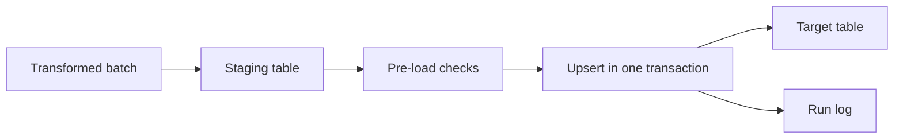

## Introduction

Loading writes the transformed data into the target. The load strategy decides whether reruns are safe, whether readers see half-loaded data and how fast the job runs.

## Definition

Data loading persists transformed rows into target tables using a strategy: **append** (insert only), **overwrite** (truncate and reload), **upsert/merge** (insert new, update changed), or **partition swap** (replace one partition atomically).

## Why it matters

- The wrong strategy creates duplicates on rerun or loses history.
- Loading row by row can be 100x slower than bulk loading.
- Readers should never see a half-finished load.

## How it works

| Strategy | SQL | Rerun-safe? |
|---|---|---|
| Append | `INSERT` | No, unless deduplicated by key |
| Truncate + load | `TRUNCATE; INSERT` in one transaction | Yes |
| Upsert | `INSERT ... ON CONFLICT DO UPDATE` / `MERGE` | Yes |
| Delete + insert window | `DELETE WHERE date = d; INSERT` | Yes |
| Partition swap | `ATTACH/DETACH PARTITION` | Yes |

Upserts need a unique key (primary key or unique constraint) to detect conflicts.

## Syntax and configuration

PostgreSQL upsert (PostgreSQL-specific syntax; requires a unique index on the conflict columns):

```sql-syntax
INSERT INTO target (id, col1, col2)
SELECT id, col1, col2 FROM staging
ON CONFLICT (id) DO UPDATE
SET col1 = EXCLUDED.col1,
    col2 = EXCLUDED.col2
WHERE (target.col1, target.col2) IS DISTINCT FROM (EXCLUDED.col1, EXCLUDED.col2);
```

Standard SQL `MERGE` (PostgreSQL 15+):

```sql-syntax
MERGE INTO target t
USING staging s ON t.id = s.id
WHEN MATCHED THEN UPDATE SET col1 = s.col1
WHEN NOT MATCHED THEN INSERT (id, col1) VALUES (s.id, s.col1);
```

Bulk load from a file:

```sql-syntax
COPY staging_orders FROM '/data/orders.csv' WITH (FORMAT csv, HEADER true);
```

## Examples

Upsert into a product dimension. The first statement loads all products; the second simulates a price change and re-runs the upsert, updating only the changed row.

```sql
CREATE TEMP TABLE dim_product (
  product_id   INT PRIMARY KEY,
  product_name TEXT,
  unit_price   NUMERIC(10,2),
  updated_at   TIMESTAMPTZ DEFAULT now()
);

INSERT INTO dim_product (product_id, product_name, unit_price)
SELECT product_id, product_name, unit_price FROM products;

UPDATE products SET unit_price = unit_price + 1 WHERE product_id = 1;

INSERT INTO dim_product AS d (product_id, product_name, unit_price)
SELECT product_id, product_name, unit_price FROM products
ON CONFLICT (product_id) DO UPDATE
SET product_name = EXCLUDED.product_name,
    unit_price   = EXCLUDED.unit_price,
    updated_at   = now()
WHERE (d.product_name, d.unit_price) IS DISTINCT FROM (EXCLUDED.product_name, EXCLUDED.unit_price)
RETURNING product_id, unit_price
```

The same load with `MERGE`. It needs PostgreSQL 15+ (and has no `RETURNING` before PostgreSQL 17), so it is shown as syntax here:

```sql-syntax
CREATE TEMP TABLE dim_shipper (shipper_id INT PRIMARY KEY, company_name TEXT);
INSERT INTO dim_shipper VALUES (1, 'old name');

MERGE INTO dim_shipper t
USING shippers s ON t.shipper_id = s.shipper_id
WHEN MATCHED AND t.company_name IS DISTINCT FROM s.company_name THEN
  UPDATE SET company_name = s.company_name
WHEN NOT MATCHED THEN
  INSERT (shipper_id, company_name) VALUES (s.shipper_id, s.company_name);

SELECT * FROM dim_shipper ORDER BY shipper_id
```

## Architecture



Data is bulk-loaded into staging first, checked, then merged into the target in one transaction so readers see either the old or the new state.

## Practical example

Batched upsert into SQLite (which supports `ON CONFLICT ... DO UPDATE`, like PostgreSQL), run twice to prove reruns do not duplicate.

```python
import sqlite3

tgt = sqlite3.connect(":memory:")
tgt.execute("CREATE TABLE dim_customer(customer_id TEXT PRIMARY KEY, city TEXT, load_count INT DEFAULT 1)")

UPSERT = """
INSERT INTO dim_customer(customer_id, city) VALUES (?, ?)
ON CONFLICT(customer_id) DO UPDATE SET
  city = excluded.city,
  load_count = dim_customer.load_count + 1
WHERE dim_customer.city IS NOT excluded.city
"""

def load(rows, batch_size=2):
    with tgt:  # single transaction: all or nothing
        for i in range(0, len(rows), batch_size):
            tgt.executemany(UPSERT, rows[i:i + batch_size])

batch = [("ALFKI", "Berlin"), ("BONAP", "Marseille"), ("QUICK", "Cunewalde")]
load(batch)
load(batch)                                     # rerun: no change
load([("ALFKI", "Hamburg")])                    # real change: one update
print(tgt.execute("SELECT * FROM dim_customer ORDER BY customer_id").fetchall())
assert tgt.execute("SELECT COUNT(*) FROM dim_customer").fetchone()[0] == 3
```

## Exercises

1. Why add `WHERE ... IS DISTINCT FROM` to the `DO UPDATE` clause?
<details><summary>Answer</summary>It skips no-op updates, avoiding dead tuples, wasted WAL and misleading `updated_at` changes.</details>

2. You append daily files with plain `INSERT`. A file is accidentally processed twice. What happens and how do you prevent it?
<details><summary>Answer</summary>Rows are duplicated. Use an upsert on a business key, or delete-then-insert the file's date window, or record processed file names.</details>

3. When would you choose truncate-and-load over upsert?
<details><summary>Answer</summary>For small tables or when the source cannot tell you what changed; doing it in one transaction keeps readers safe.</details>

## Common mistakes

- `ON CONFLICT` without a matching unique index (error: no unique or exclusion constraint).
- `TRUNCATE` and `INSERT` in separate transactions, leaving an empty table on failure.
- Row-by-row inserts with a commit per row.
- Upserting a batch that contains the same key twice (`ON CONFLICT DO UPDATE command cannot affect row a second time`). Deduplicate the batch first.

## Performance and best practices

- Bulk-load with `COPY` into an unlogged or temp staging table, then merge.
- Batch inserts (hundreds to thousands of rows per statement).
- Drop or defer secondary indexes for very large full reloads, then rebuild.
- Wrap each batch in one transaction.
- `ANALYZE` the target after big loads.

## Interview questions

### How do you implement an upsert in PostgreSQL?

`INSERT ... ON CONFLICT (key) DO UPDATE SET col = EXCLUDED.col`, which needs a unique constraint on `key`. Since PostgreSQL 15, `MERGE` also works.

### What is the difference between ON CONFLICT and MERGE?

`ON CONFLICT` is PostgreSQL-specific, atomic against concurrent inserts and supports `RETURNING`. `MERGE` is standard SQL, can also delete, but in PostgreSQL 16 lacks `RETURNING` and can raise unique violations under concurrent inserts.

### How do you load without readers seeing partial data?

Load inside one transaction, or build a new table/partition and swap it in atomically (rename or `ATTACH PARTITION`).

### Why is COPY faster than INSERT?

It streams rows in one command with minimal per-row parsing and round trips.

## Quick revision

- Strategies: append, truncate+load, upsert, delete+insert window, partition swap.
- Upsert needs a unique key.
- `ON CONFLICT DO UPDATE` with `EXCLUDED`; `MERGE` in PostgreSQL 15+.
- Deduplicate the batch before upserting.
- One transaction per batch.
- `COPY` for bulk loads.
