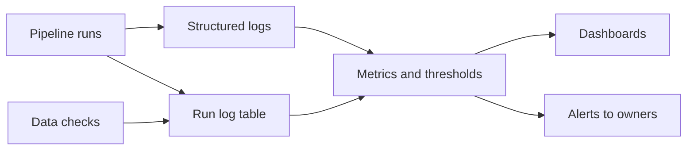

## Introduction

A pipeline nobody watches fails silently: the dashboard shows yesterday's numbers and nobody notices for a week. Monitoring tells you a pipeline is broken before your users do.

## Definition

Pipeline monitoring collects run metadata and data metrics (status, duration, row counts, freshness, quality results), compares them to expectations (SLAs, thresholds, history) and alerts when they deviate.

## Why it matters

- Green runs can still produce empty or stale data.
- SLAs ("sales ready by 07:00") need measurable signals.
- Trends (slowly growing duration) predict failures.

## How it works

Monitor two layers:

| Layer | Metrics |
|---|---|
| Pipeline health | Run status, duration, retries, queue time, SLA misses |
| Data health | Freshness (max timestamp), volume (rows per run), null rates, duplicate rates, schema changes, reconciliation |

Steps:

1. Every run writes a structured run log row (and logs JSON lines).
2. Metrics are compared to static thresholds or to history (e.g. z-score on row counts).
3. Alerts go to the owning team with context and a runbook link.
4. Dashboards show trends; incidents are reviewed.

## Syntax and configuration

Structured log line per step:

```json
{"ts": "2024-05-01T03:02:11Z", "job": "orders_daily", "run_id": 4812, "step": "load",
 "status": "success", "rows_in": 10233, "rows_out": 10230, "rejected": 3, "duration_s": 41.2}
```

Freshness check expressed as SQL:

```sql-syntax
SELECT now() - MAX(loaded_at) > interval '2 hours' AS is_stale FROM fact_orders;
```

## Examples

Volume monitoring on Northwind: orders per month compared to the trailing 3-month average, flagging large drops.

```sql
WITH monthly AS (
  SELECT date_trunc('month', order_date)::date AS month, COUNT(*) AS rows
  FROM orders
  GROUP BY 1
)
SELECT month,
       rows,
       ROUND(AVG(rows) OVER (ORDER BY month ROWS BETWEEN 3 PRECEDING AND 1 PRECEDING), 1) AS trailing_avg,
       rows < 0.5 * AVG(rows) OVER (ORDER BY month ROWS BETWEEN 3 PRECEDING AND 1 PRECEDING) AS volume_alert
FROM monthly
ORDER BY month
LIMIT 8
```

Freshness of the source, relative to a fixed "now" since this dataset is historical:

```sql
SELECT MAX(order_date)                          AS latest_order,
       DATE '1998-12-31' - MAX(order_date)      AS days_behind,
       DATE '1998-12-31' - MAX(order_date) > 2  AS freshness_alert
FROM orders
```

## Architecture



Runs and checks emit logs and run-log rows; a metrics layer evaluates thresholds, feeding both dashboards (trends) and alerts (action).

## Practical example

Anomaly detection on run history with pandas: flag runs whose row count or duration deviates from the recent median, and check SLA and freshness.

```python
import numpy as np
import pandas as pd

runs = pd.DataFrame({
    "run_date": pd.date_range("2024-05-01", periods=10),
    "status": ["success"] * 9 + ["success"],
    "rows_loaded": [10200, 10150, 10310, 9980, 10240, 10190, 10050, 10120, 10260, 1200],
    "duration_s": [40, 42, 39, 44, 41, 43, 40, 95, 42, 12],
    "finished_at": pd.Timestamp("2024-05-01 03:05") + pd.to_timedelta(np.arange(10), unit="D"),
})
runs.loc[7, "finished_at"] += pd.Timedelta(hours=5)  # one late run

def robust_z(s, window=5):
    med = s.shift(1).rolling(window, min_periods=3).median()
    mad = (s.shift(1) - med).abs().rolling(window, min_periods=3).median().replace(0, np.nan)
    return (s - med) / (1.4826 * mad)

runs["rows_z"] = robust_z(runs["rows_loaded"]).round(1)
runs["dur_z"] = robust_z(runs["duration_s"]).round(1)
sla = runs["run_date"] + pd.Timedelta(hours=7)          # data due by 07:00
runs["sla_miss"] = runs["finished_at"] > sla
runs["alert"] = (runs["rows_z"].abs() > 4) | (runs["dur_z"].abs() > 4) | runs["sla_miss"]

print(runs.loc[runs["alert"], ["run_date", "rows_loaded", "duration_s", "rows_z", "dur_z", "sla_miss"]].to_string(index=False))
assert runs["alert"].iloc[-1] and runs["sla_miss"].iloc[7]
```

## Exercises

1. A job ran successfully but loaded 0 rows. Which monitor catches this?
<details><summary>Answer</summary>A volume check (row count vs history or a minimum) and a freshness check on the target's max timestamp.</details>

2. Why use median and MAD instead of mean and standard deviation for anomaly detection?
<details><summary>Answer</summary>They are robust to the outliers you are trying to detect, so one bad run does not distort the baseline.</details>

3. What makes an alert actionable?
<details><summary>Answer</summary>It goes to the owner, says what broke and how badly (job, run id, metric vs expected), links to logs and a runbook, and fires only when action is needed.</details>

## Common mistakes

- Monitoring only job status, not the data.
- Alerting on everything, so alerts are ignored.
- Static thresholds that do not follow growth or seasonality.
- No owner per pipeline.
- Unstructured logs that cannot be queried.

## Performance and best practices

- Write one run-log row per run and step; keep it queryable.
- Track freshness, volume, duration and quality for every critical table.
- Use history-based thresholds with seasonality (compare to same weekday).
- Define SLAs with consumers and alert on predicted misses.
- Route alerts by severity: page for SLA breaches, ticket for warnings.

## Interview questions

### What would you monitor in a production ETL pipeline?

Run status, duration, retries and SLA adherence; data freshness, row volume, null and duplicate rates, schema changes and source-target reconciliation.

### How do you detect a silent failure?

Data-level monitors: freshness on the target's max timestamp and volume anomalies vs history catch runs that succeed but load nothing or stale data.

### How do you avoid alert fatigue?

Alert only on actionable conditions, use history-based thresholds, deduplicate and group alerts, set severities and review noisy alerts regularly.

## Quick revision

- Monitor pipeline health and data health.
- Freshness and volume catch silent failures.
- Structured logs plus a run-log table.
- History-based, robust thresholds.
- SLAs agreed with consumers.
- Actionable alerts with owner, context and runbook.
