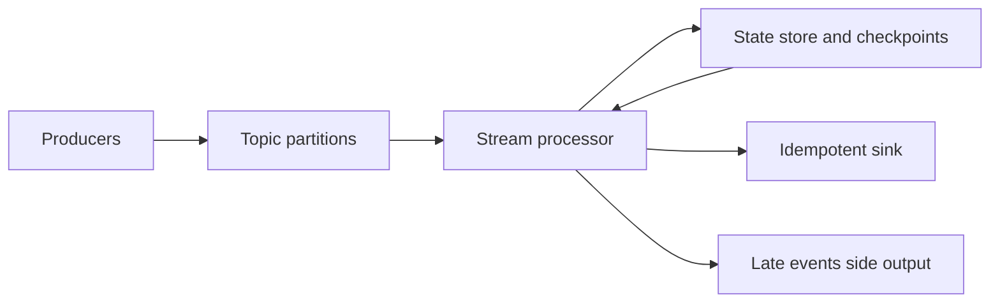

## Introduction

Some data cannot wait for tonight's batch: payments, clicks, sensor readings. Streaming processes events continuously as they arrive.

## Definition

Stream processing consumes an **unbounded** sequence of events, typically from a log such as Kafka, and updates results incrementally, using windows to turn the infinite stream into finite groups.

## Why it matters

- Latency of seconds instead of hours.
- Natural fit for CDC, IoT and user activity.
- Interviews probe event time vs processing time, late data and exactly-once.

## How it works

Key concepts:

- **Event, topic, partition, offset:** events are appended to partitioned topics; each consumer group tracks its offset per partition.
- **Event time vs processing time:** when it happened vs when you saw it.
- **Windows:** tumbling (fixed, non-overlapping), sliding/hopping (overlapping), session (gap-based).
- **Watermark:** "no events older than T are expected any more". Windows close when the watermark passes their end.
- **Late data:** events behind the watermark are dropped, sent to a side output, or used to update results within an allowed lateness.
- **Delivery guarantees:** at-most-once, at-least-once (default in practice), exactly-once (transactions or idempotent sinks).

## Syntax and configuration

A Spark Structured Streaming job (not executed here):

```python-syntax
events = (spark.readStream.format("kafka")
          .option("kafka.bootstrap.servers", "broker:9092")
          .option("subscribe", "orders").load())
agg = (parse(events)
       .withWatermark("event_time", "10 minutes")
       .groupBy(window("event_time", "5 minutes"), "country")
       .sum("amount"))
agg.writeStream.outputMode("update").option("checkpointLocation", "/chk/orders").start()
```

## Examples

A tumbling window in SQL: the batch equivalent of a streaming aggregation, grouping Northwind orders into 30-day windows by event time.

```sql
SELECT date_bin(interval '30 days', order_date::timestamp, TIMESTAMP '1996-01-01') AS window_start,
       COUNT(*)                                                                  AS orders,
       SUM(freight)                                                              AS freight
FROM orders
GROUP BY 1
ORDER BY 1
LIMIT 5
```

`date_bin` is PostgreSQL 14+.

## Architecture



The processor keeps window state and offsets in checkpoints, so after a crash it resumes from the last checkpoint and replays events since then into an idempotent sink.

## Practical example

A tumbling-window aggregator with an event-time watermark and late-data side output, in pure Python.

```python
from collections import defaultdict

WINDOW, ALLOWED_LATENESS = 10, 5
events = [  # (event_time, amount) in arrival order
    (1, 5), (3, 7), (12, 1), (8, 2),   # 8 is out of order but within lateness
    (25, 4), (4, 9),                   # 4 arrives after watermark passed window [0,10)
    (31, 3),
]

open_windows = defaultdict(int)
closed, late = {}, []
max_event_time = 0

for ts, amount in events:
    max_event_time = max(max_event_time, ts)
    watermark = max_event_time - ALLOWED_LATENESS
    start = ts // WINDOW * WINDOW
    if start + WINDOW <= watermark and start not in open_windows:
        late.append((ts, amount))          # too late: side output
        continue
    open_windows[start] += amount
    for w in [w for w in open_windows if w + WINDOW <= watermark]:
        closed[w] = open_windows.pop(w)    # emit final result

print("closed:", closed)
print("still open:", dict(open_windows))
print("late:", late)
assert closed[0] == 14 and late == [(4, 9)]
```

## Exercises

1. Explain the difference between event time and processing time with an example.
<details><summary>Answer</summary>A phone records a purchase at 10:00 (event time) but is offline and sends it at 10:20 (processing time). Windows by event time put it in the 10:00 window.</details>

2. What does a watermark of "10 minutes" trade off?
<details><summary>Answer</summary>Larger lateness tolerance means more complete results but later output and more state held in memory.</details>

3. Your consumer is at-least-once. How do you avoid double counting in the sink?
<details><summary>Answer</summary>Write idempotently: upsert by event id or by (window, key), or use transactional writes tied to offsets.</details>

## Common mistakes

- Windowing by processing time when the business means event time.
- No watermark, so state grows forever.
- Committing offsets before the sink write succeeds.
- Assuming global ordering; ordering exists only within a partition.
- Treating "exactly-once" as free; it requires transactional or idempotent sinks.

## Performance and best practices

- Partition topics by the key you aggregate on.
- Set watermarks from measured lateness, not guesses.
- Checkpoint state and offsets together.
- Use idempotent sinks (upsert by key).
- Monitor consumer lag per partition.

## Interview questions

### What is a watermark in stream processing?

A moving threshold on event time asserting that older events are no longer expected; it decides when windows can be finalised and state dropped.

### Compare tumbling, sliding and session windows.

Tumbling: fixed size, no overlap. Sliding: fixed size, overlapping by a slide interval. Session: dynamic, closed after a gap of inactivity per key.

### What delivery guarantees exist and which is most common?

At-most-once, at-least-once and exactly-once. At-least-once plus an idempotent sink is the common practical approach.

### What is consumer lag?

The difference between the latest offset in a partition and the consumer's committed offset; growing lag means the consumer cannot keep up.

## Quick revision

- Streams are unbounded; windows make them finite.
- Event time over processing time for business logic.
- Watermarks close windows and bound state.
- Late events: drop, side output or allowed lateness.
- At-least-once plus idempotent sink is the norm.
- Ordering only within a partition; watch consumer lag.
