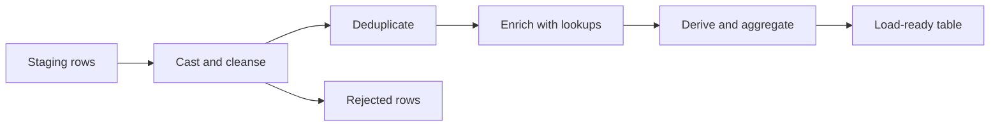

## Introduction

Raw data is never ready to use. Transformation turns inconsistent source records into trustworthy, analysis-ready tables.

## Definition

Transformation is the set of operations applied between extraction and loading: type casting, cleansing, standardising, deduplicating, joining (enrichment), deriving columns and aggregating.

## Why it matters

- Business rules (what counts as revenue, an active customer) live here.
- Bugs here produce wrong numbers that look right.
- Interviewers test it with deduplication, null handling and window functions.

## How it works

A typical order of operations:

1. **Cast types** (strings to dates and numbers).
2. **Cleanse** (trim, fix case, replace sentinel values with NULL).
3. **Standardise** (country codes, units, time zones).
4. **Deduplicate** (keep the latest record per key).
5. **Enrich** (join reference data, lookups).
6. **Derive** (computed columns like revenue).
7. **Aggregate** (daily totals, per-customer metrics).

Transforms should be deterministic: the same input always gives the same output.

## Syntax and configuration

```sql-syntax
-- deduplicate: keep latest version of each key
SELECT *
FROM (
  SELECT t.*, ROW_NUMBER() OVER (PARTITION BY business_key ORDER BY updated_at DESC) AS rn
  FROM staging_table t
) x
WHERE rn = 1;
```

```python-syntax
df["col"] = df["col"].str.strip().str.upper()
df["amount"] = pd.to_numeric(df["amount"], errors="coerce")
df = df.drop_duplicates(subset=["key"], keep="last")
```

## Examples

Derive revenue, standardise country names and bucket orders, all in one SQL transform:

```sql
SELECT o.order_id,
       UPPER(TRIM(c.country))                                   AS country,
       ROUND(SUM(od.unit_price * od.quantity * (1 - od.discount))::numeric, 2) AS revenue,
       CASE WHEN o.freight >= 100 THEN 'heavy' ELSE 'standard' END AS freight_band,
       COALESCE(o.employee_id, -1)                              AS employee_key
FROM orders o
JOIN customers c      ON c.customer_id = o.customer_id
JOIN order_details od ON od.order_id   = o.order_id
GROUP BY o.order_id, c.country, o.freight, o.employee_id
ORDER BY revenue DESC
LIMIT 5
```

Keep only each customer's latest order (dedup pattern):

```sql
SELECT customer_id, order_id, order_date
FROM (
  SELECT customer_id, order_id, order_date,
         ROW_NUMBER() OVER (PARTITION BY customer_id ORDER BY order_date DESC, order_id DESC) AS rn
  FROM orders
) x
WHERE rn = 1
ORDER BY customer_id
LIMIT 5
```

## Architecture



Rows that cannot be cast or cleansed are routed to a rejected table instead of stopping the whole batch.

## Practical example

A pandas transform: cast, cleanse, deduplicate, enrich and aggregate.

```python
import io
import pandas as pd

raw = io.StringIO("""order_id,customer,country,amount,updated_at
1, alfki ,germany,100.50,2024-01-01
1,ALFKI,Germany,110.00,2024-01-03
2,bonap,FR,20,2024-01-02
3,quick,Germany,n/a,2024-01-02
4,bonap,france,35.5,2024-01-04
""")
countries = pd.DataFrame({"raw": ["GERMANY", "FR", "FRANCE"], "iso": ["DE", "FR", "FR"]})

df = pd.read_csv(raw, parse_dates=["updated_at"])
df["customer"] = df["customer"].str.strip().str.upper()
df["country"] = df["country"].str.strip().str.upper()
df["amount"] = pd.to_numeric(df["amount"], errors="coerce")

rejected = df[df["amount"].isna()]
df = df[df["amount"].notna()]

df = df.sort_values("updated_at").drop_duplicates("order_id", keep="last")
df = df.merge(countries, left_on="country", right_on="raw", how="left").drop(columns=["raw", "country"])

summary = df.groupby(["customer", "iso"], as_index=False)["amount"].sum()
print(summary.to_string(index=False))
print("rejected:", rejected["order_id"].tolist())
assert summary["amount"].sum() == 110.0 + 20 + 35.5
```

## Exercises

1. Why sort by `updated_at` before `drop_duplicates(keep="last")`?
<details><summary>Answer</summary>`keep="last"` keeps the last row in the current order. Without sorting, "last" is arbitrary file order, not the newest version.</details>

2. A lookup join to `countries` is `how="inner"`. What risk does that create?
<details><summary>Answer</summary>Rows with unmapped countries silently disappear. Use a left join and flag or reject unmapped rows.</details>

3. Write the SQL to find order_ids that appear more than once in a staging table.
<details><summary>Answer</summary>`SELECT order_id, COUNT(*) FROM stg GROUP BY order_id HAVING COUNT(*) > 1;`</details>

## Common mistakes

- Inner joins to lookups that drop unmatched rows silently.
- Deduplicating without a deterministic order (ties give random winners).
- Converting bad values to 0 instead of NULL or rejecting them.
- Joining before aggregating and multiplying rows (fan-out).
- Non-deterministic logic like `now()` inside transforms.

## Performance and best practices

- Push filters and projections as early as possible.
- Prefer set-based SQL or vectorised pandas over Python loops.
- Aggregate child tables before joining to parents.
- Keep transforms pure and testable; separate I/O from logic.
- Log rejected rows with a reason.

## Interview questions

### How do you deduplicate records keeping the latest version?

`ROW_NUMBER() OVER (PARTITION BY key ORDER BY updated_at DESC)` and keep `rn = 1`; in pandas sort by timestamp and `drop_duplicates(key, keep="last")`.

### What is fan-out and how do you avoid it?

Joining a parent to a child multiplies parent rows, so parent-level sums inflate. Aggregate the child first or sum only child-level columns.

### Should bad values be fixed, nulled or rejected?

Depends on the rule: fix known formatting issues, NULL genuinely unknown values, and reject rows that violate critical rules, logging them for review.

## Quick revision

- Order: cast, cleanse, standardise, dedup, enrich, derive, aggregate.
- Dedup with `ROW_NUMBER()` and a deterministic order.
- Use left joins to lookups and flag misses.
- Route bad rows to a rejected table.
- Aggregate before joining to avoid fan-out.
- Keep transforms deterministic.
