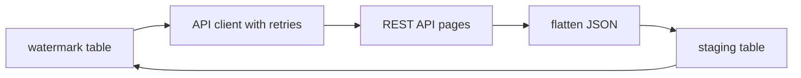

## Introduction

Much source data lives behind REST APIs: CRMs, payment providers, SaaS tools. Extracting it means handling auth, pages, rate limits and flaky networks, then flattening nested JSON into rows.

## Definition

API integration is calling HTTP endpoints from code, parsing the JSON response and turning it into records your pipeline can load.

## Why it matters

- APIs are a common extraction source in ETL.
- Real APIs paginate, throttle (HTTP 429) and fail (5xx); naive code loses data or hangs.
- Interviewers ask how you would make an API extract reliable and incremental.

## How it works

1. Build a request: method, URL, query params, headers (auth token).
2. Send it with a timeout.
3. Check the status code: 2xx ok, 429/5xx retry, other 4xx fail fast.
4. Parse JSON; follow the next page (cursor, page number or `next` URL).
5. Flatten and load; save a watermark such as `updated_since` for the next run.

## Syntax and configuration

```python-syntax
import os
import requests

session = requests.Session()
session.headers.update({"Authorization": f"Bearer {os.environ['API_TOKEN']}"})

resp = session.get(
    "https://api.example.com/v1/orders",
    params={"updated_since": "2024-06-01T00:00:00Z", "limit": 100},
    timeout=10,
)
resp.raise_for_status()
payload = resp.json()
```

```python-syntax
# Cursor pagination
def fetch_all(session, url):
    params = {"limit": 100}
    while True:
        r = session.get(url, params=params, timeout=10)
        r.raise_for_status()
        body = r.json()
        yield from body["data"]
        if not body.get("next_cursor"):
            break
        params["cursor"] = body["next_cursor"]
```

## Examples

Pagination logic tested against a fake API (no network):

```python
import json

PAGES = {
    None: '{"data": [{"id": 1}, {"id": 2}], "next_cursor": "c2"}',
    "c2": '{"data": [{"id": 3}], "next_cursor": null}',
}

def fake_get(cursor):
    return json.loads(PAGES[cursor])

def fetch_all(get):
    cursor = None
    while True:
        body = get(cursor)
        yield from body["data"]
        cursor = body["next_cursor"]
        if cursor is None:
            break

print([r["id"] for r in fetch_all(fake_get)])
```

Retry with exponential backoff on transient errors:

```python
import time

class TransientError(Exception):
    pass

calls = {"n": 0}
def flaky():
    calls["n"] += 1
    if calls["n"] < 3:
        raise TransientError("HTTP 503")
    return {"status": "ok"}

def with_retries(fn, attempts=5, base=0.01):
    for i in range(attempts):
        try:
            return fn()
        except TransientError as e:
            if i == attempts - 1:
                raise
            wait = base * 2 ** i
            print(f"attempt {i + 1} failed ({e}), sleeping {wait:.2f}s")
            time.sleep(wait)

print(with_retries(flaky), "after", calls["n"], "calls")
```

## Architecture

An incremental API extract stores a watermark between runs.



## Practical example

Flatten nested JSON orders into a table with `pandas.json_normalize`:

```python
import json
import pandas as pd

response = json.loads("""
{"data": [
  {"id": 1, "customer": {"id": "ALFKI", "country": "Germany"},
   "items": [{"sku": "A", "qty": 2}, {"sku": "B", "qty": 1}], "updated_at": "2024-06-01T10:00:00Z"},
  {"id": 2, "customer": {"id": "ANATR", "country": "Mexico"},
   "items": [{"sku": "A", "qty": 5}], "updated_at": "2024-06-02T09:30:00Z"}
]}
""")

orders = pd.json_normalize(response["data"], sep="_").drop(columns="items")
items = pd.json_normalize(response["data"], record_path="items", meta=["id"]).rename(columns={"id": "order_id"})
print(orders)
print(items)
print("new watermark:", orders["updated_at"].max())
```

## Exercises

1. Which status codes should be retried?
<details><summary>Answer</summary>

429 and 5xx (and connection timeouts). Do not retry 400, 401, 403 or 404; fix the request instead.
</details>

2. Why always pass `timeout=` to `requests`?
<details><summary>Answer</summary>

Without it a request can hang forever and block the pipeline.
</details>

3. How do you avoid re-downloading everything every day?
<details><summary>Answer</summary>

Store the max `updated_at` seen and pass it as `updated_since` on the next run, with a small overlap and an upsert on load.
</details>

## Common mistakes

- No timeout, no retries, or retrying non-retryable 4xx errors.
- Ignoring the `Retry-After` header on 429.
- Stopping after the first page.
- Hard-coding API tokens in code.
- Advancing the watermark before the data is safely loaded.

## Performance and best practices

- Reuse a `requests.Session` for connection pooling.
- Use the largest page size the API allows.
- Respect rate limits; add jitter to backoff.
- Land raw JSON first, then transform, so you can replay.
- Unit test pagination and parsing with fake responses, as above.

## Interview questions

### How would you make an API extract reliable?

Timeouts, retries with exponential backoff for 429/5xx, full pagination, idempotent upserts and a watermark saved only after a successful load.

### What pagination styles do APIs use?

Offset/limit, page numbers, cursors (opaque token) and `next` links. Cursor pagination is the most stable when data changes during the extract.

### How do you load nested JSON into relational tables?

Flatten objects with `json_normalize`, explode arrays into child tables keyed by the parent id, or store raw JSON in a `jsonb` column and transform in SQL.

### What is exponential backoff?

Waiting `base * 2**attempt` (plus jitter) between retries so a struggling server gets time to recover.

## Quick revision

- Always `timeout=` and `raise_for_status()`.
- Retry 429/5xx with backoff; fail fast on other 4xx.
- Loop until no next cursor/page.
- `json_normalize` to flatten; child tables for arrays.
- Incremental: watermark `updated_since`, upsert, then save state.
- Tokens from env vars or a secret manager.
