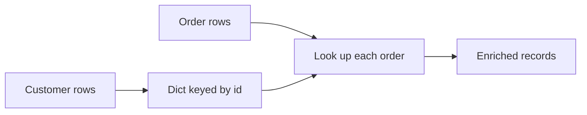

## Introduction

Records are dicts, batches are lists, keys are tuples, seen-IDs are sets. Picking the right container is most of writing fast pipeline code.

## Definition

- `list`: ordered, mutable sequence.
- `tuple`: ordered, immutable; hashable if its items are.
- `set`: unordered unique hashable items.
- `dict`: key-to-value mapping, insertion-ordered since Python 3.7.

## Why it matters

- Membership in a set or dict is O(1); in a list it is O(n).
- Dict lookups replace SQL joins in small in-memory transforms.
- `Counter` and `defaultdict` replace `GROUP BY` for quick aggregates.

## How it works

Sets and dicts are hash tables: the key's hash picks a slot. That is why keys must be immutable (hashable). Lists are dynamic arrays: fast append and index, slow insert at front and search.

## Syntax and configuration

```python-syntax
items = [1, 2, 3]; items.append(4); items[0]; items[-1]; items[1:3]
pair = ("ALFKI", 1997)
ids = {1, 2, 3}; ids.add(4); a | b; a & b; a - b
row = {"id": 1}; row["id"]; row.get("x", default); row.items()
```

## Examples

```python
from collections import Counter, defaultdict

orders = [("ALFKI", 120.0), ("ANATR", 40.0), ("ALFKI", 60.0), ("BONAP", 15.5)]

print(Counter(c for c, _ in orders).most_common(1))
totals = defaultdict(float)
for customer, amount in orders:
    totals[customer] += amount
print(dict(totals))

seen_ids = {"ALFKI", "ANATR"}
print({"BONAP", "ALFKI"} - seen_ids)   # new customers
```

## Architecture

Use a dict built from a lookup table to enrich a stream of records, like a hash join.



## Practical example

In-memory hash join and dedup:

```python
customers = [{"id": "ALFKI", "country": "Germany"}, {"id": "BONAP", "country": "France"}]
orders = [
    {"order_id": 1, "customer_id": "ALFKI"},
    {"order_id": 1, "customer_id": "ALFKI"},   # duplicate
    {"order_id": 2, "customer_id": "BONAP"},
    {"order_id": 3, "customer_id": "ZZZZZ"},   # orphan
]
by_id = {c["id"]: c for c in customers}
seen = set()
for o in orders:
    if o["order_id"] in seen:
        continue
    seen.add(o["order_id"])
    country = by_id.get(o["customer_id"], {}).get("country")
    print(o["order_id"], o["customer_id"], country)
```

## Exercises

1. Remove duplicates from `[3, 1, 3, 2]` while keeping order.
   <details><summary>Answer</summary>

   `list(dict.fromkeys([3, 1, 3, 2]))` gives `[3, 1, 2]`.
   </details>
2. Can a list be a dict key?
   <details><summary>Answer</summary>

   No, lists are unhashable. Use a tuple.
   </details>
3. Count words in a list of strings in one line.
   <details><summary>Answer</summary>

   `Counter(words)`.
   </details>

## Common mistakes

- Searching a big list with `in` inside a loop; convert to a set first.
- `d[key]` on a missing key raises `KeyError`; use `.get()` or `defaultdict`.
- Mutable default containers shared across function calls.
- Copying with `b = a` (same object); use `a.copy()` or `copy.deepcopy`.

## Performance and best practices

- Set/dict membership O(1), list membership O(n).
- `list.append` is amortised O(1); `list.insert(0, x)` is O(n) - use `collections.deque`.
- Use tuples for composite keys: `(customer_id, year)`.

## Interview questions

### What is the difference between a list and a tuple?

Lists are mutable; tuples are immutable and hashable, so they can be dict keys or set items.

### How do you deduplicate while preserving order?

`list(dict.fromkeys(items))`, since dicts keep insertion order.

### Why is set lookup faster than list lookup?

Sets are hash tables (average O(1)); lists need a linear scan.

### When would you use defaultdict?

For grouping or accumulating without checking whether a key exists first.

## Quick revision

- list = ordered mutable, tuple = immutable, set = unique, dict = mapping.
- Hashable keys only in sets/dicts.
- `Counter` counts, `defaultdict` groups.
- Dict lookup = in-memory hash join.
- `dict.fromkeys` dedups keeping order.
