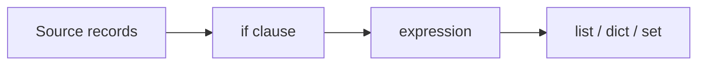

## Introduction

Most pipeline code takes a collection of records, filters some out and reshapes the rest. A comprehension does that in one readable expression instead of a loop with `append`.

## Definition

A comprehension builds a new list, dict or set from an iterable: `[expr for item in iterable if condition]`. A generator expression uses parentheses and yields items lazily instead of building the whole collection.

## Why it matters

- Shorter than the equivalent loop, and usually faster.
- Dict comprehensions build lookup tables (id to record) in one line.
- Generator expressions let you stream large files without loading them into memory.

## How it works

1. Python iterates over the source.
2. The optional `if` clause filters each item.
3. The expression on the left is evaluated for each kept item.
4. The result is collected into a list, dict or set, or yielded one at a time for a generator.

Nested `for` clauses run left to right, like nested loops.

## Syntax and configuration

```python-syntax
[expr for x in iterable]                     # list
[expr for x in iterable if cond]             # filter
[a if cond else b for x in iterable]         # conditional value (not a filter)
{key: value for x in iterable}               # dict
{expr for x in iterable}                     # set
(expr for x in iterable)                     # generator, lazy
[y for row in rows for y in row]             # flatten: outer loop first
```

## Examples

```python
orders = [
    {"id": 1, "customer": "ALFKI", "amount": 120.0},
    {"id": 2, "customer": "ANATR", "amount": 0.0},
    {"id": 3, "customer": "ALFKI", "amount": 75.5},
]

# filter and project
non_zero_ids = [o["id"] for o in orders if o["amount"] > 0]
print(non_zero_ids)                     # [1, 3]

# lookup table: id -> order
by_id = {o["id"]: o for o in orders}
print(by_id[3]["customer"])             # ALFKI

# distinct customers
customers = {o["customer"] for o in orders}
print(sorted(customers))                # ['ALFKI', 'ANATR']

# conditional value
labels = ["paid" if o["amount"] > 0 else "free" for o in orders]
print(labels)

# flatten a list of batches
batches = [[1, 2], [3], [4, 5]]
print([x for batch in batches for x in batch])

# generator: sum without building a list
print(sum(o["amount"] for o in orders))
```

## Architecture

A comprehension is a filter followed by a map, written as one expression.



## Practical example

Clean raw CSV-like rows: strip whitespace, drop blank lines, cast types and dedupe by key.

```python
raw = """id,email,amount
1, ALICE@EXAMPLE.COM ,10.5
2,bob@example.com,
,missing@example.com,3

1,alice@example.com,10.5
"""

lines = [line for line in raw.splitlines()[1:] if line.strip()]
rows = [[part.strip() for part in line.split(",")] for line in lines]
valid = [r for r in rows if r[0] and r[2]]
clean = {
    int(r[0]): {"email": r[1].lower(), "amount": float(r[2])}
    for r in valid
}
print(clean)    # {1: {'email': 'alice@example.com', 'amount': 10.5}}
```

The dict comprehension dedupes by `id`: later rows overwrite earlier ones with the same key.

## Exercises

1. Given `nums = [1, 2, 3, 4, 5, 6]`, build a list of the squares of the even numbers.

<details><summary>Answer</summary>

`[n * n for n in nums if n % 2 == 0]` gives `[4, 16, 36]`.

</details>

2. Invert `{"a": 1, "b": 2}` into `{1: "a", 2: "b"}`.

<details><summary>Answer</summary>

`{v: k for k, v in d.items()}`. Duplicate values collapse to one key.

</details>

3. Count lines longer than 80 characters in a huge file without loading it into memory.

<details><summary>Answer</summary>

`sum(1 for line in f if len(line) > 80)`. The generator reads one line at a time.

</details>

## Common mistakes

- Putting `if/else` after the `for`. A trailing `if` filters; `a if c else b` before the `for` chooses a value.
- Reversing the order of nested `for` clauses when flattening.
- Writing a three-level comprehension nobody can read. Use a loop or a helper function.
- Using a list comprehension only for its side effects, such as `[print(x) for x in xs]`.
- Building a list just to pass it to `sum`, `any` or `max`. Use a generator.

## Performance and best practices

- Comprehensions avoid repeated `append` lookups and are usually faster than loops.
- Use generators for large or streamed inputs; a list holds everything in memory at once.
- For numeric work on millions of rows, use pandas or NumPy vectorised operations instead.
- Keep each comprehension to one filter and one transformation.

## Interview questions

### What is the difference between a list comprehension and a generator expression?

A list comprehension builds the full list immediately. A generator expression yields items on demand, uses constant memory and can be consumed only once.

### How do you filter versus transform conditionally in a comprehension?

A trailing `if` filters items out. A conditional expression `a if cond else b` before the `for` keeps every item and chooses its value.

### How would you dedupe records by key while keeping the last one?

Use a dict comprehension keyed by that field: `{r["id"]: r for r in rows}`. Later rows overwrite earlier ones.

### When should you not use a comprehension?

When the logic needs several statements, error handling or side effects, or when nesting makes it hard to read.

## Quick revision

- `[expr for x in xs if cond]` is filter plus map.
- Dict: `{k: v for ...}`; set: `{x for ...}`.
- Parentheses give a lazy generator.
- Nested `for` clauses read like nested loops, outer first.
- `a if c else b` before `for` is a value choice, not a filter.
- Prefer generators for `sum`, `any`, `max` on large inputs.
