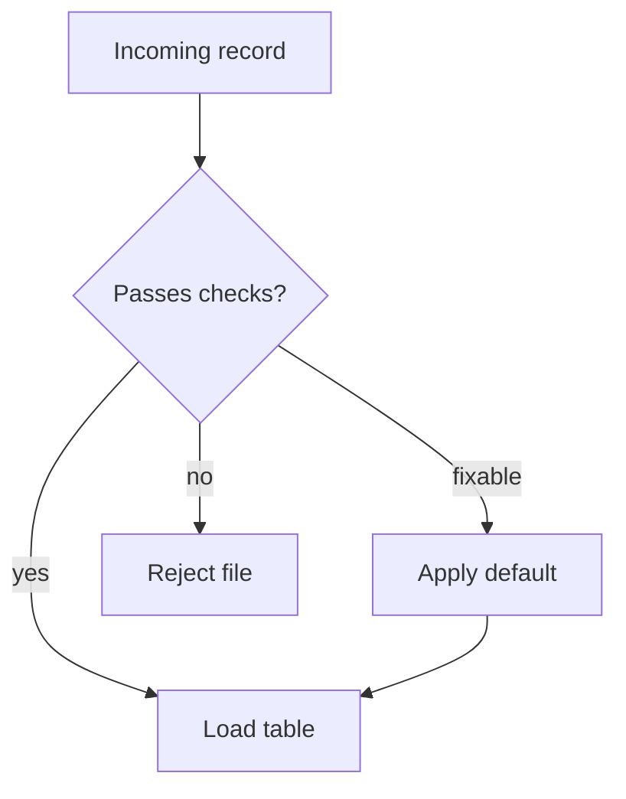

## Introduction

Validation rules, record routing and derived columns are all conditionals. They are Python's version of SQL `CASE`.

## Definition

`if` / `elif` / `else` run the first block whose condition is truthy. `x if cond else y` is the expression form. Python 3.10+ adds `match`.

## Why it matters

- Data quality checks decide whether a row is loaded, fixed or rejected.
- Truthiness quirks (`0`, `""`, `[]` are false) cause silent bugs.

## How it works

1. Each condition is evaluated top to bottom.
2. `and` / `or` short-circuit and return one of their operands.
3. Falsy values: `False`, `None`, `0`, `0.0`, `""`, empty containers. All else is truthy.

## Syntax and configuration

```python-syntax
if condition:
    ...
elif other_condition:
    ...
else:
    ...

label = "big" if amount > 100 else "small"

match status:            # Python 3.10+
    case "shipped": ...
    case _: ...
```

## Examples

```python
def bucket(amount):
    if amount is None:
        return "unknown"
    elif amount >= 1000:
        return "large"
    elif amount >= 100:
        return "medium"
    return "small"

print([bucket(a) for a in [None, 50, 250, 5000]])
print(0 or "default", "" and "x", 0 < 5 <= 10)
```

## Architecture

Route each record to an outcome based on rules.



## Practical example

```python
def validate(row):
    errors = []
    if not row.get("order_id"):
        errors.append("missing order_id")
    qty = row.get("quantity")
    if qty is None or qty <= 0:
        errors.append("quantity must be positive")
    if row.get("discount", 0) > 0.25:
        errors.append("discount too high")
    return errors

rows = [
    {"order_id": 10248, "quantity": 12, "discount": 0.0},
    {"order_id": None, "quantity": 0},
    {"order_id": 10249, "quantity": 5, "discount": 0.5},
]
for r in rows:
    errs = validate(r)
    print("OK" if not errs else f"REJECT {errs}")
```

## Exercises

1. What does `None or 0 or "x"` return?
   <details><summary>Answer</summary>

   `"x"`: `or` returns the first truthy operand.
   </details>
2. Why is `if qty:` wrong for checking "quantity is present"?
   <details><summary>Answer</summary>

   It treats `0` as missing. Use `if qty is not None:`.
   </details>

## Common mistakes

- Truthiness checks where `0` or `""` are valid values.
- `if x == None` instead of `if x is None`.
- Long `elif` chains that a dict lookup would replace.
- Using `match` on Python 3.9 (syntax error).

## Performance and best practices

- Put the cheapest and most selective checks first; `and` short-circuits.
- Replace value-to-value `elif` chains with a dict: `MAP.get(code, "other")`.
- Return early (guard clauses) to keep nesting shallow.

## Interview questions

### Which values are falsy in Python?

`False`, `None`, zero numbers, empty strings and empty containers.

### What does `a or b` return?

`a` if `a` is truthy, otherwise `b` - not necessarily a bool.

### What is the Python equivalent of SQL CASE?

`if/elif/else`, the conditional expression, or a dict lookup; in pandas, `np.select` or `np.where`.

## Quick revision

- First truthy branch wins.
- `x if c else y` for expressions.
- Use `is None` for missing values.
- `and`/`or` short-circuit and return operands.
- Dict lookups beat long `elif` chains.
