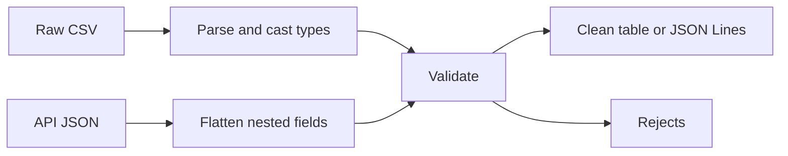

## Introduction

CSV and JSON are the formats you meet most: CSV from spreadsheets and database exports, JSON from APIs and event streams. Both look simple and both hide traps such as quoted commas, everything-is-a-string and deeply nested fields.

## Definition

- **CSV**: rows of delimited text. Python's `csv` module handles quoting and escaping. Every value is read as a string.
- **JSON**: nested objects, arrays, strings, numbers, booleans and null. `json.loads` and `json.dumps` convert between JSON text and Python dicts and lists.
- **JSON Lines (NDJSON)**: one JSON object per line, easy to stream and append.

## Why it matters

- Splitting CSV lines on `","` breaks on quoted values like `"Smith, John"`.
- Types must be cast and validated after reading CSV.
- API responses must be flattened before loading into a relational table.

## How it works

1. `csv.reader` yields lists; `csv.DictReader` yields dicts keyed by the header row.
2. `csv.writer` and `DictWriter` quote values that contain the delimiter, quotes or newlines.
3. `json.loads` maps objects to `dict`, arrays to `list`, `null` to `None`.
4. `json.dumps` cannot serialize `datetime` or `Decimal` without a `default` function.
5. `pandas.read_csv`, `read_json` and `json_normalize` do the same at DataFrame level, with type inference.

## Syntax and configuration

```python-syntax
import csv, json
import pandas as pd

csv.DictReader(f, delimiter=",", quotechar='"')
csv.DictWriter(f, fieldnames=[...]).writeheader()

json.loads(text);  json.dumps(obj, indent=2, default=str, ensure_ascii=False)
json.load(f);      json.dump(obj, f)

pd.read_csv(src, dtype={"zip": "string"}, parse_dates=["order_date"], na_values=["", "N/A"])
pd.read_json(src, lines=True)          # JSON Lines
pd.json_normalize(records, sep="_")    # flatten nested JSON
df.to_csv(dst, index=False);  df.to_json(dst, orient="records", lines=True)
```

## Examples

CSV with quoting, using `io.StringIO` instead of a real file:

```python
import csv, io

text = 'id,name,city\n1,"Smith, John",Berlin\n2,"Say ""hi""",London\n'
for row in csv.DictReader(io.StringIO(text)):
    print(row)

out = io.StringIO()
writer = csv.DictWriter(out, fieldnames=["id", "name"])
writer.writeheader()
writer.writerow({"id": 3, "name": "O'Neil, Pat"})
print(out.getvalue())
```

JSON round trip with dates:

```python
import json
from datetime import date

order = {"order_id": 10248, "order_date": date(1996, 7, 4), "items": [{"sku": 11, "qty": 12}]}
text = json.dumps(order, default=str)
print(text)
back = json.loads(text)
print(back["items"][0]["qty"], type(back["order_date"]).__name__)   # 12 str
```

Flatten nested JSON with pandas:

```python
import pandas as pd

records = [
    {"id": 1, "customer": {"id": "ALFKI", "country": "Germany"}, "lines": [{"sku": 1}, {"sku": 2}]},
    {"id": 2, "customer": {"id": "ANATR", "country": "Mexico"}, "lines": [{"sku": 3}]},
]
print(pd.json_normalize(records, sep="_")[["id", "customer_id", "customer_country"]])
print(pd.json_normalize(records, record_path="lines", meta=["id"]))
```

## Architecture

Raw files are parsed, typed and validated, then written to a clean format.



## Practical example

Read a dirty CSV, cast and validate with pandas, and write good rows as JSON Lines and bad rows to a reject CSV.

```python
import io
import json
import pandas as pd

raw = """order_id,customer_id,order_date,amount
10248,VINET,1996-07-04,440.00
10249,TOMSP,1996-07-05,N/A
10250,,1996-07-08,1552.60
10251,VICTE,not-a-date,654.06
"""

df = pd.read_csv(io.StringIO(raw), dtype={"customer_id": "string"}, na_values=["N/A"])
df["order_date"] = pd.to_datetime(df["order_date"], errors="coerce")

bad = df["customer_id"].isna() | df["order_date"].isna() | df["amount"].isna()
good, rejects = df[~bad], df[bad]

jsonl = good.assign(order_date=good["order_date"].dt.strftime("%Y-%m-%d")).to_json(orient="records", lines=True)
print(jsonl)
print(rejects.to_csv(index=False))

first = json.loads(jsonl.splitlines()[0])
print(first["order_id"], first["amount"])
```

## Exercises

1. Why not parse CSV with `line.split(",")`?

<details><summary>Answer</summary>

Quoted fields can contain commas, quotes and newlines. The `csv` module handles the quoting rules.

</details>

2. `json.dumps({"d": datetime.now()})` fails. Give two fixes.

<details><summary>Answer</summary>

Pass `default=str` (or a function returning `isoformat()`), or convert the value yourself before dumping.

</details>

3. A zip code column `"01234"` loses its leading zero in pandas. Why, and how do you fix it?

<details><summary>Answer</summary>

`read_csv` infers an integer type. Pass `dtype={"zip": "string"}`.

</details>

4. Why are JSON Lines preferred over one big JSON array for large exports?

<details><summary>Answer</summary>

Each line is independent, so you can stream, split and append without parsing the whole file.

</details>

## Common mistakes

- Forgetting `newline=""` when writing CSV, which gives blank rows on Windows.
- Trusting type inference: IDs and zip codes become numbers, and mixed columns become `object`.
- Ignoring encodings and byte order marks; use `encoding="utf-8-sig"` for Excel exports.
- Floats for money; use `Decimal` or integer cents.
- `json.load` on a JSON Lines file (it is not one JSON document).

## Performance and best practices

- Stream large CSVs with `csv.reader` or `pd.read_csv(chunksize=...)`.
- Pass `usecols` and `dtype` to `read_csv` to cut memory and parsing time.
- Prefer Parquet for intermediate storage: typed, columnar and compressed.
- Keep raw files unchanged; write cleaned output to a new location.
- Validate row counts in and out.

## Interview questions

### What is the difference between csv.reader and csv.DictReader?

`reader` yields each row as a list. `DictReader` uses the header row as keys and yields dicts, which is clearer and robust to column order changes.

### How do you load nested JSON from an API into a table?

Flatten it with `pandas.json_normalize`, using `record_path` for child arrays and `meta` for parent keys, or store the raw JSON in a `jsonb` column and extract with SQL.

### How do you handle a CSV file too big for memory?

Use `pd.read_csv(..., chunksize=100_000)` or the `csv` module and process each chunk, or bulk load it with PostgreSQL `COPY`.

### How do you serialize a datetime to JSON?

Convert it to an ISO 8601 string, for example with `json.dumps(obj, default=str)` or `value.isoformat()`.

## Quick revision

- Use the `csv` module, never manual splitting.
- CSV values are strings; cast and validate them.
- `json.loads` and `dumps`; `default=str` for dates.
- JSON Lines: one object per line, streamable.
- `json_normalize` flattens nested records.
- Set `dtype` for IDs and codes in `read_csv`.
