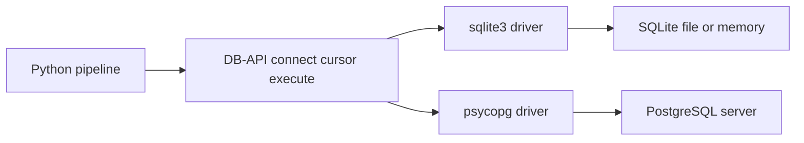

## Introduction

A pipeline that cannot read from or write to a database is a script. Python's DB-API (PEP 249) gives every driver the same shape: connect, cursor, execute, fetch, commit. Learn it with `sqlite3` and it transfers to PostgreSQL via psycopg.

## Definition

DB-API 2.0 is the standard interface for Python database drivers. A **connection** owns a session and a transaction; a **cursor** runs statements and fetches rows.

## Why it matters

- Loading and extracting data is the core of ETL.
- Parameterised queries prevent SQL injection and type bugs.
- Transaction handling decides whether a failed load leaves half-written data.

## How it works

1. `connect(...)` opens a session. psycopg and sqlite3 start a transaction implicitly before the first write.
2. `cursor.execute(sql, params)` sends SQL with values bound separately.
3. `fetchone`, `fetchmany(n)` or `fetchall` read rows.
4. `conn.commit()` makes changes durable; `conn.rollback()` discards them.
5. Close cursors and connections, ideally with context managers.

Placeholder style depends on the driver: sqlite3 uses `?` (or `:name`), psycopg uses `%s` (or `%(name)s`).

## Syntax and configuration

```python-syntax
import psycopg   # pip install "psycopg[binary]"

with psycopg.connect("host=localhost dbname=northwind user=etl password=...") as conn:
    with conn.cursor() as cur:
        cur.execute("SELECT order_id, order_date FROM orders WHERE customer_id = %s",
                    ("ALFKI",))
        rows = cur.fetchall()
        cur.executemany(
            "INSERT INTO staging_orders (order_id, amount) VALUES (%s, %s)",
            [(1, 10.5), (2, 20.0)],
        )
    # leaving the with-block commits; an exception rolls back
```

```python-syntax
# Bulk load into PostgreSQL with COPY (much faster than INSERTs)
with conn.cursor() as cur, cur.copy("COPY staging_orders (order_id, amount) FROM STDIN") as copy:
    for row in rows:
        copy.write_row(row)
```

## Examples

Create, insert with parameters, query:

```python
import sqlite3

conn = sqlite3.connect(":memory:")
cur = conn.cursor()
cur.execute("CREATE TABLE orders (order_id INTEGER PRIMARY KEY, customer_id TEXT, amount REAL)")
cur.executemany("INSERT INTO orders VALUES (?, ?, ?)",
                [(1, "ALFKI", 120.5), (2, "ANATR", 80.0), (3, "ALFKI", 45.0)])
conn.commit()

cur.execute("SELECT customer_id, SUM(amount) FROM orders WHERE amount > ? GROUP BY customer_id ORDER BY 1", (50,))
print(cur.fetchall())
conn.close()
```

Transactions: a failure rolls back the whole batch:

```python
import sqlite3

conn = sqlite3.connect(":memory:")
conn.execute("CREATE TABLE t (id INTEGER PRIMARY KEY, v TEXT NOT NULL)")
try:
    with conn:                       # commits on success, rolls back on error
        conn.execute("INSERT INTO t VALUES (1, 'a')")
        conn.execute("INSERT INTO t VALUES (2, NULL)")   # violates NOT NULL
except sqlite3.IntegrityError as e:
    print("rolled back:", e)
print(conn.execute("SELECT COUNT(*) FROM t").fetchone()[0])
conn.close()
```

## Architecture

The application talks to any database through the same DB-API calls.



## Practical example

Idempotent upsert of a batch, then read back into pandas:

```python
import sqlite3
import pandas as pd

conn = sqlite3.connect(":memory:")
conn.execute("CREATE TABLE customers (customer_id TEXT PRIMARY KEY, country TEXT, updated_at TEXT)")

def upsert(rows):
    with conn:
        conn.executemany(
            """INSERT INTO customers (customer_id, country, updated_at) VALUES (?, ?, ?)
               ON CONFLICT (customer_id) DO UPDATE
               SET country = excluded.country, updated_at = excluded.updated_at""",
            rows,
        )

upsert([("ALFKI", "Germany", "2024-01-01"), ("ANATR", "Mexico", "2024-01-01")])
upsert([("ALFKI", "Germany", "2024-02-01"), ("BONAP", "France", "2024-02-01")])  # rerun-safe

df = pd.read_sql_query("SELECT * FROM customers ORDER BY customer_id", conn)
print(df)
conn.close()
```

The same `INSERT ... ON CONFLICT ... DO UPDATE` works in PostgreSQL with `%s` placeholders.

## Exercises

1. Why is `cur.execute(f"... WHERE id = '{user_id}'")` dangerous?
<details><summary>Answer</summary>

It allows SQL injection and breaks on quotes. Pass values as parameters: `cur.execute("... WHERE id = ?", (user_id,))`.
</details>

2. A load inserts 500 rows and fails on row 300. How do you avoid partial data?
<details><summary>Answer</summary>

Run the batch in one transaction (`with conn:`) so the error rolls everything back, and make the load idempotent with upserts.
</details>

3. How do you read a big query without loading all rows into memory?
<details><summary>Answer</summary>

Loop over `cur.fetchmany(10_000)`, or `pd.read_sql_query(sql, conn, chunksize=10_000)`. In psycopg, use a named (server-side) cursor.
</details>

## Common mistakes

- String-formatting values into SQL.
- Forgetting `commit()`, so writes vanish when the connection closes.
- Passing a single parameter as `("x")` instead of the tuple `("x",)`.
- Opening a new connection per row.
- Hard-coding passwords; read them from environment variables or a secret store.

## Performance and best practices

- Batch with `executemany`, or use `COPY` for bulk PostgreSQL loads.
- Reuse connections; use a pool (psycopg_pool, SQLAlchemy) in services.
- Load into a staging table, validate, then merge into the target.
- Set statement timeouts for long-running extracts.

## Interview questions

### What are the main DB-API objects?

The connection (session and transaction control: `commit`, `rollback`, `close`) and the cursor (`execute`, `executemany`, `fetchone/fetchmany/fetchall`).

### How do you prevent SQL injection in Python?

Use parameter placeholders and pass values separately; the driver handles quoting and types.

### What is the fastest way to load a million rows into PostgreSQL from Python?

`COPY ... FROM STDIN` through psycopg's `cursor.copy`, ideally into a staging table.

### What does using a connection as a context manager do?

In sqlite3 and psycopg 3 it commits on success and rolls back on exception. In psycopg 3 it also closes the connection; sqlite3 does not.

## Quick revision

- DB-API: connect, cursor, execute, fetch, commit.
- Placeholders: `?` in sqlite3, `%s` in psycopg; never f-strings.
- `with conn:` gives commit-or-rollback.
- `executemany` / `COPY` for bulk loads.
- `ON CONFLICT DO UPDATE` makes loads rerun-safe.
- `pd.read_sql_query(sql, conn)` straight into a DataFrame.
