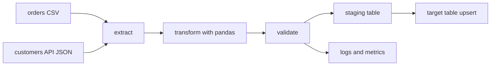

## Introduction

Every earlier topic in this track comes together here: read files and APIs, clean with pandas, load with DB-API, log what happened, and make reruns safe. A small, well-structured Python pipeline is the first real data engineering deliverable.

## Definition

An ETL pipeline **extracts** data from sources, **transforms** it into the target shape, and **loads** it into a destination, as separate testable steps run by an orchestrator or scheduler.

## Why it matters

- It is the core data engineering job and the most common take-home task.
- Structure (pure transform functions, idempotent loads) decides whether the pipeline survives reruns and bad data.
- The same design scales to Airflow, Spark or dbt later.

## How it works

1. **Extract**: read raw data unchanged; record source and run id.
2. **Validate input**: schema, required columns, types.
3. **Transform**: pure functions `DataFrame -> DataFrame`.
4. **Validate output**: row counts, nulls, uniqueness.
5. **Load**: staging table, then upsert or partition swap inside a transaction.
6. **Log and report**: counts and durations per step; non-zero exit on failure.

## Syntax and configuration

```python-syntax
def extract(cfg) -> pd.DataFrame: ...
def transform(df: pd.DataFrame) -> pd.DataFrame: ...
def validate(df: pd.DataFrame) -> None: ...      # raise on bad data
def load(df: pd.DataFrame, conn) -> int: ...      # idempotent

def run(cfg):
    raw = extract(cfg)
    clean = transform(raw)
    validate(clean)
    with connect(cfg.dsn) as conn:
        return load(clean, conn)

if __name__ == "__main__":
    sys.exit(0 if run(load_config()) else 1)
```

```yaml
# config.yaml - keep paths and credentials out of code
source_path: data/orders.csv
target_table: fact_orders
dsn_env: WAREHOUSE_DSN
```

## Examples

A minimal pure transform that is easy to unit test:

```python
import pandas as pd

def transform(df: pd.DataFrame) -> pd.DataFrame:
    out = df.copy()
    out["customer_id"] = out["customer_id"].str.strip().str.upper()
    out["amount"] = pd.to_numeric(out["amount"], errors="coerce").fillna(0).round(2)
    out["order_date"] = pd.to_datetime(out["order_date"]).dt.date
    return out.drop_duplicates("order_id", keep="last")

raw = pd.DataFrame({"order_id": [1, 2, 2], "customer_id": [" alfki", "anatr", "anatr"],
                    "amount": ["10.5", "x", "7"], "order_date": ["2024-01-01"] * 3})
result = transform(raw)
assert result["order_id"].is_unique
print(result.to_dict("records"))
```

Validation that fails loudly:

```python
import pandas as pd

def validate(df):
    errors = []
    for col in ("order_id", "customer_id", "amount"):
        if col not in df.columns:
            errors.append(f"missing column {col}")
    if not errors:
        if df["order_id"].duplicated().any():
            errors.append("duplicate order_id")
        if (df["amount"] < 0).any():
            errors.append("negative amount")
    if errors:
        raise ValueError("; ".join(errors))

validate(pd.DataFrame({"order_id": [1, 2], "customer_id": ["A", "B"], "amount": [1.0, 2.0]}))
try:
    validate(pd.DataFrame({"order_id": [1, 1], "customer_id": ["A", "B"], "amount": [1.0, -2.0]}))
except ValueError as e:
    print("rejected:", e)
```

## Architecture

The pipeline lands raw data, transforms it, and loads through a staging table.



## Practical example

End-to-end run: CSV file in a temp directory plus JSON lookup, into SQLite, safe to rerun:

```python
import io
import json
import logging
import os
import sqlite3
import tempfile
import pandas as pd

logging.basicConfig(level=logging.INFO, format="%(levelname)s %(name)s %(message)s")
log = logging.getLogger("etl")

ORDERS_CSV = """order_id,customer_id,order_date,amount
10248,vinet,1996-07-04,440.00
10249,TOMSP,1996-07-05,1863.40
10250,hanar,1996-07-08,
10249,TOMSP,1996-07-05,1863.40
"""
CUSTOMERS_JSON = '[{"id": "VINET", "country": "France"}, {"id": "TOMSP", "country": "Germany"}, {"id": "HANAR", "country": "Brazil"}]'

def extract(path):
    orders = pd.read_csv(path, dtype={"customer_id": "string"})
    customers = pd.DataFrame(json.loads(CUSTOMERS_JSON)).rename(columns={"id": "customer_id"})
    log.info("extracted %d orders, %d customers", len(orders), len(customers))
    return orders, customers

def transform(orders, customers):
    o = orders.copy()
    o["customer_id"] = o["customer_id"].str.upper()
    o["amount"] = o["amount"].fillna(0.0)
    o = o.drop_duplicates("order_id")
    out = o.merge(customers, on="customer_id", how="left", validate="many_to_one")
    log.info("transformed to %d rows", len(out))
    return out

def load(df, conn):
    conn.execute("""CREATE TABLE IF NOT EXISTS fact_orders (
        order_id INTEGER PRIMARY KEY, customer_id TEXT, order_date TEXT,
        amount REAL, country TEXT)""")
    rows = list(df[["order_id", "customer_id", "order_date", "amount", "country"]]
                .astype(object).itertuples(index=False, name=None))
    with conn:
        conn.executemany("""INSERT INTO fact_orders VALUES (?, ?, ?, ?, ?)
            ON CONFLICT (order_id) DO UPDATE SET amount = excluded.amount,
            country = excluded.country""", rows)
    return len(rows)

with tempfile.TemporaryDirectory() as d:
    path = os.path.join(d, "orders.csv")
    with open(path, "w") as f:
        f.write(ORDERS_CSV)
    conn = sqlite3.connect(":memory:")
    for run in (1, 2):                      # second run proves idempotency
        orders, customers = extract(path)
        n = load(transform(orders, customers), conn)
        total = conn.execute("SELECT COUNT(*), ROUND(SUM(amount), 2) FROM fact_orders").fetchone()
        log.info("run %d loaded %d rows; table now %s", run, n, total)
    print(pd.read_sql_query("SELECT * FROM fact_orders ORDER BY order_id", conn))
    conn.close()
```

## Exercises

1. Why keep `transform` free of I/O?
<details><summary>Answer</summary>

Pure functions can be unit tested with small in-memory DataFrames and reused in any orchestrator.
</details>

2. The pipeline crashed mid-load and is rerun. What stops duplicate rows?
<details><summary>Answer</summary>

A transaction per load plus an upsert (`ON CONFLICT DO UPDATE`) or delete-then-insert of the run's partition.
</details>

3. How would you make it incremental?
<details><summary>Answer</summary>

Store a watermark (max `order_date` or `updated_at`) after a successful load and extract only newer rows next time.
</details>

## Common mistakes

- One giant script with no functions or tests.
- Plain `INSERT` loads that duplicate data on rerun.
- Swallowing errors and exiting 0, so the scheduler reports success.
- Transforming the raw data in place and losing the original.
- Credentials and paths hard-coded instead of config and environment variables.

## Performance and best practices

- Push set-based work (joins, aggregates) into SQL when data is already in the database.
- Read with explicit dtypes and `chunksize` for large files.
- Bulk-load with `COPY` or `executemany`, not row-by-row commits.
- Log row counts per step and alert on unexpected drops.
- Hand scheduling, retries and backfills to an orchestrator such as Airflow.

## Interview questions

### How do you structure a Python ETL job?

Separate extract, transform, validate and load functions; config outside code; a `run()` entry point that logs per step and exits non-zero on failure.

### What makes a pipeline idempotent?

Running it twice with the same input gives the same target state, via upserts, partition overwrite or delete-insert inside a transaction.

### How do you handle bad records?

Validate early; either fail the run for systemic problems or route bad rows to a quarantine table with a reason, and report counts.

### When would you stop using pandas for a pipeline?

When data no longer fits comfortably in memory or needs distributed processing; move to SQL in the warehouse, DuckDB, Polars or Spark.

## Quick revision

- Extract, transform, validate, load as separate functions.
- Transforms are pure and unit tested.
- Load into staging, then upsert in one transaction.
- Rerun must not duplicate data.
- Log counts and durations; non-zero exit on failure.
- Watermarks for incremental loads.
