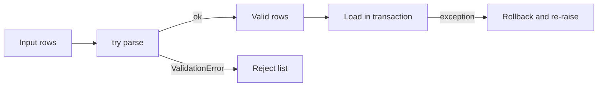

## Introduction

Real data is dirty and real systems fail: a malformed row, a missing file, a timed-out API call. Exception handling decides which failures you recover from and which ones stop the pipeline.

## Definition

An exception is an object raised when an error occurs. `try` runs code; `except` catches matching exception types; `else` runs only if nothing was raised; `finally` always runs. `raise` throws an exception, and `raise ... from err` chains it to its cause.

## Why it matters

- One bad row should go to a reject file, not crash a 10-million-row load.
- A failed load must not leave a half-written table: roll back in `except` or `finally`.
- Transient errors (timeouts, deadlocks) deserve a retry; logic errors do not.

## How it works

1. Python runs the `try` block.
2. On an exception, it checks each `except` clause in order and runs the first that matches the type (including subclasses).
3. With no match, the exception propagates up the call stack.
4. `else` runs if the `try` block finished without error.
5. `finally` runs in every case, even after `return` or an uncaught exception.

## Syntax and configuration

```python-syntax
try:
    risky()
except (ValueError, KeyError) as err:    # catch specific types
    handle(err)
except Exception:
    log.exception("unexpected")
    raise                                 # re-raise the same exception
else:
    commit()                              # only on success
finally:
    close()                               # always

class PipelineError(Exception):
    """Base error for this project."""

raise PipelineError("bad batch") from original_error
```

## Examples

```python
def to_int(value):
    try:
        return int(value)
    except (TypeError, ValueError):
        return None

print([to_int(v) for v in ["1", "x", None, " 7 "]])   # [1, None, None, 7]
```

`else` and `finally`:

```python
def divide(a, b):
    try:
        result = a / b
    except ZeroDivisionError as err:
        print("error:", err)
        return None
    else:
        print("ok")
        return result
    finally:
        print("done")

divide(4, 2)
divide(1, 0)
```

Custom exceptions and chaining:

```python
class ValidationError(Exception):
    def __init__(self, row_number, message):
        super().__init__(f"row {row_number}: {message}")
        self.row_number = row_number

def parse_amount(row_number, text):
    try:
        return float(text)
    except ValueError as err:
        raise ValidationError(row_number, f"bad amount {text!r}") from err

try:
    parse_amount(3, "12,5")
except ValidationError as err:
    print(err, "| cause:", type(err.__cause__).__name__)
```

## Architecture

Each row either loads or goes to a reject list. A batch-level failure rolls back.



## Practical example

Load rows into SQLite inside a transaction. Bad rows are rejected individually; a database error rolls back the whole batch.

```python
import sqlite3

raw = [("1", "ALFKI", "10.5"), ("2", "ANATR", "oops"), ("3", "ANTON", "7")]

conn = sqlite3.connect(":memory:")
conn.execute("CREATE TABLE orders (id INTEGER PRIMARY KEY, customer TEXT, amount REAL)")

good, rejects = [], []
for rec in raw:
    try:
        good.append((int(rec[0]), rec[1], float(rec[2])))
    except ValueError as err:
        rejects.append({"row": rec, "error": str(err)})

try:
    with conn:                                   # commits, or rolls back on error
        conn.executemany("INSERT INTO orders VALUES (?, ?, ?)", good)
        conn.execute("INSERT INTO orders VALUES (1, 'DUP', 0)")   # primary key clash
except sqlite3.IntegrityError as err:
    print("batch rolled back:", err)

print("rows loaded:", conn.execute("SELECT COUNT(*) FROM orders").fetchone()[0])  # 0
print("rejects:", rejects)
conn.close()
```

A simple retry for transient errors:

```python
import time

class TransientError(Exception):
    pass

calls = {"n": 0}
def flaky():
    calls["n"] += 1
    if calls["n"] < 3:
        raise TransientError("timeout")
    return "ok"

def retry(fn, attempts=4, delay=0.01):
    for attempt in range(1, attempts + 1):
        try:
            return fn()
        except TransientError as err:
            if attempt == attempts:
                raise
            print(f"attempt {attempt} failed: {err}; retrying")
            time.sleep(delay * 2 ** attempt)      # exponential backoff

print(retry(flaky))
```

## Exercises

1. What does this print: `try: return 1` / `finally: print("x")` inside a function?

<details><summary>Answer</summary>

It prints `x`, then the function returns `1`. `finally` runs before the return completes.

</details>

2. Why is `except Exception: pass` dangerous in an ETL job?

<details><summary>Answer</summary>

It hides every error, so bad data loads silently or rows disappear. Catch specific types, and log or re-raise.

</details>

3. Which errors should a retry wrapper retry?

<details><summary>Answer</summary>

Only transient ones: timeouts, connection resets, HTTP 429/503, deadlocks. Never validation or programming errors.

</details>

## Common mistakes

- Bare `except:` also catches `KeyboardInterrupt` and `SystemExit`.
- Swallowing errors without logging them.
- `raise err` instead of `raise`, which is fine in Python 3 but loses intent; prefer bare `raise` to re-raise.
- Putting too much code in `try`, so you catch errors you did not expect.
- Retrying non-idempotent operations, which duplicates inserts.

## Performance and best practices

- `try` is cheap when nothing is raised; raising is relatively expensive. For a hot loop where failure is common, check first.
- Define one base exception per project and subclass it.
- Use `with` (context managers) instead of manual `finally` for files, connections and locks.
- Use `logger.exception(...)` inside `except` to record the traceback.
- Fail fast on configuration errors; tolerate and quarantine row-level data errors.

## Interview questions

### What is the difference between else and finally?

`else` runs only if the `try` block raised nothing. `finally` always runs, whether or not an exception occurred.

### What does raise ... from do?

It sets `__cause__` on the new exception, so the traceback shows the original error as the direct cause.

### How do you keep one bad row from failing the whole load?

Wrap per-row parsing in `try/except`, send failures to a reject table or file with the error message, and load the rest. Alert if the reject rate passes a threshold.

### How do you make sure a database transaction is rolled back on error?

Use the connection as a context manager or call `rollback()` in `except`, then re-raise so the caller knows the load failed.

## Quick revision

- Catch specific exceptions, never a bare `except:`.
- `else` on success, `finally` always.
- Bare `raise` re-raises; `raise X from err` chains.
- Custom exceptions subclass `Exception`.
- Row errors: quarantine. Batch errors: roll back and re-raise.
- Retry only transient errors, with backoff.
