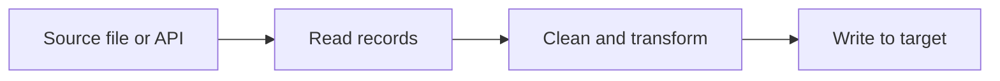

## Introduction

Python is the glue language of data engineering. Airflow DAGs, PySpark jobs, dbt macros' helpers and most ETL scripts are Python. You need only a small core to be productive.

## Definition

Python is an interpreted, dynamically typed language. Code runs top to bottom, blocks are defined by indentation, and everything (numbers, functions, modules) is an object.

## Why it matters

- Pipelines are mostly "read records, clean them, write them" - plain Python handles that.
- Interviews often start with a small Python task: parse, count, deduplicate.
- Every tool later in the track (pandas, Airflow, PySpark) assumes these basics.

## How it works

1. The interpreter compiles a `.py` file to bytecode.
2. It runs statements in order.
3. Names are bound to objects at run time; types belong to objects, not names.
4. `if __name__ == "__main__":` guards code that should run only when the file is executed directly.

## Syntax and configuration

```python-syntax
# comment
import module_name

def main() -> None:
    value = expression
    if condition:
        do_something()   # 4-space indent marks the block

if __name__ == "__main__":
    main()
```

Run a script with `python3 script.py`; check the version with `python3 --version`.

## Examples

Expressions, built-ins and f-strings:

```python
rows = ["alfki,4", "anatr,0", "bonap,7"]
total = 0
for row in rows:
    customer, orders = row.split(",")
    total += int(orders)
print(f"customers={len(rows)} orders={total}")
print(max(rows, key=lambda r: int(r.split(",")[1])))
```

Integer vs float division and rounding:

```python
print(7 / 2, 7 // 2, 7 % 2, round(2.675, 2), 2 ** 10)
```

## Architecture

A typical script reads input, transforms it in memory and writes output.



## Practical example

A tiny "pipeline" in one script with a `main()` entry point:

```python
import io

RAW = io.StringIO("order_id,amount\n1,10.5\n2,\n3,7.25\n")

def main() -> None:
    next(RAW)  # skip header
    good, bad = 0.0, 0
    for line in RAW:
        order_id, amount = line.strip().split(",")
        if not amount:
            bad += 1
            continue
        good += float(amount)
    print(f"revenue={good:.2f} rejected={bad}")

if __name__ == "__main__":
    main()
```

## Exercises

1. Print the number of words in `"extract transform load"`.
   <details><summary>Answer</summary>

   `print(len("extract transform load".split()))` prints `3`.
   </details>
2. What does `7 // 2` return, and `-7 // 2`?
   <details><summary>Answer</summary>

   `3` and `-4`. Floor division rounds toward negative infinity.
   </details>
3. Why wrap script logic in `main()` with a `__name__` guard?
   <details><summary>Answer</summary>

   So importing the file (for tests or reuse) does not run the pipeline.
   </details>

## Common mistakes

- Mixing tabs and spaces: `IndentationError`.
- Using `/` and expecting an integer.
- Running code at import time instead of under `if __name__ == "__main__":`.
- Relying on `python` meaning Python 3; use `python3` or a virtual environment.

## Performance and best practices

- Use built-ins (`sum`, `max`, `sorted`) - they run in C.
- Stream large inputs line by line rather than reading everything into memory.
- Follow PEP 8: 4-space indents, `snake_case` names.
- Add type hints; they document data shapes and help linters.

## Interview questions

### Is Python compiled or interpreted?

Both: source is compiled to bytecode, which the CPython virtual machine interprets.

### What does `if __name__ == "__main__":` do?

It runs the block only when the file is executed directly, not when imported.

### What is dynamic typing?

Types are attached to objects at run time; a name can be rebound to an object of another type.

### Why is Python popular in data engineering?

Readable syntax, a huge ecosystem (pandas, PySpark, Airflow, DB drivers) and easy glue between systems.

## Quick revision

- Indentation defines blocks.
- `/` is true division, `//` floor division.
- f-strings: `f"{value:.2f}"`.
- Guard entry points with `__name__ == "__main__"`.
- Prefer built-ins and streaming for big data.
