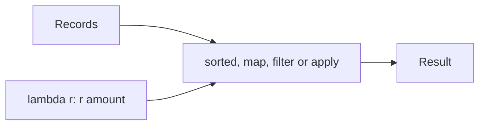

## Introduction

Many APIs take a small function as an argument: `sorted(key=...)`, `max(key=...)`, `df.apply(...)`. A lambda writes that function inline.

## Definition

`lambda params: expression` creates an anonymous function whose body is a single expression. It returns the expression's value.

## Why it matters

- Sort records by any field without writing a named function.
- Pandas `assign`, `apply` and `sort_values(key=...)` use them constantly.
- Overusing them hurts readability - a common code-review point.

## How it works

A lambda is a normal function object; only the syntax differs. It captures enclosing variables by reference (late binding), like any closure.

## Syntax and configuration

```python-syntax
lambda x: x * 2
lambda a, b=0: a + b
sorted(rows, key=lambda r: (r["country"], -r["amount"]))
```

## Examples

```python
from functools import reduce
import operator

rows = [{"cust": "ALFKI", "amount": 120}, {"cust": "BONAP", "amount": 15}, {"cust": "ANATR", "amount": 40}]
print(sorted(rows, key=lambda r: r["amount"], reverse=True)[0])
print(list(filter(lambda r: r["amount"] > 20, rows)))
print(reduce(lambda acc, r: acc + r["amount"], rows, 0))
print(sorted(rows, key=operator.itemgetter("cust"))[0]["cust"])
```

With pandas:

```python
import pandas as pd

df = pd.DataFrame({"name": [" chai", "Chang ", "tofu"], "price": [18.0, 19.0, 23.25]})
df = df.assign(name=lambda d: d["name"].str.strip().str.title(),
               price_band=lambda d: d["price"].apply(lambda p: "high" if p > 20 else "low"))
print(df)
```

## Architecture

The lambda is passed into a higher-order function, which calls it per item.



## Practical example

Pick the latest record per key (dedup by `updated_at`):

```python
records = [
    {"id": 1, "updated_at": "2024-01-01", "status": "new"},
    {"id": 1, "updated_at": "2024-02-01", "status": "shipped"},
    {"id": 2, "updated_at": "2024-01-15", "status": "new"},
]
latest = {}
for r in sorted(records, key=lambda r: r["updated_at"]):
    latest[r["id"]] = r
print(list(latest.values()))
```

## Exercises

1. Sort `["bb", "a", "ccc"]` by length.
   <details><summary>Answer</summary>

   `sorted(words, key=lambda w: len(w))` or simply `key=len`.
   </details>
2. What does `[lambda: i for i in range(3)][0]()` return?
   <details><summary>Answer</summary>

   `2`: late binding. Fix with `lambda i=i: i`.
   </details>

## Common mistakes

- Assigning a lambda to a name (`f = lambda ...`); use `def`.
- Late binding in loops.
- Row-wise `df.apply(lambda ...)` where a vectorised column operation exists.
- Cramming conditionals into unreadable one-liners.

## Performance and best practices

- `key=len` or `operator.itemgetter` is faster and clearer than a wrapping lambda.
- In pandas, prefer vectorised methods (`.str`, `np.where`) over `apply(lambda)`.
- Prefer comprehensions over `map`/`filter` with lambdas.

## Interview questions

### What is the difference between lambda and def?

A lambda is a single anonymous expression; `def` creates a named function with statements, docstrings and better tracebacks.

### What is late binding in closures?

Captured variables are looked up when the function runs, not when it is created, so loop lambdas all see the last value.

### Why avoid df.apply with a lambda?

It calls Python once per row; vectorised operations run in C and are often 10-100x faster.

## Quick revision

- `lambda args: expr` - one expression only.
- Great for `key=` arguments.
- `operator.itemgetter` and built-ins are often better.
- Watch late binding; use default args.
- Vectorise instead of `apply(lambda)` in pandas.
