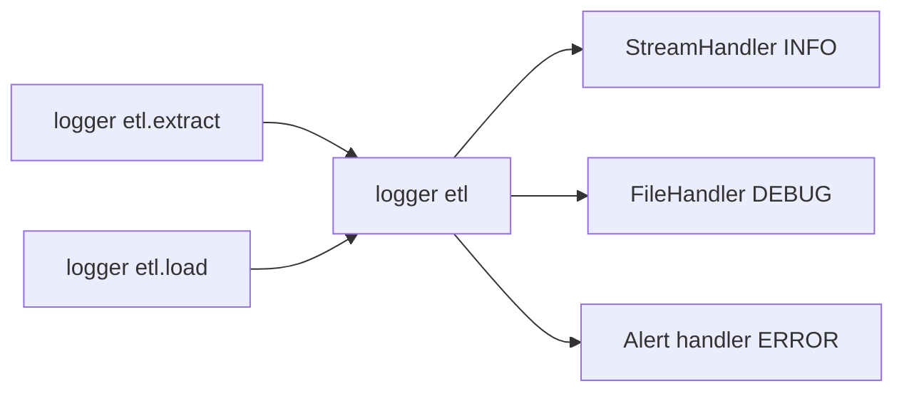

## Introduction

`print` works until a job runs at 3 a.m. on a scheduler. Then you need timestamps, levels, the module name and the traceback, written somewhere you can search. That is the `logging` module.

## Definition

`logging` is the standard-library framework for emitting records. A **logger** creates records, **handlers** send them to destinations, and **formatters** turn them into text.

## Why it matters

- Pipeline failures are debugged from logs, not from a terminal.
- Levels let you keep DEBUG detail off in production and on when investigating.
- Airflow, Spark and cloud runtimes collect standard logging output.

## How it works

1. `logging.getLogger(__name__)` returns a named logger in a dot hierarchy (`etl.extract` is a child of `etl`).
2. A call such as `log.info(...)` creates a record if the level passes the logger's threshold.
3. The record propagates to parent loggers and each handler on the way.
4. Each handler checks its own level, formats the record and writes it.

Levels: `DEBUG` 10, `INFO` 20, `WARNING` 30, `ERROR` 40, `CRITICAL` 50.

## Syntax and configuration

```python-syntax
import logging

logging.basicConfig(
    level=logging.INFO,
    format="%(asctime)s %(levelname)s %(name)s %(message)s",
)
log = logging.getLogger(__name__)

log.debug("hidden at INFO level")
log.info("loaded %d rows", row_count)       # lazy % formatting
log.warning("missing column %s", col)
try:
    load()
except Exception:
    log.exception("load failed")            # ERROR + traceback
    raise
```

## Examples

Logger with a handler writing to an in-memory stream:

```python
import io
import logging

stream = io.StringIO()
log = logging.getLogger("etl.demo")
log.setLevel(logging.INFO)
handler = logging.StreamHandler(stream)
handler.setFormatter(logging.Formatter("%(levelname)s %(name)s %(message)s"))
log.addHandler(handler)
log.propagate = False

log.debug("not shown")
log.info("extracted %d rows", 120)
try:
    1 / 0
except ZeroDivisionError:
    log.exception("transform failed")

print(stream.getvalue().splitlines()[:3])
```

Logging to a file in a temp directory:

```python
import logging
import os
import tempfile

with tempfile.TemporaryDirectory() as d:
    path = os.path.join(d, "pipeline.log")
    log = logging.getLogger("etl.file")
    fh = logging.FileHandler(path)
    log.addHandler(fh)
    log.setLevel(logging.INFO)
    log.info("run started")
    fh.close()
    log.removeHandler(fh)
    print(open(path).read().strip())
```

## Architecture

Records flow from module loggers up to the root, then to each handler.



## Practical example

Structured JSON logs with a run id, easy to query in a log store:

```python
import io
import json
import logging

class JsonFormatter(logging.Formatter):
    def format(self, record):
        return json.dumps({
            "level": record.levelname,
            "logger": record.name,
            "msg": record.getMessage(),
            "run_id": getattr(record, "run_id", None),
        })

stream = io.StringIO()
h = logging.StreamHandler(stream)
h.setFormatter(JsonFormatter())
log = logging.getLogger("etl.json")
log.addHandler(h)
log.setLevel(logging.INFO)
log.propagate = False

log.info("loaded %d rows", 500, extra={"run_id": "2024-06-01"})
print(json.loads(stream.getvalue()))
```

## Exercises

1. Why write `log.info("rows=%d", n)` instead of an f-string?
<details><summary>Answer</summary>

Formatting is deferred and skipped when the level is disabled. Log aggregators can also group by the template.
</details>

2. What does `log.exception` do that `log.error` does not?
<details><summary>Answer</summary>

It adds the current traceback. Call it inside an `except` block.
</details>

3. Messages appear twice. Why?
<details><summary>Answer</summary>

A handler is attached to both the logger and an ancestor (often root), and `propagate` is True. Attach handlers once, usually at the root.
</details>

## Common mistakes

- Calling `basicConfig` in library modules; configure only in the entry point.
- Adding handlers on every function call, which duplicates lines.
- Swallowing exceptions with `log.error(e)` and losing the traceback.
- Logging secrets such as connection strings or API keys.

## Performance and best practices

- One `log = logging.getLogger(__name__)` per module.
- Log counts and durations per step, not every row.
- Use JSON logs and a run id in production pipelines.
- Use `RotatingFileHandler` or ship stdout to the platform instead of growing files forever.

## Interview questions

### What is the difference between a logger and a handler?

A logger creates records and decides by level whether to emit them. A handler decides where records go and has its own level and formatter.

### How does logger propagation work?

Records pass to the parent logger's handlers up to the root unless `propagate = False`.

### How do you log an exception with its traceback?

Call `log.exception("msg")` inside `except`, or pass `exc_info=True`.

### Which level should a skipped bad row use?

Usually `WARNING`, with a summary count at the end. `ERROR` is for failures that stop or fail a step.

## Quick revision

- `getLogger(__name__)` per module; configure once at entry.
- Levels: DEBUG < INFO < WARNING < ERROR < CRITICAL.
- Handlers = destinations; formatters = layout.
- `log.exception` adds traceback.
- Use lazy `%s` args, not f-strings.
- JSON logs plus run id for production.
