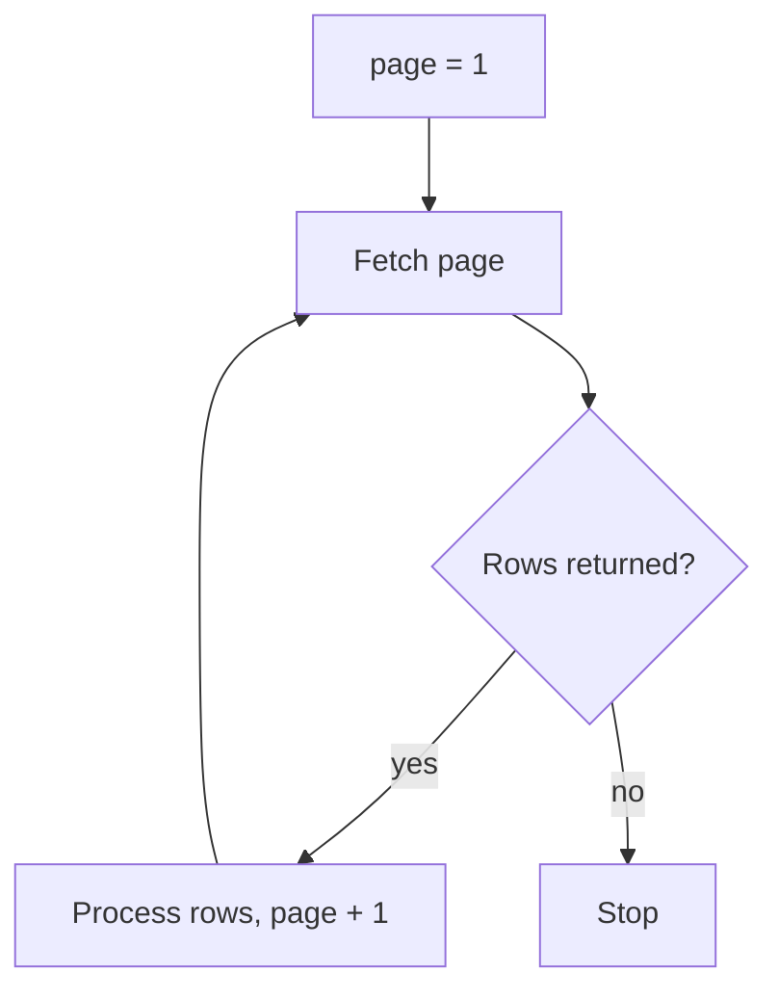

## Introduction

A pipeline is a loop over records. Writing that loop well - streaming, batching, stopping on errors - decides memory use and speed.

## Definition

`for item in iterable:` visits each item of any iterable. `while cond:` repeats until the condition is false. `break` exits, `continue` skips to the next item, and `else` on a loop runs when no `break` happened.

## Why it matters

- Files, DB cursors and API pages are all iterables.
- Batching rows (for example 1,000 per insert) is a loop pattern.
- Pagination and retries are `while` loops.

## How it works

`for` calls `iter()` on the object and then `next()` until `StopIteration`. Generators produce items lazily, so a loop over a 10 GB file never holds it all in memory.

## Syntax and configuration

```python-syntax
for i, item in enumerate(items, start=1): ...
for a, b in zip(list_a, list_b): ...
for key, value in mapping.items(): ...
while not done: ...
```

## Examples

```python
from itertools import islice

names = ["Chai", "Chang", "Aniseed Syrup"]
prices = [18.0, 19.0, 10.0]
for i, (name, price) in enumerate(zip(names, prices), start=1):
    print(i, name, price)

def batches(iterable, size):
    it = iter(iterable)
    while True:
        chunk = list(islice(it, size))
        if not chunk:
            break
        yield chunk

print(list(batches(range(7), 3)))
```

## Architecture

Paginated extraction: keep fetching until a page comes back empty.



## Practical example

Simulated paginated API with a `while` loop and a safety limit:

```python
DATA = list(range(1, 24))

def fetch_page(page, size=10):
    start = (page - 1) * size
    return DATA[start:start + size]

page, collected = 1, []
while page <= 100:          # guard against infinite loops
    rows = fetch_page(page)
    if not rows:
        break
    collected.extend(rows)
    page += 1
print(len(collected), "rows in", page - 1, "pages")
```

## Exercises

1. Print each key and value of `{"a": 1, "b": 2}`.
   <details><summary>Answer</summary>

   `for k, v in d.items(): print(k, v)`.
   </details>
2. When does a loop's `else` block run?
   <details><summary>Answer</summary>

   When the loop finished without `break`.
   </details>
3. Why use a generator for reading a big file?
   <details><summary>Answer</summary>

   It yields one item at a time, so memory stays constant.
   </details>

## Common mistakes

- Modifying a list while iterating over it.
- `for i in range(len(items))` instead of `enumerate`.
- `while True` with no exit guard on pagination.
- Inserting rows one by one in a loop instead of in batches.

## Performance and best practices

- Python loops are slow per item; push heavy math to pandas/NumPy or SQL.
- Batch DB writes with `executemany` or `COPY`.
- Use generators and `itertools` to stream.
- `zip(strict=True)` (3.10+) catches length mismatches.

## Interview questions

### How does a for loop work internally?

It calls `iter()` on the iterable, then `next()` repeatedly until `StopIteration`.

### What is the difference between break and continue?

`break` leaves the loop; `continue` skips to the next iteration.

### How would you process a 50 GB file in Python?

Iterate line by line or in chunks (`pd.read_csv(chunksize=...)`), never `read()` it all.

## Quick revision

- `enumerate` for indexes, `zip` for parallel lists.
- `.items()` for dicts.
- `while` for pagination with a guard.
- Generators stream with `yield`.
- Batch writes; vectorise math.
