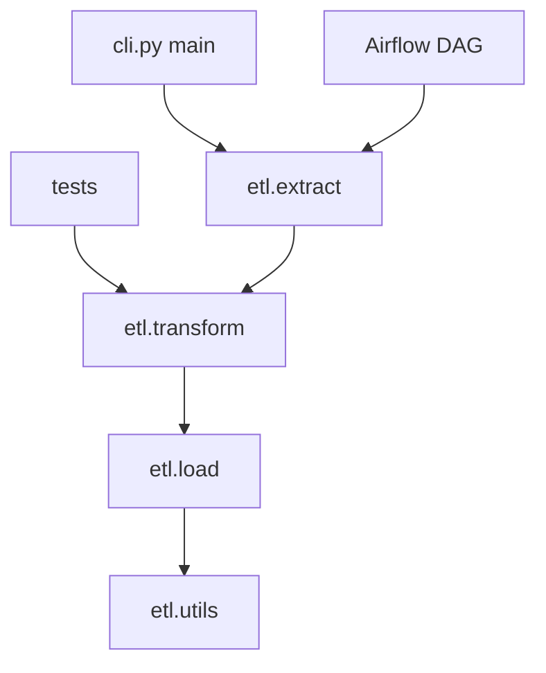

## Introduction

A single 800-line `etl.py` works until a second pipeline needs its helpers. Modules and packages split code into reusable, testable pieces that Airflow DAGs, scripts and tests can all import.

## Definition

- A **module** is one `.py` file. Importing it runs the file once and caches the result in `sys.modules`.
- A **package** is a directory of modules, normally with an `__init__.py`.
- `sys.path` is the list of directories Python searches for imports.

## Why it matters

- Shared code (connections, validation, logging setup) lives in one place.
- Tests import functions directly instead of running a script.
- Installable packages (`pip install -e .`) make imports work the same locally, in CI and in containers.

## How it works

1. `import pkg.mod` searches `sys.path` for `pkg`, runs `pkg/__init__.py`, then `pkg/mod.py`.
2. The module object is cached; a second import does not run the code again.
3. `from pkg.mod import name` binds `name` in your namespace.
4. When a file runs as a script, its `__name__` is `"__main__"`; when imported, it is the module name.

## Syntax and configuration

```python-syntax
import json                       # standard library
import pandas as pd               # third-party, aliased
from etl.extract import read_orders
from . import transform           # relative import inside a package
from .utils import retry

if __name__ == "__main__":        # run only as a script
    main()
```

A typical project layout:

```text
sales-pipeline/
  pyproject.toml
  src/etl/
    __init__.py
    extract.py
    transform.py
    load.py
    cli.py
  tests/
    test_transform.py
```

Minimal `pyproject.toml`:

```text
[project]
name = "etl"
version = "0.1.0"
dependencies = ["pandas>=2.0", "psycopg[binary]>=3.1"]

[project.scripts]
run-etl = "etl.cli:main"

[build-system]
requires = ["setuptools>=68"]
build-backend = "setuptools.build_meta"
```

## Examples

Build a tiny package in a temp directory and import it. This shows `sys.path`, `__init__.py`, relative imports and module caching.

```python
import sys
import tempfile
import textwrap
from pathlib import Path

with tempfile.TemporaryDirectory() as tmp:
    pkg = Path(tmp) / "etl_demo"
    pkg.mkdir()
    (pkg / "__init__.py").write_text('from .transform import clean_name\n__version__ = "0.1"\n')
    (pkg / "transform.py").write_text(textwrap.dedent('''
        print("loading transform")
        def clean_name(s):
            return " ".join(s.split()).title()
    '''))

    sys.path.insert(0, tmp)
    sys.dont_write_bytecode = True
    try:
        import etl_demo
        import etl_demo.transform            # cached: prints nothing the second time
        from etl_demo import clean_name
        print(etl_demo.__version__, clean_name("  alfreds   futterkiste "))
        print("etl_demo.transform" in sys.modules)
    finally:
        sys.path.remove(tmp)
        for name in [m for m in sys.modules if m.startswith("etl_demo")]:
            del sys.modules[name]
```

The `__main__` guard:

```python
def main():
    print("running pipeline")

print("module name:", __name__)
if __name__ == "__main__":
    main()
```

## Architecture

Entry points (CLI, Airflow DAG, tests) import the same package modules.



## Practical example

`transform.py` stays pure and importable; `cli.py` wires steps together behind a `__main__` guard.

```python-syntax
# src/etl/transform.py
import pandas as pd

def add_revenue(df: pd.DataFrame) -> pd.DataFrame:
    return df.assign(revenue=df.unit_price * df.quantity * (1 - df.discount))

# src/etl/cli.py
import argparse
from etl.extract import read_orders
from etl.transform import add_revenue
from etl.load import write_table

def main(argv=None):
    parser = argparse.ArgumentParser()
    parser.add_argument("--date", required=True)
    args = parser.parse_args(argv)
    write_table(add_revenue(read_orders(args.date)), "fact_sales")

if __name__ == "__main__":
    main()
```

```bash
pip install -e .
run-etl --date 2024-03-01        # console script from pyproject.toml
python -m etl.cli --date 2024-03-01
pytest tests/
```

## Exercises

1. A module prints `"connecting"` at import time and every test that imports it opens a database connection. What should you change?

<details><summary>Answer</summary>

Move side effects into functions (for example `get_connection()`) and call them from `main()` or behind `if __name__ == "__main__":`.

</details>

2. What is the difference between `python etl/cli.py` and `python -m etl.cli`?

<details><summary>Answer</summary>

`-m` runs the module as part of its package, so package-relative and absolute `etl.*` imports work. Running the file path puts only its directory on `sys.path`.

</details>

3. Two modules import each other and you get `ImportError: cannot import name`. Why?

<details><summary>Answer</summary>

A circular import: one module is only partly initialised when the other imports from it. Move the shared code into a third module or import inside a function.

</details>

## Common mistakes

- Naming a file `pandas.py`, `json.py` or `csv.py`, which shadows the real library.
- Heavy work (connections, file reads) at import time.
- `from module import *`, which hides where names come from.
- Editing `sys.path` in application code instead of installing the package.
- Circular imports between `extract` and `transform`.

## Performance and best practices

- Use a `src/` layout and `pip install -e .` so tests import the installed package.
- Keep imports at the top of the file, grouped: standard library, third-party, local.
- Import heavy optional libraries lazily inside the function that needs them.
- Expose a small public API from `__init__.py`.
- Pin dependencies in `pyproject.toml` or a lock file.

## Interview questions

### What is the difference between a module and a package?

A module is a single `.py` file. A package is a directory of modules, usually with `__init__.py`, imported with dotted names.

### What does if __name__ == "__main__" do?

It runs code only when the file is executed directly, not when imported, so the module can be both a script and a library.

### How does Python find a module on import?

It checks `sys.modules` first, then searches `sys.path`: the script's directory, `PYTHONPATH`, the standard library and site-packages.

### How do you share code between several Airflow DAGs?

Put it in a package (for example `plugins/` or an installed internal library) and import it, keeping DAG files thin.

## Quick revision

- Module = file; package = directory with `__init__.py`.
- Imports run once and are cached in `sys.modules`.
- Use the `__main__` guard for script entry points.
- No side effects at import time.
- `src/` layout plus `pyproject.toml` plus `pip install -e .`.
- Never name files after libraries you import.
