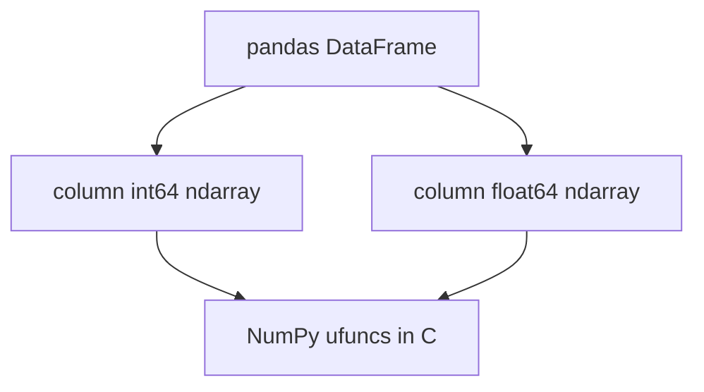

## Introduction

A Python list of a million floats is a million separate objects. A NumPy array is one block of memory with a single type. Every pandas column is backed by one, which is why vectorised pandas is fast.

## Definition

NumPy provides `ndarray`: a fixed-type, N-dimensional array with fast element-wise operations written in C.

## Why it matters

- Vectorised maths is often 10-100x faster than Python loops.
- Masks, `where` and `select` replace row-by-row `if` logic.
- Understanding dtypes explains pandas memory use and NaN behaviour.

## How it works

- Every array has a `dtype` (`int64`, `float64`, `bool`, `datetime64`...) and a `shape`.
- Operations apply to all elements at once (ufuncs).
- **Broadcasting** stretches smaller arrays to match shapes without copying.
- Slices are views on the same memory; boolean indexing returns copies.
- `NaN` exists only for floats, so an int column with a missing value becomes float.

## Syntax and configuration

```python-syntax
import numpy as np

a = np.array([1, 2, 3], dtype=np.int64)
np.zeros((3, 4)); np.arange(0, 10, 2); np.linspace(0, 1, 5)
a * 2; a + b; np.sqrt(a); a.sum(); a.mean(axis=0)
a[a > 1]                       # boolean mask
np.where(cond, x, y)           # vectorised if/else
np.nanmean(a)                  # ignore NaN
```

## Examples

Vectorised arithmetic and masks:

```python
import numpy as np

price = np.array([18.0, 19.0, 10.0, 22.0])
qty = np.array([12, 10, 5, 0])
discount = np.array([0.0, 0.1, 0.0, 0.05])

revenue = price * qty * (1 - discount)
print(revenue, revenue.sum())
print("big lines:", revenue[revenue > 100])
print(np.where(qty == 0, "empty", "ok"))
```

Broadcasting and NaN-aware stats:

```python
import numpy as np

m = np.array([[1.0, 2.0, 3.0], [4.0, np.nan, 6.0]])
col_means = np.nanmean(m, axis=0)
print("column means:", col_means)
filled = np.where(np.isnan(m), col_means, m)   # broadcast row of means
print(filled)
print((m - np.nanmean(m)).round(2))
```

## Architecture

pandas sits on top of NumPy arrays; heavy maths runs in compiled code.



## Practical example

Bucket transaction amounts and flag outliers with z-scores, no loops:

```python
import numpy as np

rng = np.random.default_rng(42)
amounts = np.round(rng.normal(100, 20, size=1000), 2)
amounts[[10, 20]] = [900.0, -50.0]

z = (amounts - amounts.mean()) / amounts.std()
outliers = np.flatnonzero(np.abs(z) > 4)
buckets = np.select([amounts < 50, amounts < 150], ["low", "mid"], default="high")
labels, counts = np.unique(buckets, return_counts=True)
print("outlier positions:", outliers.tolist())
print(dict(zip(labels.tolist(), counts.tolist())))
```

## Exercises

1. Replace negative values in an array with 0 without a loop.
<details><summary>Answer</summary>

`np.where(a < 0, 0, a)` or `np.clip(a, 0, None)`.
</details>

2. Why does `np.array([1, None, 3], dtype=float)` work but an int array cannot hold NaN?
<details><summary>Answer</summary>

`NaN` is a float value. Integer dtypes have no missing-value marker, so pandas upcasts to float or uses nullable `Int64`.
</details>

3. What is the shape of `np.ones((3, 1)) + np.ones(4)`?
<details><summary>Answer</summary>

`(3, 4)` by broadcasting.
</details>

## Common mistakes

- Python loops over arrays instead of vectorised operations.
- Modifying a slice and accidentally changing the original (views).
- `a == np.nan` is always False; use `np.isnan`.
- Mixed types creating `object` arrays that lose all speed.
- Integer overflow with small dtypes such as `int8`.

## Performance and best practices

- Choose the smallest safe dtype (`float32`, `int32`) for large arrays.
- Preallocate with `np.empty` instead of appending in a loop.
- Use `np.random.default_rng(seed)` for reproducible tests.
- Leave tabular work to pandas; use NumPy for numeric kernels.

## Interview questions

### Why is a NumPy array faster than a Python list?

It stores values contiguously with one dtype and runs operations in compiled loops, avoiding per-element Python object overhead.

### What is broadcasting?

The rule that lets arrays of different shapes combine by virtually repeating dimensions of size 1 without copying data.

### What is the difference between a view and a copy?

A view shares memory with the original (basic slicing); a copy owns new memory (boolean or fancy indexing, `.copy()`).

### How do you implement CASE WHEN in NumPy?

`np.where(cond, a, b)` for two branches, `np.select(conditions, choices, default)` for many.

## Quick revision

- `ndarray`: one dtype, fixed shape, contiguous memory.
- Vectorise; avoid Python loops.
- Masks: `a[a > 0]`; branches: `np.where`, `np.select`.
- NaN is float only; use `np.isnan`, `np.nanmean`.
- Slices are views; masks are copies.
- Broadcasting aligns trailing dimensions.
