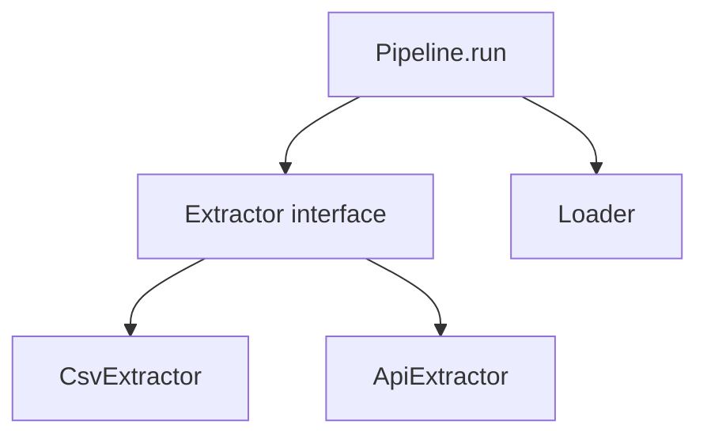

## Introduction

Scripts start as functions. As a pipeline grows, you need several sources that behave the same way, records with typed fields and steps that share configuration. Classes group that state and behaviour.

## Definition

A class defines a type: its data (attributes) and its behaviour (methods). An object is an instance of a class. Inheritance lets a subclass reuse and override a parent class. A `dataclass` generates `__init__`, `__repr__` and `__eq__` from type-annotated fields.

## Why it matters

- One `Extractor` interface with `CsvExtractor` and `ApiExtractor` implementations keeps the pipeline code unchanged when the source changes.
- Dataclasses give records named, typed fields instead of fragile dict keys.
- Frameworks such as Airflow operators and Spark readers are classes; you need to read and subclass them.

## How it works

1. `class Name:` defines the class. `__init__` runs when you call `Name(...)`.
2. `self` is the instance; methods receive it as the first argument.
3. Attribute lookup checks the instance, then the class, then parent classes in method resolution order (MRO).
4. Dunder methods (`__repr__`, `__len__`, `__iter__`, `__enter__`) hook into built-in syntax.

## Syntax and configuration

```python-syntax
class Base:
    class_attr = "shared"            # one value for all instances

    def __init__(self, name):
        self.name = name             # per-instance attribute

    def run(self):
        raise NotImplementedError

    @classmethod
    def from_config(cls, cfg): return cls(cfg["name"])

    @staticmethod
    def helper(x): return x * 2

    @property
    def upper_name(self): return self.name.upper()

class Child(Base):
    def run(self):
        return super().helper(1)
```

## Examples

```python
from dataclasses import dataclass, field, asdict
from datetime import date

@dataclass(frozen=True)
class Order:
    order_id: int
    customer_id: str
    order_date: date
    amount: float = 0.0
    tags: tuple = field(default_factory=tuple)

o = Order(10248, "VINET", date(1996, 7, 4), 440.0)
print(o)                         # generated __repr__
print(asdict(o)["customer_id"])  # VINET
print(o == Order(10248, "VINET", date(1996, 7, 4), 440.0))  # True

try:
    o.amount = 1                 # frozen: immutable
except Exception as e:
    print(type(e).__name__)      # FrozenInstanceError
```

Inheritance and polymorphism:

```python
from abc import ABC, abstractmethod
import io, csv, json

class Extractor(ABC):
    @abstractmethod
    def extract(self):
        """Yield dict records."""

class CsvExtractor(Extractor):
    def __init__(self, text):
        self.text = text
    def extract(self):
        yield from csv.DictReader(io.StringIO(self.text))

class JsonExtractor(Extractor):
    def __init__(self, text):
        self.text = text
    def extract(self):
        yield from json.loads(self.text)

sources = [CsvExtractor("id,name\n1,a\n"), JsonExtractor('[{"id": 2, "name": "b"}]')]
for s in sources:
    for rec in s.extract():
        print(type(s).__name__, rec)
```

## Architecture

The pipeline depends on the abstract `Extractor`, not on concrete sources.



## Practical example

A small pipeline built from step objects. Each step has a `name` and a `__call__`, so the runner treats steps like functions and logs them uniformly.

```python
class Step:
    def __init__(self, name):
        self.name = name
    def __call__(self, rows):
        raise NotImplementedError
    def __repr__(self):
        return f"{type(self).__name__}({self.name!r})"

class DropNulls(Step):
    def __init__(self, column):
        super().__init__(f"drop_nulls:{column}")
        self.column = column
    def __call__(self, rows):
        return [r for r in rows if r.get(self.column) is not None]

class Rename(Step):
    def __init__(self, mapping):
        super().__init__("rename")
        self.mapping = mapping
    def __call__(self, rows):
        return [{self.mapping.get(k, k): v for k, v in r.items()} for r in rows]

class Pipeline:
    def __init__(self, *steps):
        self.steps = steps
    def run(self, rows):
        for step in self.steps:
            before = len(rows)
            rows = step(rows)
            print(f"{step!r}: {before} -> {len(rows)} rows")
        return rows

rows = [{"cust": "ALFKI", "amt": 10}, {"cust": None, "amt": 5}]
print(Pipeline(DropNulls("cust"), Rename({"cust": "customer_id"})).run(rows))
```

## Exercises

1. Make a `dataclass` `Product` with `product_id: int`, `name: str` and `price: float = 0.0`, then sort a list of products by price.

<details><summary>Answer</summary>

`sorted(products, key=lambda p: p.price)`. Or use `@dataclass(order=True)` with `price` as the first field.

</details>

2. Why does `def __init__(self, tags=[])` cause bugs, and how does a dataclass avoid it?

<details><summary>Answer</summary>

The default list is created once and shared by every instance. A dataclass rejects mutable defaults; use `field(default_factory=list)`.

</details>

3. Add a `@property` `is_large` to `Order` that is `True` when `amount > 1000`.

<details><summary>Answer</summary>

`@property def is_large(self): return self.amount > 1000`. Read it as `o.is_large`, without parentheses.

</details>

## Common mistakes

- Forgetting `self` in a method signature, or calling an instance method on the class.
- Mutable default arguments shared across instances.
- Class attributes that are mutable (`rows = []`) and shared by every instance.
- Deep inheritance trees. Prefer composition: pass a loader object into the pipeline.
- Wrapping a single function in a class with no state.

## Performance and best practices

- Use `@dataclass(frozen=True)` for records; add `slots=True` (Python 3.10+) for many small objects.
- For millions of rows, use pandas DataFrames, not one object per row.
- Program to an interface (`ABC` or `typing.Protocol`) so sources and sinks are swappable and testable.
- Keep `__init__` cheap: do not open connections there; use a method or a context manager.

## Interview questions

### What is the difference between a classmethod and a staticmethod?

A `classmethod` receives the class as `cls` and is used for alternative constructors such as `from_config`. A `staticmethod` receives nothing implicit; it is a plain function namespaced in the class.

### Why use a dataclass instead of a dict for records?

You get named, typed fields, a generated `__init__`, `__repr__` and `__eq__`, typo errors at construction time and optional immutability.

### What does super() do?

It calls the next class in the method resolution order, usually the parent, so a subclass can extend rather than replace a method.

### Composition or inheritance for a pipeline?

Usually composition. A pipeline that holds extractor, transformer and loader objects is easier to test and recombine than a deep class hierarchy.

## Quick revision

- `__init__` sets instance state; `self` is the instance.
- `@dataclass` generates boilerplate; `frozen=True` makes it immutable.
- `ABC` plus `@abstractmethod` defines an interface.
- `@property` exposes computed attributes.
- `super()` follows the MRO.
- Prefer composition over deep inheritance.
