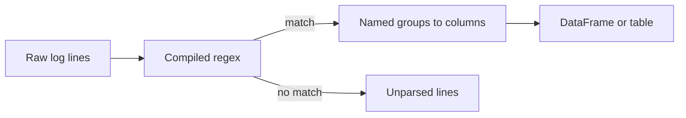

## Introduction

Raw text rarely arrives in tidy columns. Log lines, free-text phone numbers and file names with embedded dates all need pattern matching. Regular expressions describe those patterns.

## Definition

A regular expression is a pattern language for text. Python's `re` module compiles patterns and searches strings with them. Groups `( )` capture parts of a match; named groups `(?P<name>...)` capture by name.

## Why it matters

- Parse semi-structured logs into columns.
- Validate formats such as emails, postcodes and IDs before loading.
- Extract partition dates from file names like `orders_2024-03-01.csv`.

## How it works

1. `re.compile` turns the pattern into a matcher object.
2. `match` anchors at the start of the string, `fullmatch` at both ends, and `search` scans for the first match anywhere.
3. `findall` and `finditer` return every match; `sub` replaces matches.
4. Quantifiers (`*`, `+`, `?`, `{m,n}`) are greedy by default; add `?` for lazy matching.

## Syntax and configuration

```python-syntax
import re
\d digit   \w word char   \s whitespace   .  any char   ^ $ anchors
[A-Z]  class    [^,]  negated class    a|b  alternation
*  +  ?  {3}  {2,5}       quantifiers;  *?  +?  lazy
(...) group   (?P<name>...) named group   (?:...) non-capturing

pattern = re.compile(r"(?P<year>\d{4})-(?P<month>\d{2})", re.IGNORECASE)
pattern.search(s); pattern.fullmatch(s); pattern.findall(s); pattern.sub(repl, s)
df["col"].str.extract(r"(\d+)"); df["col"].str.contains(r"^A", regex=True)
```

Always use raw strings (`r"..."`) so backslashes reach the regex engine unchanged.

## Examples

```python
import re

print(re.search(r"\d+", "order 10248 shipped").group())          # 10248
print(re.findall(r"\b[A-Z]{5}\b", "ALFKI and BONAP ordered"))     # ['ALFKI', 'BONAP']
print(re.sub(r"\s+", " ", "  too   many \t spaces ").strip())     # too many spaces
print(re.sub(r"\D", "", "(030) 555-0123"))                       # 0305550123

m = re.search(r"orders_(?P<date>\d{4}-\d{2}-\d{2})\.csv$", "s3/raw/orders_2024-03-01.csv")
print(m.group("date"))                                           # 2024-03-01

email = re.compile(r"[\w.+-]+@[\w-]+\.[\w.]+")
for value in ["a.b@example.com", "bad@", "x@y.org"]:
    print(value, bool(email.fullmatch(value)))

print(re.findall(r"<.+>", "<a><b>"), re.findall(r"<.+?>", "<a><b>"))  # greedy vs lazy
```

## Architecture

A compiled pattern turns each raw line into named fields, or flags it as unparsed.



## Practical example

Parse web server logs into a DataFrame, then aggregate.

```python
import re
import pandas as pd

log = """\
10.0.0.1 - - [01/Mar/2024:10:00:01 +0000] "GET /api/orders HTTP/1.1" 200 512
10.0.0.2 - - [01/Mar/2024:10:00:02 +0000] "POST /api/orders HTTP/1.1" 201 128
garbage line
10.0.0.1 - - [01/Mar/2024:10:00:05 +0000] "GET /api/customers HTTP/1.1" 500 64
"""

LINE = re.compile(
    r'(?P<ip>\d+\.\d+\.\d+\.\d+) \S+ \S+ \[(?P<ts>[^\]]+)\] '
    r'"(?P<method>[A-Z]+) (?P<path>\S+) [^"]*" (?P<status>\d{3}) (?P<bytes>\d+)'
)

rows, unparsed = [], []
for line in log.splitlines():
    m = LINE.match(line)
    if m:
        rows.append(m.groupdict())
    else:
        unparsed.append(line)

df = pd.DataFrame(rows).astype({"status": int, "bytes": int})
df["ts"] = pd.to_datetime(df["ts"], format="%d/%b/%Y:%H:%M:%S %z")
print(df[["ip", "method", "path", "status"]])
print("errors:", (df["status"] >= 500).sum(), "| unparsed:", unparsed)

# the same idea, vectorised with pandas
s = pd.Series(["SKU-001 x2", "SKU-042 x10", "none"])
print(s.str.extract(r"SKU-(?P<sku>\d+) x(?P<qty>\d+)"))
```

## Exercises

1. Extract all 4-digit years from `"from 1996 to 1998, not 12345"`.

<details><summary>Answer</summary>

`re.findall(r"\b\d{4}\b", text)` gives `['1996', '1998']`. Word boundaries exclude `12345`.

</details>

2. What is the difference between `re.match` and `re.search`?

<details><summary>Answer</summary>

`match` only matches at the start of the string. `search` finds the first match anywhere.

</details>

3. Mask all but the last four digits of a card number `"4111 1111 1111 1234"`.

<details><summary>Answer</summary>

`re.sub(r"\d(?=(?:\s?\d){4})", "*", s)`, or strip spaces and use `"*" * (len(d) - 4) + d[-4:]`.

</details>

## Common mistakes

- Forgetting raw strings, so `"\b"` becomes a backspace character.
- Using `search` to validate when you meant `fullmatch`, so `"x12345y"` passes a digits check.
- Greedy `.*` swallowing too much; use `.*?` or a negated class like `[^"]*`.
- Not escaping literal dots: `.` matches any character. Use `\.` or `re.escape`.
- Writing a giant regex for structured formats. Use `csv`, `json` or a real parser instead.

## Performance and best practices

- Compile patterns once outside loops (Python caches some, but explicit is clearer).
- Prefer pandas `.str.extract` and `.str.contains` over row-by-row loops on DataFrames.
- Anchor patterns and use specific classes to avoid catastrophic backtracking.
- Keep a count of unparsed lines and alert on it.
- Use `re.VERBOSE` with comments for long patterns.

## Interview questions

### What are named groups and why use them?

`(?P<name>...)` captures a group you can read with `m.group("name")` or `m.groupdict()`. Code stays readable and survives pattern changes that shift group numbers.

### What is the difference between greedy and lazy quantifiers?

Greedy quantifiers match as much as possible, then backtrack. Lazy ones (`*?`, `+?`) match as little as possible.

### How would you parse a 50 GB log file with regex?

Stream it line by line, use one compiled pattern, write parsed rows in batches and count unmatched lines. Or use Spark with `regexp_extract` for parallelism.

### When should you not use regex?

For nested or well-specified formats such as JSON, HTML, XML or CSV. Use a proper parser.

## Quick revision

- Use raw strings: `r"\d+"`.
- `match` checks the start, `fullmatch` the whole string, `search` anywhere.
- `findall`, `finditer`, `sub` for multiple matches and replacements.
- Named groups plus `groupdict()` map to columns.
- `.*?` is lazy; `[^x]*` is often better.
- pandas `.str.extract` vectorises regex on columns.
