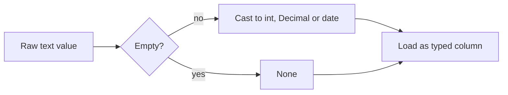

## Introduction

Raw data arrives as text. Turning `"19.99"`, `""` and `"1997-07-04"` into the right Python types is the first step of every load.

## Definition

A variable is a name bound to an object. Core scalar types: `int`, `float`, `bool`, `str`, `NoneType`, plus `decimal.Decimal` and `datetime` from the standard library.

## Why it matters

- Wrong types give wrong answers: `"10" + "5"` is `"105"`.
- `float` cannot store money exactly.
- `None` maps to SQL `NULL`; empty strings do not.

## How it works

- Assignment binds a name; it never copies the object.
- `int`, `float`, `str`, `tuple` are immutable; operations create new objects.
- Conversion is explicit: `int("42")`, `float("3.5")`, `str(7)`.
- `type(x)` and `isinstance(x, int)` inspect types.

## Syntax and configuration

```python-syntax
name: type = value          # type hint is optional
count = int(text)
price = Decimal(text)
when = datetime.strptime(text, "%Y-%m-%d")
missing = None
```

## Examples

```python
from decimal import Decimal
from datetime import datetime, date

print(0.1 + 0.2 == 0.3)                       # False
print(Decimal("0.1") + Decimal("0.2"))        # 0.3
print(int("42") + 1, float("3.5") * 2)
d = datetime.strptime("1997-07-04", "%Y-%m-%d").date()
print(d, d.isoformat(), (date(1998, 1, 1) - d).days)
print(bool(""), bool("0"), bool(0), None is None)
```

## Architecture

Every incoming value passes through a typing step before it is loaded.



## Practical example

A safe converter for CSV fields:

```python
from decimal import Decimal, InvalidOperation
from datetime import datetime

def to_decimal(text):
    text = (text or "").strip()
    if not text:
        return None
    try:
        return Decimal(text)
    except InvalidOperation:
        return None

def to_date(text):
    text = (text or "").strip()
    return datetime.strptime(text, "%Y-%m-%d").date() if text else None

row = {"unit_price": " 18.00", "discount": "", "order_date": "1996-07-04"}
clean = {
    "unit_price": to_decimal(row["unit_price"]),
    "discount": to_decimal(row["discount"]),
    "order_date": to_date(row["order_date"]),
}
print(clean)
```

## Exercises

1. What does `int("3.0")` do?
   <details><summary>Answer</summary>

   Raises `ValueError`. Use `int(float("3.0"))` or `Decimal`.
   </details>
2. Why use `Decimal("19.99")` and not `Decimal(19.99)`?
   <details><summary>Answer</summary>

   The float literal is already imprecise; passing a string keeps the exact value.
   </details>
3. Is `bool("False")` true or false?
   <details><summary>Answer</summary>

   `True`: any non-empty string is truthy.
   </details>

## Common mistakes

- Using `float` for money; use `Decimal` (maps to PostgreSQL `numeric`).
- Treating `""` and `None` the same without deciding explicitly.
- Comparing with `== None` instead of `is None`.
- Parsing dates without an explicit format.

## Performance and best practices

- Convert once, at the edge of the pipeline.
- For large columns, let pandas do vectorised conversion (`pd.to_numeric`, `pd.to_datetime`).
- Use timezone-aware datetimes (`datetime.now(timezone.utc)`) for event times.

## Interview questions

### Why is `0.1 + 0.2 != 0.3` in Python?

Floats are binary IEEE 754; 0.1 has no exact binary form. Use `Decimal` or `math.isclose`.

### What is the difference between `is` and `==`?

`is` checks identity (same object), `==` checks equality. Use `is` for `None`.

### Which types are immutable?

`int`, `float`, `bool`, `str`, `tuple`, `frozenset`, `bytes`.

### How does Python None relate to SQL NULL?

DB-API drivers map `None` to `NULL` both ways.

## Quick revision

- Names bind to objects; types live on objects.
- `Decimal(str)` for money.
- `None` is SQL `NULL`; test with `is None`.
- `datetime.strptime(text, fmt)` parses dates.
- Empty string is falsy, `"0"` is truthy.
