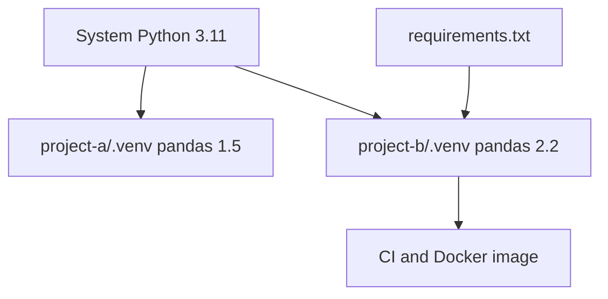

## Introduction

Two pipelines on one machine need pandas 1.5 and pandas 2.2. A single global install cannot satisfy both. A virtual environment gives each project its own interpreter and package set.

## Definition

A virtual environment is a directory with a Python interpreter link and its own `site-packages`. Activating it puts its `bin/` first on `PATH`, so `python` and `pip` use that directory.

## Why it matters

- Reproducible builds: the same `requirements.txt` gives the same packages in CI, Docker and on a laptop.
- No conflicts between projects.
- No `sudo pip install` into the system Python.

## How it works

1. `python3 -m venv .venv` copies or links the interpreter and writes `pyvenv.cfg`.
2. `source .venv/bin/activate` changes `PATH` and sets `VIRTUAL_ENV`.
3. `pip install` writes into `.venv/lib/pythonX.Y/site-packages`.
4. `sys.prefix` points at the venv; `sys.base_prefix` still points at the base install.

## Syntax and configuration

```bash
python3 -m venv .venv
source .venv/bin/activate          # Windows: .venv\Scripts\activate
python -m pip install --upgrade pip
pip install pandas==2.2.2 psycopg[binary]==3.2.1
pip freeze > requirements.txt
pip install -r requirements.txt    # on another machine
deactivate
```

```text
# requirements.txt
pandas==2.2.2
numpy==1.26.4
psycopg[binary]==3.2.1
```

## Examples

Check from code whether you are inside a venv:

```python
import sys

in_venv = sys.prefix != sys.base_prefix
print("prefix:", sys.prefix)
print("inside a virtual environment:", in_venv)
```

Create a venv programmatically in a temp directory (without pip, so it is fast):

```python
import os
import tempfile
import venv

with tempfile.TemporaryDirectory() as d:
    target = os.path.join(d, "env")
    venv.EnvBuilder(with_pip=False).create(target)
    print(sorted(os.listdir(target)))
    print(open(os.path.join(target, "pyvenv.cfg")).read().splitlines()[0])
```

## Architecture

Each project owns its own environment; the base interpreter is shared read-only.



## Practical example

Parse a `requirements.txt` and flag unpinned packages before a deploy:

```python
import re

requirements = """
pandas==2.2.2
numpy>=1.26
requests
# comment line
psycopg[binary]==3.2.1
"""

unpinned = []
for line in requirements.splitlines():
    line = line.split("#")[0].strip()
    if not line:
        continue
    if "==" not in line:
        unpinned.append(re.split(r"[<>=!\[]", line)[0])
print("unpinned:", unpinned)
```

## Exercises

1. Which command records the exact installed versions?
<details><summary>Answer</summary>

`pip freeze > requirements.txt`.
</details>

2. How do you detect a venv from inside Python?
<details><summary>Answer</summary>

`sys.prefix != sys.base_prefix`.
</details>

3. Should `.venv/` go into git?
<details><summary>Answer</summary>

No. Commit `requirements.txt` (or a lock file) and add `.venv/` to `.gitignore`.
</details>

## Common mistakes

- Running `pip` that belongs to another interpreter. Use `python -m pip`.
- Committing the `.venv` folder.
- Unpinned versions, so a new release breaks the nightly job.
- Moving a venv folder: paths inside are absolute. Recreate it instead.

## Performance and best practices

- One venv per project, named `.venv` at the repo root.
- Pin exact versions for pipelines; use tools such as pip-tools, Poetry or uv for lock files.
- In Docker, install requirements in a separate layer so it caches.
- Use `--no-cache-dir` in images to keep them small.

## Interview questions

### What problem does a virtual environment solve?

It isolates dependencies per project, so different versions of the same package do not conflict and builds are reproducible.

### What does activation actually do?

It prepends the venv `bin/` directory to `PATH` and sets `VIRTUAL_ENV`. You can skip activation and call `.venv/bin/python` directly.

### How do you reproduce an environment on a server?

Create a fresh venv and run `pip install -r requirements.txt` with pinned versions.

### Why use python -m pip instead of pip?

It guarantees pip runs for the same interpreter you call, avoiding installs into the wrong environment.

## Quick revision

- `python3 -m venv .venv`, then `source .venv/bin/activate`.
- `pip freeze > requirements.txt` to pin.
- `pip install -r requirements.txt` to reproduce.
- `sys.prefix != sys.base_prefix` means inside a venv.
- Never commit `.venv`; recreate instead of moving it.
