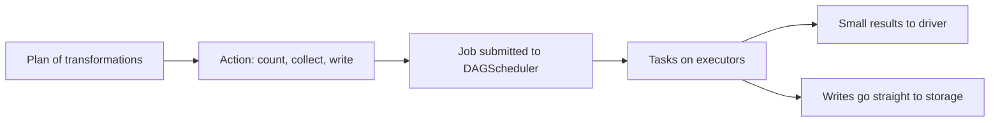

## Introduction

Transformations only build a plan. Actions make Spark do the work. Every action starts at least one job, so knowing which calls are actions explains why a notebook cell suddenly takes minutes.

## Definition

An **action** returns a value to the driver or writes data to external storage, and triggers execution of the plan. Common actions:
- return data: `collect()`, `take(n)`, `head(n)`, `first()`, `show()`, `toPandas()`, `toLocalIterator()`;
- return a value: `count()`, `reduce()` (RDD);
- side effects: `write...save()/parquet()/saveAsTable()`, `foreach()`, `foreachPartition()`.

## Why it matters

- Each action recomputes the plan from the source unless data is cached.
- Driver-returning actions can cause out-of-memory errors.
- Spark UI jobs map one-to-one (roughly) to actions.

## How it works

1. The action submits the plan to the DAGScheduler.
2. Stages and tasks run on executors.
3. Results stream to the driver (for `collect`) or are written by executors directly (for `write`, so data does not pass through the driver).
4. `take(n)` and `show()` scan a few partitions first and scan more only if needed, so they are cheap on simple plans; after a wide transformation they still need the full upstream shuffle.

## Syntax and configuration

```python-syntax
df.count()                         # number of rows
df.show(20, truncate=False)        # prints first 20 rows
rows = df.take(5)                  # list of Row
first = df.first()
pdf = df.limit(1000).toPandas()    # bounded transfer to the driver

df.write.mode("overwrite").parquet("/out/data")
df.write.mode("append").saveAsTable("analytics.events")

def send(partition):
    # open one connection per partition, not per row
    for row in partition:
        pass

df.foreachPartition(send)
```

## Examples

Two actions on the same uncached DataFrame read the source twice:

```python-syntax
clean = spark.read.parquet("/data/events").filter("event = 'purchase'")
n = clean.count()                         # job 1: read + filter
clean.write.parquet("/out/purchases")     # job 2: read + filter again
```

Caching avoids the second read:

```python-syntax
clean = clean.cache()
n = clean.count()                         # materialises the cache
clean.write.parquet("/out/purchases")     # reads from cache
clean.unpersist()
```

pandas has no lazy plan; each line runs immediately. The closest analogy for `take(3)` and `count()`:

```python
import pandas as pd

df = pd.DataFrame({"event": ["purchase", "view", "purchase", "purchase"], "amount": [10, 0, 5, 7]})
clean = df[df["event"] == "purchase"]
print(clean.head(3).to_string(index=False))   # like take(3)
print(len(clean))                            # like count()
```

## Architecture



## Practical example

A notebook ran `df.count()` after every step to "check progress", turning one job into twelve full scans of a 500 GB table. Removing the counts and adding one final validation query on the written output cut runtime from 40 minutes to 6.

## Exercises

1. Is `df.write.parquet(path)` an action?
<details><summary>Answer</summary>Yes. It triggers a job, and executors write their partitions directly.</details>

2. Why is `df.toPandas()` risky?
<details><summary>Answer</summary>It collects all rows to the driver. Large data causes driver out-of-memory or exceeds `spark.driver.maxResultSize`.</details>

3. What is the difference between `foreach` and `foreachPartition` for writing to an API?
<details><summary>Answer</summary>`foreachPartition` lets you open one connection per partition and batch calls; `foreach` runs per row.</details>

## Common mistakes

- `collect()` on large data.
- Debug `count()` and `show()` calls left in production code.
- Multiple actions on an expensive, uncached DataFrame.
- Assuming `show()` order is meaningful without `orderBy`.

## Performance and best practices

- Write results to storage instead of collecting them.
- Use `limit()` before `toPandas()`.
- Cache only when the same DataFrame feeds several actions.
- Enable Arrow (`spark.sql.execution.arrow.pyspark.enabled=true`) to speed up `toPandas()`.

## Interview questions

### What is the difference between a transformation and an action?

A transformation returns a new DataFrame lazily. An action triggers execution and returns a result to the driver or writes output.

### Name some actions.

`count`, `collect`, `take`, `first`, `show`, `toPandas`, `foreach`, `foreachPartition`, and `write` operations.

### Why might two actions on the same DataFrame be slow?

Each action re-executes the whole plan from the source unless the DataFrame is cached or persisted.

### Does data pass through the driver when writing to Parquet?

No. Each executor writes its own partitions; the driver only coordinates the commit.

## Quick revision

- Actions trigger jobs; transformations do not.
- `collect`/`toPandas` bring data to the driver: keep it small.
- Writes run on executors.
- Each action recomputes unless cached.
- Remove debug actions from production code.
