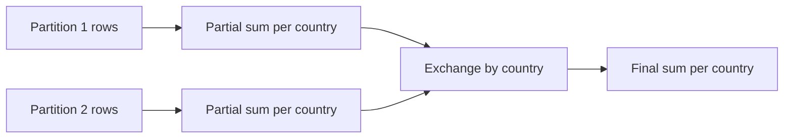

## Introduction

Aggregations turn many rows into summaries: revenue per day, users per country. In Spark they also move data, because every row with the same key must end up in the same place. Spark reduces that cost by aggregating locally first.

## Definition

- `df.groupBy(cols).agg(...)` groups rows and computes aggregate functions (`sum`, `count`, `avg`, `min`, `max`, `countDistinct`, `approx_count_distinct`, `collect_list`, `collect_set`, `percentile_approx`).
- **Window functions** (`F.row_number().over(Window.partitionBy(...).orderBy(...))`) compute per-row results over a group without collapsing rows.
- `groupBy(...).pivot(col, values).agg(...)` turns values into columns.
- `rollup` and `cube` produce subtotals.

## Why it matters

- Almost every reporting job ends in an aggregation.
- Choosing `approx_count_distinct` over `countDistinct` can save huge shuffles.
- Window functions over a skewed partition key can overload one task.

## How it works

For `groupBy("country").agg(F.sum("amount"))`, the physical plan is usually:
1. `HashAggregate (partial)` in each map task: one partial sum per country per partition.
2. `Exchange hashpartitioning(country, 200)`: shuffle only the partial results.
3. `HashAggregate (final)`: combine partials per country.

This is the DataFrame version of the RDD map-side combine. Aggregates that cannot be partially combined well (`collect_list`, exact `countDistinct` on many values) shuffle much more data. When the hash map does not fit in memory, Spark falls back to sort-based aggregation.

Window functions need an `Exchange` on the `partitionBy` keys plus a sort; a window with no `partitionBy` moves all data to a single partition.

## Syntax and configuration

```python-syntax
from pyspark.sql import functions as F, Window

summary = (
    orders.groupBy("country", "order_date")
          .agg(F.count("*").alias("orders"),
               F.sum("amount").alias("revenue"),
               F.avg("amount").alias("avg_amount"),
               F.approx_count_distinct("customer_id").alias("customers"))
)

w = Window.partitionBy("customer_id").orderBy(F.col("order_date").desc())
latest = (orders.withColumn("rn", F.row_number().over(w))
                .filter("rn = 1").drop("rn"))

running = orders.withColumn(
    "running_total",
    F.sum("amount").over(Window.partitionBy("customer_id").orderBy("order_date")
                         .rowsBetween(Window.unboundedPreceding, Window.currentRow)))

pivoted = orders.groupBy("country").pivot("status", ["shipped", "cancelled"]).sum("amount")
```

## Examples

The same three results in pandas:

```python
import pandas as pd

orders = pd.DataFrame({
    "customer_id": [1, 1, 2, 2, 3],
    "country": ["DE", "DE", "FR", "FR", "DE"],
    "order_date": pd.to_datetime(["2024-01-01", "2024-01-05", "2024-01-02", "2024-01-03", "2024-01-04"]),
    "status": ["shipped", "cancelled", "shipped", "shipped", "shipped"],
    "amount": [100.0, 50.0, 70.0, 30.0, 20.0],
})

summary = orders.groupby("country").agg(orders=("amount", "size"), revenue=("amount", "sum"))
print(summary)

latest = (orders.sort_values("order_date", ascending=False)
                .groupby("customer_id").head(1).sort_values("customer_id"))
print(latest[["customer_id", "order_date", "amount"]].to_string(index=False))

pivoted = orders.pivot_table(index="country", columns="status", values="amount", aggfunc="sum")
print(pivoted)
```

## Architecture

Partial aggregation shrinks the data before the shuffle.



## Practical example

A daily active users report used `countDistinct("user_id")` per country over 5 billion events. Switching to `approx_count_distinct("user_id", rsd=0.01)` (HyperLogLog++, about 1% error) cut shuffle size from hundreds of GB to MBs because each partition sends a small sketch instead of distinct IDs.

## Exercises

1. Why does `groupBy().sum()` shuffle less data than `groupBy().agg(F.collect_list(...))`?
<details><summary>Answer</summary>Sums combine into one value per key per partition before the shuffle. `collect_list` must ship every value.</details>

2. What happens with `Window.orderBy("ts")` and no `partitionBy`?
<details><summary>Answer</summary>All rows are moved to one partition and processed by one task. Spark logs a warning; it does not scale.</details>

3. How do you get the latest order per customer?
<details><summary>Answer</summary>`row_number()` over a window partitioned by customer and ordered by date descending, then keep `rn = 1`.</details>

## Common mistakes

- Windows with no `partitionBy` on large data.
- `pivot` without listing values: Spark runs an extra job to find distinct values.
- `collect_list` on high-cardinality groups causing out-of-memory.
- Assuming `first()` in `agg` is deterministic without an order.

## Performance and best practices

- Prefer aggregates that combine partially (`sum`, `count`, `min`, `max`, `approx_count_distinct`).
- Filter before grouping.
- Watch for skewed grouping keys; salt them with two-stage aggregation if needed.
- Pass pivot values explicitly.

## Interview questions

### How does Spark execute a groupBy aggregation?

Partial aggregation in each partition, a shuffle of the partial results by key, then final aggregation. This appears as two `HashAggregate` nodes around an `Exchange`.

### What is the difference between groupBy and a window function?

`groupBy` collapses each group into one row. A window function keeps every row and adds a computed value per row.

### How do you speed up a distinct count over billions of rows?

Use `approx_count_distinct`, which uses HyperLogLog++ sketches, when a small error is acceptable.

### How do you handle a skewed groupBy key?

Two-stage aggregation: add a random salt, aggregate by key and salt, then aggregate again by key alone. AQE skew handling targets joins, not aggregations.

## Quick revision

- `groupBy().agg()` = partial agg → shuffle → final agg.
- Window functions shuffle by `partitionBy` keys and sort.
- No `partitionBy` = one partition.
- `approx_count_distinct` for cheap distinct counts.
- Salt skewed keys with two-stage aggregation.
