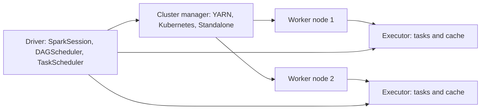
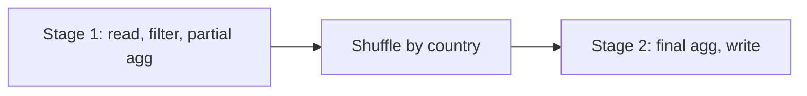

## Introduction

Every Spark program has the same shape: one driver that plans, many executors that do the work, and a cluster manager that hands out machines. Knowing this layout explains most Spark behaviour, from why `collect()` can crash the driver to why a job is split into stages.

## Definition

A **Spark application** consists of:
- a **driver** process that runs your `main` code, holds the `SparkSession` and schedules work;
- a **cluster manager** (Standalone, YARN or Kubernetes; Mesos is deprecated) that allocates resources;
- **executors**, JVM processes on worker nodes that run tasks and store cached data.

Work is split into **jobs** (one per action), **stages** (split at shuffle boundaries) and **tasks** (one per partition per stage).

## Why it matters

- Tuning (memory, cores, partitions) is configured per component.
- Reading the Spark UI requires knowing jobs, stages and tasks.
- Failures make sense once you know where code runs: driver out-of-memory versus executor out-of-memory.

## How it works

1. You call an action such as `count()` or `write`.
2. The driver turns the logical plan into a physical plan, then into a **DAG** of stages.
3. The **DAGScheduler** cuts the DAG at wide dependencies (shuffles). Each stage is a run of narrow transformations.
4. The **TaskScheduler** sends one task per partition to executors with free cores.
5. Stages that produce shuffle data are **ShuffleMapStages**; the final stage is the **ResultStage**.
6. Executors report results and status to the driver; failed tasks are retried (default `spark.task.maxFailures=4`).

## Syntax and configuration

```bash
spark-submit \
  --master yarn \
  --deploy-mode cluster \
  --driver-memory 4g \
  --executor-memory 8g \
  --executor-cores 4 \
  --num-executors 10 \
  --conf spark.sql.shuffle.partitions=200 \
  etl_job.py
```

```python-syntax
from pyspark.sql import SparkSession

spark = SparkSession.builder.appName("arch-demo").getOrCreate()
sc = spark.sparkContext
print(sc.master, sc.applicationId, sc.defaultParallelism)
```

## Examples

This job has one action, so one job. `groupBy` causes a shuffle, so two stages.

```python-syntax
from pyspark.sql import functions as F

orders = spark.read.parquet("s3://bucket/orders/")      # stage 1 reads
result = (
    orders.filter(F.col("status") == "shipped")         # narrow: same stage
          .groupBy("country")                            # wide: stage boundary
          .agg(F.sum("amount").alias("revenue"))
)
result.write.mode("overwrite").parquet("s3://bucket/revenue/")  # action → job
```

## Architecture

The driver asks the cluster manager for executors, then sends tasks directly to them.



A job with one shuffle becomes two stages:



## Practical example

On YARN in cluster mode, the driver runs inside the YARN ApplicationMaster container, so the job survives the client laptop disconnecting. In client mode the driver runs on the machine that ran `spark-submit`, which is handy for notebooks but means the driver dies with that session.

## Exercises

1. A script calls `df.count()` then `df.write.parquet(...)`. How many jobs run?
<details><summary>Answer</summary>At least two, one per action. Some operations (for example schema inference or AQE) can add extra small jobs.</details>

2. A stage reads 300 partitions. How many tasks does it have?
<details><summary>Answer</summary>300, one task per partition.</details>

3. Where does a Python lambda passed to `rdd.map` run?
<details><summary>Answer</summary>In Python worker processes started by the executors, not on the driver.</details>

## Common mistakes

- Thinking the driver processes data: it only plans, unless you `collect()`.
- Confusing jobs, stages and tasks in the Spark UI.
- Giving the driver too little memory while broadcasting or collecting large data.
- Running production jobs in client mode from a laptop.

## Performance and best practices

- Size executors moderately (for example 4–5 cores, 8–32 GB) rather than one huge executor per node.
- Use dynamic allocation (`spark.dynamicAllocation.enabled`) for shared clusters.
- Fewer shuffles means fewer stages and less I/O.
- Use the Spark UI's Stages tab to find slow or skewed stages.

## Interview questions

### What are jobs, stages and tasks?

A job is triggered by an action. It is split into stages at shuffle boundaries. Each stage has one task per partition, and tasks run in parallel on executor cores.

### What does the cluster manager do?

It allocates resources (containers or pods) for the driver and executors. It does not schedule Spark tasks; the driver does that.

### What is the difference between client and cluster deploy mode?

In client mode the driver runs where you submit the job. In cluster mode the driver runs on a node inside the cluster.

### What creates a new stage?

A wide dependency, meaning a shuffle, such as from `groupBy`, `join` (non-broadcast), `repartition` or `distinct`.

## Quick revision

- Driver plans and schedules; executors run tasks and cache data.
- Cluster manager allocates resources: Standalone, YARN, Kubernetes.
- Action → job → stages (cut at shuffles) → tasks (one per partition).
- DAGScheduler builds stages; TaskScheduler launches tasks.
- Cluster mode for production; client mode for interactive work.
