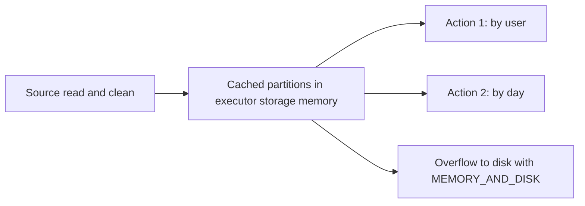

## Introduction

Each action replays the plan from the source. When the same expensive DataFrame feeds several actions, caching keeps its partitions on executors so later actions skip the recomputation.

## Definition

- `df.persist(storageLevel)` marks a DataFrame to be stored when first computed.
- `df.cache()` is `persist()` with the default level. For **DataFrames** the default is `MEMORY_AND_DISK` (in Spark 3.5 the Python default is `MEMORY_AND_DISK_DESER`); for **RDDs** `cache()` is `MEMORY_ONLY`.
- Storage levels:
  - `MEMORY_ONLY`: in memory; partitions that do not fit are recomputed.
  - `MEMORY_AND_DISK`: spills partitions that do not fit to disk.
  - `DISK_ONLY`: on disk only.
  - `_2` variants (for example `MEMORY_AND_DISK_2`): replicated on two executors.
  - `OFF_HEAP`: off-heap memory (needs `spark.memory.offHeap.enabled`).
- DataFrame caches use an in-memory **columnar** compressed format.
- `df.unpersist()` removes it.
- `checkpoint()` writes data to reliable storage and **cuts lineage**; `localCheckpoint()` uses executor storage (faster, not fault tolerant).

## Why it matters

- Iterative algorithms and multi-output jobs can run many times faster.
- Over-caching steals execution memory and causes spills or evictions.

## How it works

1. `persist()` is lazy: it only marks the plan.
2. The first action computes the partitions and stores them in the executors' storage memory (block manager).
3. Later plans that contain the same analysed plan reuse the cached data (`InMemoryTableScan` in `explain()`).
4. Under memory pressure, cached blocks are evicted LRU; `MEMORY_AND_DISK` blocks go to disk, `MEMORY_ONLY` blocks are recomputed when needed.
5. Lost cached partitions are rebuilt from lineage (unless a replicated copy exists).

## Syntax and configuration

```python-syntax
from pyspark import StorageLevel
from pyspark.sql import functions as F

clean = (spark.read.parquet("/data/events")
              .filter(F.col("event") == "purchase")
              .select("user_id", "amount", "ts"))

clean.cache()            # MEMORY_AND_DISK for DataFrames
clean.count()            # materialise

by_user = clean.groupBy("user_id").sum("amount")
by_day = clean.groupBy(F.to_date("ts")).sum("amount")
by_user.write.parquet("/out/by_user")
by_day.write.parquet("/out/by_day")

clean.unpersist()

big = clean.persist(StorageLevel.DISK_ONLY)
print(big.storageLevel)

spark.sparkContext.setCheckpointDir("/tmp/checkpoints")
stable = clean.checkpoint()      # eager by default; lineage truncated

spark.sql("CACHE TABLE hot_users AS SELECT * FROM users WHERE active")
spark.catalog.clearCache()
```

## Examples

The effect of caching, simulated with a counter: without a cache the expensive step runs once per action.

```python
import pandas as pd

calls = {"n": 0}

def expensive_clean():
    calls["n"] += 1
    df = pd.DataFrame({"user_id": [1, 2, 1, 3], "amount": [10, 20, 30, 40]})
    return df[df["amount"] > 10]

# no cache: two "actions", two computations
a = expensive_clean().groupby("user_id")["amount"].sum()
b = expensive_clean()["amount"].sum()
print("without cache:", calls["n"])

calls["n"] = 0
cached = expensive_clean()            # computed once
a = cached.groupby("user_id")["amount"].sum()
b = cached["amount"].sum()
print("with cache:", calls["n"])
print(a.to_dict(), b)
```

## Architecture



## Practical example

A feature pipeline built a cleaned 50 GB table and derived 8 feature sets from it. Without caching, Spark read and cleaned the source 8 times. Caching with `MEMORY_AND_DISK` and one `count()` to materialise cut runtime from 70 to 18 minutes. Unpersisting after the last write freed memory for the final heavy join.

## Exercises

1. Is `df.cache()` executed immediately?
<details><summary>Answer</summary>No. It is lazy; the data is stored when the first action computes it.</details>

2. What is the default storage level of `cache()` for DataFrames and for RDDs?
<details><summary>Answer</summary>DataFrames: `MEMORY_AND_DISK` (shown as `MEMORY_AND_DISK_DESER` in PySpark 3.5). RDDs: `MEMORY_ONLY`.</details>

3. When should you checkpoint instead of cache?
<details><summary>Answer</summary>When lineage is very long (iterative jobs) and you want to truncate it, or need the data to survive executor loss without recomputing from the original source.</details>

## Common mistakes

- Caching a DataFrame used only once.
- Caching before filtering and selecting, which stores unneeded data.
- Forgetting `unpersist()`, keeping memory busy.
- Calling `df.cache()` and then using a different DataFrame (`df.filter(...)`) built before it; the cache is matched by plan, so build later steps from the cached one.
- Expecting `take(1)` to fully materialise the cache (it computes only some partitions).

## Performance and best practices

- Cache only data reused by two or more actions, and only after reducing it.
- Use `MEMORY_AND_DISK` for large data to avoid recomputation storms.
- Materialise with `count()`; check the Storage tab in the Spark UI.
- Unpersist when done; use checkpoints for long lineages.

## Interview questions

### What is the difference between cache and persist?

`cache()` is `persist()` with the default storage level. `persist()` lets you choose the level, such as `MEMORY_ONLY`, `MEMORY_AND_DISK`, `DISK_ONLY` or replicated `_2` levels.

### What storage levels exist?

`MEMORY_ONLY`, `MEMORY_AND_DISK`, `DISK_ONLY`, `OFF_HEAP` and their `_2` replicated variants; Scala/Java also have serialised `_SER` variants.

### When does caching hurt?

When data is used only once, is huge relative to memory, or crowds out execution memory, causing spills and evictions.

### Cache vs checkpoint?

Cache keeps lineage and may be evicted. Checkpoint writes to reliable storage and truncates lineage.

## Quick revision

- `cache()` = `persist()` with default level.
- DataFrame default: `MEMORY_AND_DISK`; RDD default: `MEMORY_ONLY`.
- Lazy: materialised by the first action.
- Cache only reused, reduced data; `unpersist()` after.
- Checkpoint cuts lineage.
