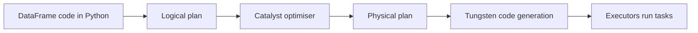

## Introduction

A Spark DataFrame looks like a pandas DataFrame or a SQL table: named, typed columns. Unlike pandas, it is distributed across executors and lazily evaluated. It is the main API for PySpark work.

## Definition

A **DataFrame** is a distributed collection of rows organised into named columns with a **schema** (`StructType`). In Scala it is `Dataset[Row]`. Operations on it build a logical plan that the Catalyst optimiser compiles into an efficient physical plan.

## Why it matters

- Same performance from Python, SQL and Scala, because the plan executes in the JVM.
- Catalyst applies predicate pushdown, column pruning and join selection automatically.
- Tungsten stores rows in a compact binary format and generates code for whole stages.

## How it works

- Reading defines a source; nothing is loaded until an action.
- Each method (`select`, `filter`, `withColumn`, ...) returns a **new** immutable DataFrame with a bigger plan.
- `df.schema`, `df.printSchema()` and `df.dtypes` describe columns without running a job (unless schema inference needs to read data).
- Columns are referenced with `F.col("x")`, `df["x"]` or `df.x`.

## Syntax and configuration

```python-syntax
from pyspark.sql import SparkSession, functions as F
from pyspark.sql.types import StructType, StructField, StringType, DoubleType, DateType

spark = SparkSession.builder.appName("df").getOrCreate()

schema = StructType([
    StructField("order_id", StringType(), False),
    StructField("country", StringType(), True),
    StructField("amount", DoubleType(), True),
    StructField("order_date", DateType(), True),
])

orders = spark.read.csv("/data/orders.csv", header=True, schema=schema)
orders.printSchema()

small = spark.createDataFrame(
    [("o1", "DE", 120.0), ("o2", "FR", 80.0)],
    ["order_id", "country", "amount"],
)

(orders.select("order_id", "country", "amount")
       .filter(F.col("amount") > 100)
       .withColumn("amount_eur", F.round(F.col("amount") * 0.92, 2))
       .write.mode("overwrite").partitionBy("country").parquet("/out/orders"))
```

## Examples

A PySpark pipeline and its pandas equivalent:

```python-syntax
result = (
    orders.filter(F.col("amount") > 50)
          .withColumn("band", F.when(F.col("amount") >= 100, "high").otherwise("low"))
          .select("order_id", "country", "band")
          .orderBy("order_id")
)
result.show()
```

```python
import pandas as pd

orders = pd.DataFrame({
    "order_id": ["o1", "o2", "o3", "o4"],
    "country": ["DE", "FR", "DE", "US"],
    "amount": [120.0, 80.0, 40.0, 300.0],
})
result = orders[orders["amount"] > 50].copy()
result["band"] = result["amount"].apply(lambda a: "high" if a >= 100 else "low")
print(result[["order_id", "country", "band"]].sort_values("order_id").to_string(index=False))
```

## Architecture



## Practical example

Ingest daily CSV exports: read with an explicit schema (avoids an extra pass for `inferSchema` and wrong types), cast and clean columns, deduplicate with `dropDuplicates(["order_id"])`, and write Parquet partitioned by `order_date`. Downstream jobs then read only the needed dates and columns.

## Exercises

1. Does `df.withColumn("x", F.lit(1))` change `df`?
<details><summary>Answer</summary>No. DataFrames are immutable; it returns a new DataFrame.</details>

2. Why provide a schema instead of `inferSchema=True` for CSV?
<details><summary>Answer</summary>Inference needs an extra pass over the data and can guess wrong types. An explicit schema is faster and stable.</details>

3. Does a PySpark DataFrame filter run Python code per row?
<details><summary>Answer</summary>No. Built-in column expressions run in the JVM. Only Python UDFs run Python per row (or per batch for pandas UDFs).</details>

## Common mistakes

- Treating Spark DataFrames like pandas (`df["x"] = ...` does not work).
- Python UDFs where a built-in function exists.
- `inferSchema` on large CSV files.
- Calling `withColumn` in a long loop, which builds huge plans; use one `select` or `withColumns`.

## Performance and best practices

- Use built-in functions from `pyspark.sql.functions`.
- Select only needed columns early; Parquet then reads fewer bytes.
- Use Parquet or Delta rather than CSV for intermediate data.
- Use `df.explain("formatted")` to see the plan.

## Interview questions

### What is a DataFrame in Spark?

A distributed, immutable table with a schema. Operations build a logical plan that Catalyst optimises before execution.

### Why are DataFrames faster than RDDs?

Catalyst can optimise structured operations, and Tungsten uses compact binary storage and whole-stage code generation. RDD lambdas are opaque and, in Python, require serialisation per row.

### What is the difference between a DataFrame and a Dataset?

A Dataset is a typed API in Scala and Java. A DataFrame is `Dataset[Row]`. Python has only DataFrames.

### How do you inspect the plan?

`df.explain()` or `df.explain("formatted")`; `explain(True)` shows the parsed, analysed, optimised and physical plans.

## Quick revision

- DataFrame = distributed table with a schema, immutable, lazy.
- Catalyst optimises; Tungsten executes efficiently.
- Prefer built-in functions to Python UDFs.
- Give explicit schemas for CSV/JSON.
- Write columnar formats, partitioned where useful.
