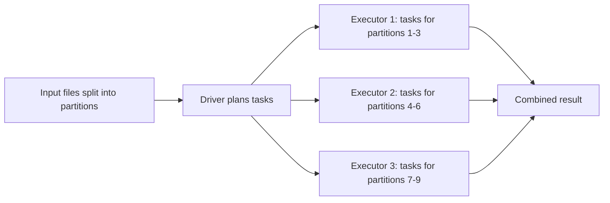

## Introduction

When a dataset no longer fits in one machine's memory, or a job takes hours on one CPU, you split the work. Distributed computing means many machines each process a slice of the data, then combine the results. Spark is the most common engine for doing this with data.

## Definition

**Distributed computing** runs one logical computation on many machines (nodes) that cooperate over a network. Spark splits data into **partitions**, runs the same code on each partition in parallel as **tasks**, and moves data between machines only when a computation needs rows from other partitions (a **shuffle**).

## Why it matters

- **Scale out, not up:** adding ten commodity nodes is cheaper than buying one huge server.
- **Parallelism:** 1 TB split into 8,000 partitions of 128 MB can be processed by hundreds of cores at once.
- **Fault tolerance:** if a node dies, Spark recomputes only the lost partitions from lineage.
- Interviews for data engineering roles almost always start here: "why Spark and not pandas?"

## How it works

1. **Partition the data.** Files are split into chunks (by default up to 128 MB per partition for file sources, `spark.sql.files.maxPartitionBytes`).
2. **Send code to data.** The driver ships the function to executors; executors read their partitions locally where possible (data locality).
3. **Compute locally.** Per-row work such as filtering and projecting needs no communication.
4. **Exchange when needed.** Grouping, joining or sorting by a key needs all rows with the same key together, so data is shuffled across the network.
5. **Combine.** Results are written to storage or collected back to the driver.

The main costs are network and disk I/O during shuffles, and stragglers: one slow task delays the whole stage.

## Syntax and configuration

```python-syntax
from pyspark.sql import SparkSession

spark = (
    SparkSession.builder
    .appName("distributed-demo")
    .master("local[4]")          # 4 local threads; on a cluster use YARN/Kubernetes
    .getOrCreate()
)

df = spark.range(0, 10_000_000)  # one column "id"
print(df.rdd.getNumPartitions()) # how the data is split
print(df.selectExpr("sum(id)").first()[0])
```

## Examples

The same idea in plain Python: split, compute partial results per chunk, combine. This is what Spark does for `sum`, with chunks on different machines.

```python
import pandas as pd

df = pd.DataFrame({"amount": range(1, 101)})
partitions = [df.iloc[i:i + 25] for i in range(0, len(df), 25)]   # 4 "partitions"

partials = [p["amount"].sum() for p in partitions]   # map side: one task per partition
total = sum(partials)                                 # reduce side: combine partials

print(partials)
print(total, total == df["amount"].sum())
```

## Architecture

The driver splits the job into tasks, one per partition, and executors on worker nodes run them in parallel.



## Practical example

A team has 2 TB of click logs per day. pandas on a laptop fails with out-of-memory. On a 20-node Spark cluster with 8 cores each (160 cores), the files are read as about 16,000 partitions of 128 MB. Filtering bot traffic runs per partition with no network traffic. Counting clicks per page needs a shuffle by `page_id`. The job finishes in minutes because 160 tasks run at a time.

## Exercises

1. A 10 GB Parquet dataset is read with default settings. About how many partitions do you expect?
<details><summary>Answer</summary>About 80 (10 GB / 128 MB), depending on file sizes and compression; small files can each become their own partition.</details>

2. Which of these needs data from other partitions: `filter`, `groupBy().count()`, `withColumn`?
<details><summary>Answer</summary>Only `groupBy().count()`. It must bring rows with the same key together, which needs a shuffle.</details>

3. Why can a job with 1,000 tasks be slow even if 999 finish in 10 seconds?
<details><summary>Answer</summary>The stage ends only when its last task ends. One straggler, often caused by a skewed partition, sets the stage time.</details>

## Common mistakes

- Using Spark for small data that fits in pandas: startup and scheduling overhead dominate.
- Assuming more nodes always help: shuffles and skew limit scaling.
- Calling `collect()` on large results, which pulls everything back to one machine.
- Ignoring data locality: reading remote data adds network cost.

## Performance and best practices

- Aim for partitions of roughly 100–200 MB and at least 2–3 tasks per core.
- Minimise shuffles; filter and project early so less data moves.
- Prefer columnar formats (Parquet, ORC) so executors read only needed columns.
- Watch for skew: one huge key means one huge task.

## Interview questions

### Why use Spark instead of pandas?

pandas runs on one machine and needs the data in memory. Spark splits data into partitions and processes them in parallel across a cluster, with fault tolerance. For data that fits in memory, pandas is often faster.

### What is a partition?

A chunk of the dataset that one task processes. The number of partitions sets the maximum parallelism of a stage.

### How does Spark handle a failed node?

It tracks lineage, the chain of transformations that produced each partition. Lost partitions are recomputed from the source or from shuffle files that still exist.

### What is data locality?

Running a task on the node that already holds its data, so it is read from local disk or memory instead of over the network.

## Quick revision

- Distributed computing: one job, many machines, data split into partitions.
- One task per partition; tasks in a stage run in parallel.
- Per-row work is local; key-based work needs a shuffle.
- Default file partition size is 128 MB.
- Lineage gives fault tolerance by recomputation.
- Stragglers and skew set the speed of a stage.
