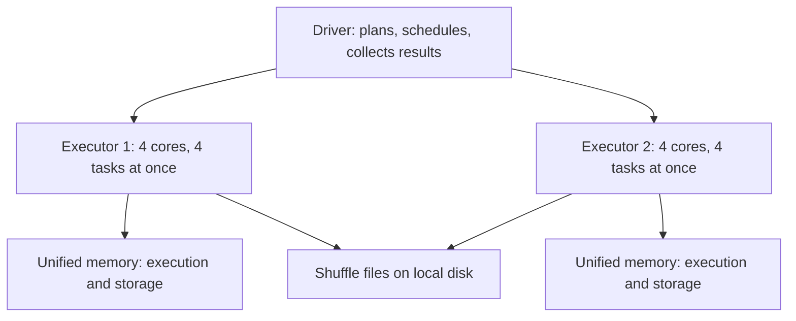

## Introduction

Most Spark out-of-memory errors come from not knowing what runs where. The driver is the brain and runs your script; executors are the muscle and process partitions. Each has its own memory and its own failure modes.

## Definition

- The **driver** runs the application's main program, creates the `SparkSession`, builds plans, schedules tasks and receives results of actions such as `collect()`.
- An **executor** is a JVM process on a worker node. It runs tasks in parallel, one per core (`spark.executor.cores`), stores cached partitions and writes shuffle files.

## Why it matters

- `collect()`, `toPandas()` and broadcast building load data into the **driver**.
- Joins, aggregations and caching use **executor** memory.
- Cluster cost depends on executor count, cores and memory.

## How it works

Executor memory (`spark.executor.memory`) is the JVM heap. Under unified memory management:
- 300 MB is reserved.
- `spark.memory.fraction` (default 0.6) of the rest is **unified memory**, shared between **execution** (shuffles, joins, sorts, aggregations) and **storage** (cache, broadcast).
- `spark.memory.storageFraction` (default 0.5) of unified memory is protected for storage; execution can evict cached blocks above that line, but storage cannot evict execution memory.
- The remaining 40% is **user memory** for your data structures and Spark metadata.

Outside the heap, `spark.executor.memoryOverhead` (default max(384 MB, 10% of executor memory)) covers off-heap use, including Python worker processes in PySpark.

Parallelism: total concurrent tasks = executors × `spark.executor.cores` (each task uses `spark.task.cpus`, default 1).

## Syntax and configuration

```python-syntax
from pyspark.sql import SparkSession

spark = (
    SparkSession.builder
    .appName("sizing")
    .config("spark.driver.memory", "4g")          # only effective before the JVM starts (spark-submit)
    .config("spark.executor.memory", "16g")
    .config("spark.executor.cores", "4")
    .config("spark.executor.instances", "10")
    .config("spark.executor.memoryOverhead", "2g")
    .config("spark.driver.maxResultSize", "2g")
    .getOrCreate()
)
```

## Examples

Driver-side versus executor-side work:

```python-syntax
from pyspark.sql import functions as F

df = spark.read.parquet("/data/events")

# Executors: filter and aggregate in parallel
daily = df.groupBy(F.to_date("ts").alias("day")).count()

# Driver: receives the result rows (fine, small)
rows = daily.orderBy("day").collect()

# Dangerous: pulls every event to the driver
# all_events = df.toPandas()
```

The memory split for a 16 GB executor, computed in Python:

```python
heap_mb = 16 * 1024
reserved = 300
usable = heap_mb - reserved
unified = usable * 0.6
storage_protected = unified * 0.5
user = usable - unified
overhead = max(384, heap_mb * 0.10)

for name, mb in [("unified", unified), ("storage protected", storage_protected),
                 ("user", user), ("overhead (off-heap)", overhead)]:
    print(f"{name:20s} {mb / 1024:5.2f} GB")
```

## Architecture



## Practical example

A node has 16 cores and 64 GB. A common layout leaves 1 core and some memory for the OS and node manager, then runs 3 executors of 5 cores each with about 18 GB heap plus about 2 GB overhead. Ten such nodes give 30 executors × 5 cores = 150 concurrent tasks. With 1,500 shuffle partitions, a stage runs in about 10 waves.

## Exercises

1. 20 executors with 4 cores each. How many tasks run at once?
<details><summary>Answer</summary>80.</details>

2. A job fails with `Total size of serialized results ... is bigger than spark.driver.maxResultSize`. What is the cause?
<details><summary>Answer</summary>An action such as `collect()` returned too much data to the driver. Write the result to storage or aggregate further instead.</details>

3. A PySpark UDF job is killed by YARN for exceeding memory limits, but the JVM heap is fine. What do you raise?
<details><summary>Answer</summary>`spark.executor.memoryOverhead`, because Python workers use memory outside the JVM heap.</details>

## Common mistakes

- `toPandas()` or `collect()` on big DataFrames: driver OOM.
- One huge executor per node (for example 64 cores): long GC pauses and poor HDFS throughput.
- Forgetting memory overhead for PySpark.
- Setting `spark.driver.memory` inside an already-running session, where it has no effect.

## Performance and best practices

- 4–5 cores per executor is a common starting point.
- Leave resources for the OS and cluster daemons.
- Keep results small at the driver; write large outputs to storage.
- Use dynamic allocation for variable workloads.

## Interview questions

### What runs on the driver and what runs on executors?

The driver runs your program, builds the plan, schedules tasks and receives action results. Executors run the tasks on partitions, hold cached data and write shuffle files.

### How is executor memory divided?

300 MB reserved; 60% of the rest is unified memory shared by execution and storage (half protected for storage by default); the remaining 40% is user memory. Overhead memory sits outside the heap.

### What happens if an executor dies?

The driver reschedules its tasks on other executors. Lost cached partitions and shuffle outputs are recomputed from lineage, which may rerun earlier stages.

### Why might the driver run out of memory?

Collecting large results, building large broadcast tables, or tracking a huge number of tasks and partitions.

## Quick revision

- Driver: plans, schedules, collects. Executors: run tasks, cache, shuffle files.
- Concurrent tasks = executors × cores per executor.
- Unified memory = 60% of (heap − 300 MB), shared by execution and storage.
- PySpark needs memory overhead for Python workers.
- Avoid `collect()` / `toPandas()` on large data.
