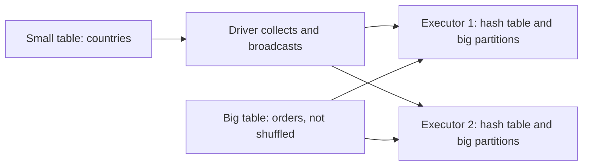
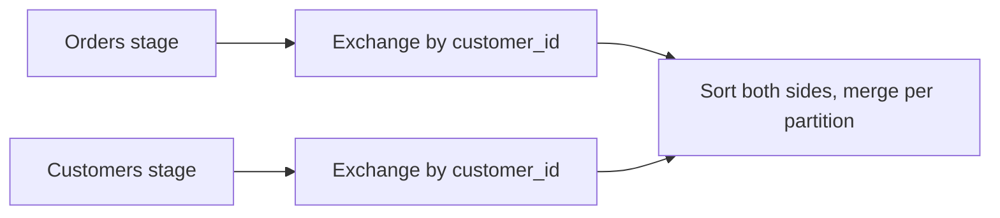

## Introduction

Joins are where most Spark jobs spend their time. The logic is the same as SQL joins, but the physical strategy decides whether terabytes move across the network or only a small table is copied.

## Definition

Join **types** (logical): `inner`, `left`/`left_outer`, `right`, `full`/`outer`, `left_semi`, `left_anti`, `cross`.

Join **strategies** (physical, for equi-joins):
- **Broadcast hash join (BHJ):** the small side is collected and broadcast to every executor; the large side is not shuffled. Used automatically when a side's estimated size is below `spark.sql.autoBroadcastJoinThreshold` (default 10 MB), or forced with a hint.
- **Shuffle hash join (SHJ):** both sides are shuffled by key; a hash table is built per partition from the smaller side.
- **Sort-merge join (SMJ):** both sides are shuffled by key and sorted, then merged. The default for large-to-large joins; can spill to disk.
- **Broadcast nested loop join** and **cartesian product** for non-equi or cross joins: expensive.

## Why it matters

- A broadcast join can turn a 30-minute job into a 2-minute job.
- Skewed keys cause one task to run for hours while others finish in seconds.
- Join choice is visible in `explain()` and the SQL tab of the Spark UI.

## How it works

1. Catalyst estimates sizes. If one side fits the threshold, it plans a BHJ.
2. Otherwise it plans an SMJ with an `Exchange hashpartitioning(key, N)` on both sides, where N is `spark.sql.shuffle.partitions` (default 200).
3. With **AQE** (on by default), after the shuffle stages run Spark knows real sizes. It can:
   - switch SMJ to BHJ if one side turned out small (`spark.sql.adaptive.autoBroadcastJoinThreshold`);
   - split skewed partitions (`spark.sql.adaptive.skewJoin.enabled=true`). A partition is skewed if it is larger than `skewedPartitionFactor` (default 5) times the median and larger than `skewedPartitionThresholdInBytes` (default 256 MB).
4. Broadcasting is not allowed for the preserved side of an outer join: for `left` joins only the right side can be broadcast.

## Syntax and configuration

```python-syntax
from pyspark.sql import functions as F

# Join types
orders.join(customers, on="customer_id", how="inner")
orders.join(customers, on="customer_id", how="left")
customers.join(orders, on="customer_id", how="left_anti")   # customers with no orders
customers.join(orders, on="customer_id", how="left_semi")   # customers with orders, no order columns

# Different column names
orders.join(customers, orders.cust_id == customers.id, "inner")

# Force a broadcast
orders.join(F.broadcast(countries), "country_code")

# Hints: broadcast, merge, shuffle_hash, shuffle_replicate_nl
orders.join(customers.hint("shuffle_hash"), "customer_id")

spark.conf.set("spark.sql.autoBroadcastJoinThreshold", 50 * 1024 * 1024)  # 50 MB
spark.conf.set("spark.sql.adaptive.skewJoin.enabled", "true")
```

Manual salting for skew AQE cannot fix (for example, a skewed aggregation, or older Spark):

```python-syntax
N = 16
orders_salted = orders.withColumn("salt", (F.rand() * N).cast("int"))
customers_salted = customers.crossJoin(spark.range(N).withColumnRenamed("id", "salt"))
joined = orders_salted.join(customers_salted, ["customer_id", "salt"]).drop("salt")
```

## Examples

Semi and anti joins in pandas, showing what Spark returns:

```python
import pandas as pd

customers = pd.DataFrame({"customer_id": [1, 2, 3, 4], "name": ["Ann", "Bo", "Cy", "Di"]})
orders = pd.DataFrame({"order_id": [10, 11, 12], "customer_id": [1, 1, 3]})

inner = customers.merge(orders, on="customer_id", how="inner")
left = customers.merge(orders, on="customer_id", how="left")
semi = customers[customers["customer_id"].isin(orders["customer_id"])]
anti = customers[~customers["customer_id"].isin(orders["customer_id"])]

print("inner rows:", len(inner), "left rows:", len(left))
print("left_semi:", semi["name"].tolist())
print("left_anti:", anti["name"].tolist())
```

## Architecture

Broadcast hash join: the small table goes to every executor, the big table stays put.



Sort-merge join: both sides are shuffled by key into the same partition numbers.



## Practical example

Joining 2 billion clicks to a 3 MB product table took 25 minutes as a sort-merge join because statistics were missing and Spark could not estimate the product table's size. Adding `F.broadcast(products)` removed the shuffle of the clicks table; the job ran in 4 minutes. A second join on `user_id` had one bot user with 40% of the rows; enabling AQE skew join split that partition into many tasks.

## Exercises

1. What join strategy does Spark pick for a 5 MB table joined to a 1 TB table with default settings?
<details><summary>Answer</summary>Broadcast hash join, because 5 MB is below the 10 MB `autoBroadcastJoinThreshold` (if the size estimate is accurate).</details>

2. In `big.join(small, "k", "left")`, which side can be broadcast? Which side in `small.join(big, "k", "left")`?
<details><summary>Answer</summary>Only the right side can be broadcast for a left outer join. In the first case `small` can be broadcast; in the second only `big` could be, so Spark will not broadcast `small`.</details>

3. How do you find customers with no orders in PySpark?
<details><summary>Answer</summary>`customers.join(orders, "customer_id", "left_anti")`.</details>

## Common mistakes

- Broadcasting a table that is too large: driver or executor out-of-memory.
- Joining on columns with different types (string vs int), which adds casts and can break broadcast estimates.
- Duplicate key rows causing row explosion (many-to-many).
- Ambiguous column names after joining on an expression; use `on="col"` or aliases.
- NULL keys: they never match, and many NULLs on one side can create a skewed partition.

## Performance and best practices

- Filter and select columns before joining.
- Broadcast dimension tables; raise the threshold carefully (for example to 50–100 MB).
- Keep AQE and skew join enabled.
- Bucket or pre-partition large tables joined repeatedly on the same key to avoid exchanges.
- Check `explain()` for `BroadcastHashJoin` vs `SortMergeJoin`.

## Interview questions

### What join strategies does Spark have?

Broadcast hash join, shuffle hash join, sort-merge join, broadcast nested loop join and cartesian product. Sort-merge is the default for large equi-joins; broadcast is used when one side is small.

### When does Spark use a broadcast join?

When one side's estimated size is below `spark.sql.autoBroadcastJoinThreshold` (10 MB by default), when hinted with `broadcast()`, or when AQE sees at runtime that a side is small.

### How do you handle a skewed join?

Enable AQE skew join, which splits large partitions. Otherwise salt the skewed key, broadcast the small side, or handle the hot keys separately and union the results.

### What is the difference between left_semi and inner join?

A semi join returns only left-side columns and each left row at most once if it has a match. An inner join returns columns from both sides and duplicates left rows for multiple matches.

## Quick revision

- Strategies: broadcast hash, shuffle hash, sort-merge, nested loop.
- Default broadcast threshold: 10 MB.
- Sort-merge join shuffles both sides to `spark.sql.shuffle.partitions` partitions.
- AQE: runtime switch to broadcast, skew splitting.
- `left_anti` = NOT EXISTS; `left_semi` = EXISTS.
- Salting spreads hot keys across partitions.
