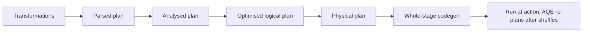

## Introduction

In Spark, `df.filter(...)` returns instantly even on a petabyte table. Nothing has run. Spark records the step and waits. This delay is what lets it optimise the entire pipeline before touching data.

## Definition

**Lazy evaluation** means transformations are recorded in a plan and executed only when an action requires a result. The plan goes through Catalyst's phases:
1. **Parsed (unresolved) logical plan**
2. **Analysed logical plan:** names and types resolved against the catalog
3. **Optimised logical plan:** rule-based rewrites such as predicate pushdown, constant folding, column pruning
4. **Physical plan:** join strategies and operators chosen (with cost-based optimisation if statistics are enabled)
5. **Code generation:** Tungsten's whole-stage codegen compiles operators into Java bytecode

## Why it matters

- Filters written late can be pushed down to the file scan.
- Unused columns are never read from Parquet.
- Errors in logic may only appear when an action runs, far from the line that caused them.

## How it works

- Each transformation adds a node; the DataFrame is just a plan plus a session.
- At the action, Catalyst rewrites the plan as a whole.
- With **Adaptive Query Execution** (AQE, default on since Spark 3.2), the plan is re-optimised at runtime after each shuffle stage using real statistics: coalescing shuffle partitions, switching to broadcast joins, and splitting skewed partitions.
- Analysis errors (unknown column) appear at transformation time; runtime errors (bad cast in ANSI mode, missing file contents) appear at the action.

## Syntax and configuration

```python-syntax
from pyspark.sql import functions as F

df = spark.read.parquet("/data/orders")          # metadata only
q = (df.withColumn("total", F.col("qty") * F.col("price"))
       .filter(F.col("country") == "DE")
       .select("order_id", "total"))

q.explain(mode="extended")   # parsed, analysed, optimised, physical
q.explain(mode="formatted")  # readable physical plan
q.count()                    # now it runs
```

In the optimised plan, the `country = 'DE'` filter moves below the projection and appears as `PushedFilters` in the Parquet scan, and `ReadSchema` lists only the needed columns.

## Examples

Plain Python generators are lazy in the same way: nothing runs until values are consumed.

```python
log = []

def read_rows():
    for i in range(5):
        log.append(f"read {i}")
        yield {"id": i, "country": "DE" if i % 2 == 0 else "FR"}

plan = (r for r in read_rows() if r["country"] == "DE")   # "transformation"
print("after building plan:", log)                         # empty: nothing ran

result = list(plan)                                        # "action"
print("after action:", len(log), "reads")
print(result)
```

Note the difference: a generator cannot reorder steps, while Catalyst can.

## Architecture



## Practical example

An analyst wrote `df.select("*")` on a 300-column Parquet table, then later used only 4 columns. Thanks to lazy evaluation and column pruning, the scan read just those 4 columns. When the same code first called `df.cache()` and `count()` on all columns, the cache stored all 300 and used 20 times more memory.

## Exercises

1. A typo in a column name: does the error appear at `select` or at `count()`?
<details><summary>Answer</summary>At `select`. The analyser resolves column names when the DataFrame is created, so an `AnalysisException` is raised immediately.</details>

2. You filter after a `withColumn`. Does Spark compute the new column for filtered-out rows?
<details><summary>Answer</summary>Usually not. Catalyst pushes the filter below the projection when the filter does not depend on the new column.</details>

3. What does AQE add to lazy planning?
<details><summary>Answer</summary>Runtime re-optimisation after shuffle stages, using actual sizes to coalesce partitions, switch join strategies and split skewed partitions.</details>

## Common mistakes

- Timing a transformation line and thinking it is fast.
- Caching too early, which blocks pruning and pushdown on later steps for the cached data.
- Thinking lazy evaluation means Spark never recomputes: each action replays the plan.
- Python UDFs in filters, which block pushdown.

## Performance and best practices

- Read plans with `explain("formatted")`.
- Keep AQE on (`spark.sql.adaptive.enabled=true`).
- Collect table statistics (`ANALYZE TABLE ... COMPUTE STATISTICS`) to help the cost-based optimiser.
- Avoid UDFs where built-ins exist so Catalyst can optimise.

## Interview questions

### What is lazy evaluation and why does Spark use it?

Spark records transformations and runs them only at an action. This lets Catalyst optimise the whole plan, for example by pushing filters to the source and pruning columns.

### What are the phases of Catalyst?

Analysis, logical optimisation, physical planning (with optional cost-based optimisation) and code generation.

### What is Tungsten?

Spark's execution engine work: off-heap binary row format, cache-aware algorithms and whole-stage code generation that fuses operators into one compiled function.

### What is Adaptive Query Execution?

Runtime re-planning using shuffle statistics. It coalesces small shuffle partitions, converts sort-merge joins to broadcast joins when one side is small, and splits skewed partitions.

## Quick revision

- Transformations build a plan; actions run it.
- Catalyst: analyse → optimise → physical plan → codegen.
- Predicate pushdown and column pruning come from seeing the whole plan.
- AQE re-optimises at runtime after shuffles.
- Each action replays the plan unless cached.
