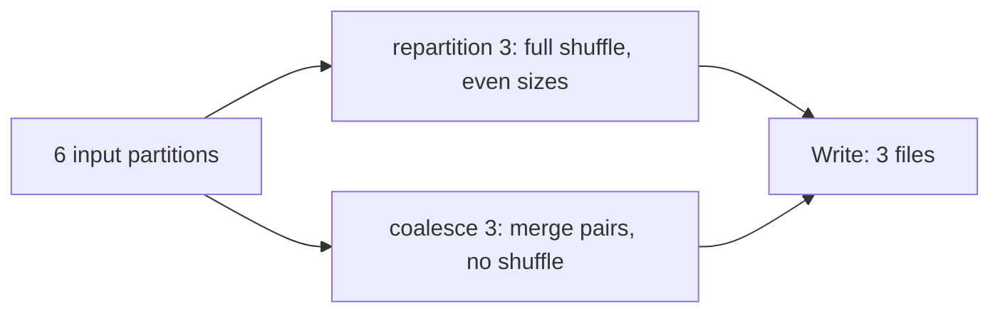

## Introduction

Partitions are Spark's unit of parallelism. Too few and cores sit idle or tasks run out of memory. Too many and scheduling overhead and tiny files dominate. Getting partitioning right is the most common tuning task.

## Definition

There are two meanings:
- **In-memory partitioning:** how a DataFrame's rows are split across tasks. Controlled by the source split size, `repartition`, `coalesce` and `spark.sql.shuffle.partitions`.
- **On-disk partitioning:** how output files are laid out in folders, using `df.write.partitionBy("col")` (for example `country=DE/`). Readers that filter on the column skip folders (**partition pruning**).

**Bucketing** (`bucketBy(n, col)` with `saveAsTable`) hashes rows into a fixed number of files per key so later joins and aggregations on that key can skip the shuffle.

## Why it matters

- Number of tasks per stage = number of partitions.
- Partition pruning can reduce a scan from TBs to GBs.
- Small-file problems (millions of tiny files) slow down every reader.

## How it works

- **Reading files:** partitions are up to `spark.sql.files.maxPartitionBytes` (128 MB). Small files are packed together, weighted by `spark.sql.files.openCostInBytes` (4 MB).
- **After a shuffle:** `spark.sql.shuffle.partitions` (200). With AQE, `spark.sql.adaptive.coalescePartitions.enabled` merges small shuffle partitions toward `spark.sql.adaptive.advisoryPartitionSizeInBytes` (64 MB).
- **`repartition(n)` / `repartition(n, col)`:** full shuffle; round-robin or hash partitioning; can increase or decrease. `repartitionByRange` uses range partitioning.
- **`coalesce(n)`:** merges existing partitions without a shuffle; can only decrease; may create uneven partitions and reduce upstream parallelism if pushed into the same stage.
- **`spark.sparkContext.defaultParallelism`:** used by RDD operations and `spark.range` / `parallelize` defaults (typically total cores).

## Syntax and configuration

```python-syntax
df.rdd.getNumPartitions()

df2 = df.repartition(400)                       # shuffle to 400 partitions
df3 = df.repartition(100, "customer_id")        # hash by key
df4 = df.repartitionByRange(100, "order_date")  # sorted ranges
df5 = df.coalesce(10)                           # merge, no shuffle

spark.conf.set("spark.sql.shuffle.partitions", "400")
spark.conf.set("spark.sql.adaptive.coalescePartitions.enabled", "true")

# On-disk layout
(df.repartition("order_date")                  # one task per date → fewer files
   .write.mode("overwrite")
   .partitionBy("order_date")
   .parquet("/lake/orders"))

spark.read.parquet("/lake/orders").filter("order_date = '2024-06-01'")  # pruning

# Bucketing for repeated joins on customer_id
(df.write.bucketBy(64, "customer_id").sortBy("customer_id")
   .mode("overwrite").saveAsTable("lake.orders_bucketed"))
```

## Examples

Hash partitioning and coalesce simulated in pandas, showing which rows land where:

```python
import pandas as pd

df = pd.DataFrame({"customer_id": [1, 2, 3, 4, 5, 6, 7, 8], "amount": range(10, 90, 10)})

n = 3
df["partition"] = df["customer_id"] % n          # like repartition(3, "customer_id") (Spark uses Murmur3 hash)
print(df.groupby("partition")["customer_id"].apply(list).to_dict())

# coalesce(2): merge whole partitions, no row moves between them
merge_map = {0: 0, 1: 1, 2: 1}
df["coalesced"] = df["partition"].map(merge_map)
print(df.groupby("coalesced").size().to_dict())
```

Picking a shuffle partition count from data size:

```python
shuffle_bytes = 150 * 1024**3        # 150 GB of shuffle data
target = 128 * 1024**2               # ~128 MB per partition
cores = 200
partitions = max(cores * 2, -(-shuffle_bytes // target))
print(partitions)
```

## Architecture

`repartition` shuffles; `coalesce` just merges neighbours.



## Practical example

A job wrote `partitionBy("event_date", "user_id")`, creating millions of folders with one tiny file each. Reads took hours listing files. Fix: partition on disk by `event_date` only (low cardinality, used in filters), call `repartition("event_date")` before writing so each date has a few large files, and use bucketing or Z-ordering for `user_id` lookups.

## Exercises

1. You need 10 output files from a 1,000-partition DataFrame and data is already balanced. `repartition(10)` or `coalesce(10)`?
<details><summary>Answer</summary>`coalesce(10)` avoids a shuffle. But note it can reduce the parallelism of the upstream narrow steps in the same stage; if those are heavy, `repartition(10)` may be faster overall.</details>

2. What is a good column for `partitionBy` on write?
<details><summary>Answer</summary>A low-to-moderate cardinality column frequently used in filters, such as a date. Not a high-cardinality ID.</details>

3. A stage after a groupBy has 200 tasks, each processing 5 MB. What would you change?
<details><summary>Answer</summary>Reduce `spark.sql.shuffle.partitions` or rely on AQE partition coalescing, which merges small partitions toward 64 MB.</details>

## Common mistakes

- Keeping 200 shuffle partitions for both 1 GB and 5 TB jobs.
- `partitionBy` on high-cardinality columns.
- `coalesce(1)` on big data, forcing one task to do all the work.
- Writing without repartitioning, producing one file per task per output partition.

## Performance and best practices

- Target 100–200 MB per partition; at least 2–3× the number of cores.
- Let AQE coalesce shuffle partitions; set a generous initial count.
- Partition on disk by date-like columns; compact small files.
- Bucket tables that are repeatedly joined on the same key.

## Interview questions

### What is the difference between repartition and coalesce?

`repartition` does a full shuffle and can increase or decrease partitions with even sizes. `coalesce` only decreases, merging existing partitions without a shuffle, possibly unevenly.

### What does spark.sql.shuffle.partitions control?

The number of partitions after a DataFrame shuffle (joins, aggregations). Default 200. AQE can coalesce them at runtime.

### What is partition pruning?

When data is written with `partitionBy`, filters on that column let Spark read only the matching folders. Dynamic partition pruning extends this to filters coming from a join with a dimension table.

### What is bucketing?

Writing a table hashed into a fixed number of buckets by a key. Joins and aggregations on that key between tables with compatible bucketing can skip the shuffle.

## Quick revision

- Tasks per stage = partitions.
- File reads: up to 128 MB per partition. Shuffles: 200 by default.
- `repartition` shuffles; `coalesce` merges without shuffle.
- `partitionBy` on write enables pruning; avoid high cardinality.
- AQE coalesces small shuffle partitions.
- Bucketing avoids repeat shuffles for joins.
