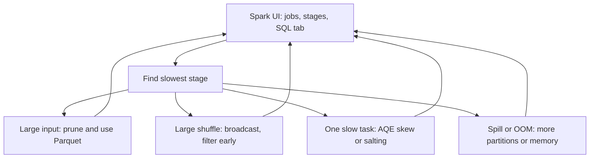

## Introduction

Spark tuning is mostly about moving less data, moving it fewer times and spreading it evenly. Before turning knobs, find where the time goes in the Spark UI. Most wins come from a handful of fixes.

## Definition

**Performance optimisation** in Spark means reducing I/O, shuffle volume, skew, serialisation and memory pressure, using:
- the optimiser: Catalyst rules, cost-based optimisation, **AQE**;
- the engine: **Tungsten** binary format and whole-stage code generation;
- your code: filters, projections, join strategy, partitioning, caching, file layout;
- resources: executor size, cores, memory.

## Why it matters

- Cloud cost scales with runtime.
- Faster jobs meet SLAs and reduce failure windows.
- Interviewers expect a structured approach, not random config changes.

## How it works

A tuning checklist, in order:
1. **Read less:** Parquet/Delta, partition pruning, column pruning, predicate pushdown. Avoid CSV/JSON for intermediate data.
2. **Shuffle less:** filter early, aggregate before joining, broadcast small tables, avoid unneeded `distinct`, `orderBy` and `repartition`.
3. **Balance work:** detect skew (one task far slower in the Stage tab); use AQE skew join or salting.
4. **Size partitions:** 100–200 MB; AQE coalescing; fix small files on write.
5. **Stay in the JVM:** built-in functions over Python UDFs; if a UDF is needed, use a vectorised pandas UDF (Arrow).
6. **Use memory wisely:** cache only reused data; give enough memory overhead for Python.
7. **Right-size resources:** 4–5 cores per executor; enough executors to cover partitions.

AQE (on by default since 3.2) does three things at runtime: coalesce shuffle partitions, convert sort-merge to broadcast joins, and split skewed join partitions. Spark 3 also has **dynamic partition pruning**, which prunes fact-table partitions using a filter on a joined dimension.

## Syntax and configuration

```python-syntax
from pyspark.sql import functions as F
from pyspark.sql.functions import pandas_udf
import pandas as pd

conf = {
    "spark.sql.adaptive.enabled": "true",
    "spark.sql.adaptive.coalescePartitions.enabled": "true",
    "spark.sql.adaptive.skewJoin.enabled": "true",
    "spark.sql.autoBroadcastJoinThreshold": str(50 * 1024 * 1024),
    "spark.sql.shuffle.partitions": "1000",
    "spark.sql.execution.arrow.pyspark.enabled": "true",
    "spark.serializer": "org.apache.spark.serializer.KryoSerializer",   # helps RDD workloads
}
for k, v in conf.items():
    spark.conf.set(k, v)

# Slow: row-at-a-time Python UDF
# to_eur = F.udf(lambda x: x * 0.92, "double")

# Better: built-in expression
df = df.withColumn("amount_eur", F.col("amount") * 0.92)

# If Python is required: vectorised pandas UDF
@pandas_udf("double")
def score(amount: pd.Series) -> pd.Series:
    return (amount.clip(upper=1000) / 1000).round(3)

df = df.withColumn("score", score("amount"))

df.explain("formatted")
```

## Examples

Detecting skew from per-key row counts, as you would with `df.groupBy("key").count().orderBy(F.desc("count"))`:

```python
import pandas as pd

keys = ["u1"] * 9000 + [f"u{i}" for i in range(2, 1002)]
counts = pd.Series(keys).value_counts()
median = counts.median()
print(counts.head(3).to_dict())
print("max / median:", counts.max() / median)
print("skewed:", (counts > 5 * median).sum(), "key(s)")
```

Two-stage salted aggregation, the standard fix for a skewed `groupBy`:

```python
import numpy as np
import pandas as pd

rng = np.random.default_rng(0)
df = pd.DataFrame({"key": ["hot"] * 1000 + ["cold"] * 10, "v": 1})
df["salt"] = rng.integers(0, 8, len(df))
stage1 = df.groupby(["key", "salt"], as_index=False)["v"].sum()   # spread hot key over 8 tasks
stage2 = stage1.groupby("key")["v"].sum()                          # combine
print(stage1.groupby("key").size().to_dict())
print(stage2.to_dict())
```

## Architecture

A tuning loop: measure, find the bottleneck stage, fix one thing, measure again.



## Practical example

A nightly job took 3 hours. The SQL tab showed a sort-merge join between a 2 TB fact table and a 30 MB dimension (above the 10 MB default threshold), then a stage where one task ran for 2 hours. Fixes: broadcast the dimension, enable AQE skew join, replace a Python UDF with `F.regexp_extract`, and write output with `repartition("dt")` to avoid 40,000 small files. Runtime dropped to 25 minutes.

## Exercises

1. One task in a stage takes 40 minutes; the median takes 20 seconds. What is the likely cause and fix?
<details><summary>Answer</summary>Data skew on the shuffle key. Use AQE skew join for joins, or salting / two-stage aggregation; also check for NULL or default keys.</details>

2. Why is a Python UDF slow compared to a built-in function?
<details><summary>Answer</summary>Rows are serialised from the JVM to a Python process and back, and Catalyst cannot optimise inside it. Built-ins run in the JVM with code generation.</details>

3. Name the three runtime optimisations of AQE.
<details><summary>Answer</summary>Coalescing shuffle partitions, switching join strategy (for example to broadcast), and splitting skewed join partitions.</details>

## Common mistakes

- Tuning configs before reading the Spark UI.
- Raising executor memory to hide skew.
- Python UDFs for simple logic.
- Caching everything.
- Disabling AQE or leaving default 200 shuffle partitions on huge jobs.
- Writing thousands of tiny files.

## Performance and best practices

- Columnar formats, pruning and pushdown first.
- Broadcast small dimensions; aggregate before joins.
- Keep AQE on; set a generous initial shuffle partition count.
- Check for skew with `groupBy(key).count()`.
- Prefer built-ins; then pandas UDFs; row UDFs last.
- Compact output files to 128 MB–1 GB.

## Interview questions

### How would you approach a slow Spark job?

Open the Spark UI, find the slowest stages, and check input size, shuffle size, spill and task-time distribution. Then fix the cause: prune reads, cut shuffles with broadcasts or earlier filters, fix skew, resize partitions, or replace UDFs.

### What is AQE?

Adaptive Query Execution re-optimises the plan at runtime using shuffle statistics: it coalesces partitions, switches to broadcast joins and splits skewed partitions.

### What are Catalyst and Tungsten?

Catalyst is the query optimiser that rewrites logical plans and chooses physical plans. Tungsten is the execution layer with binary memory management and whole-stage code generation.

### How do you handle data skew?

AQE skew join, broadcasting the small side, salting hot keys, two-stage aggregation, or processing hot keys separately. Also filter out NULL keys if they are not needed.

### Why avoid many small files?

Each file adds open and listing overhead and metadata load; tasks become tiny and scheduling dominates.

## Quick revision

- Read less, shuffle less, balance work.
- Broadcast small tables; threshold 10 MB by default.
- AQE: coalesce, broadcast switch, skew split.
- Built-ins beat pandas UDFs beat Python UDFs.
- Skew: AQE, salting, two-stage aggregation.
- Measure in the Spark UI before and after each change.
