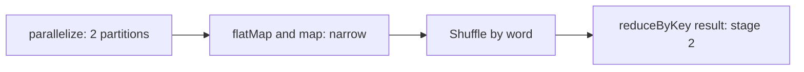

## Introduction

The RDD is the original Spark abstraction. DataFrames are built on top of it. You rarely write RDD code today, but concepts such as lineage, partitions and narrow versus wide dependencies come from the RDD model and appear in every interview.

## Definition

A **Resilient Distributed Dataset (RDD)** is an immutable, partitioned collection of objects that can be processed in parallel. Each RDD knows:
- its partitions;
- its dependencies on parent RDDs (its **lineage**);
- the function that computes each partition;
- optionally, a partitioner (for key-value RDDs) and preferred locations.

"Resilient" means lost partitions are rebuilt by replaying lineage.

## Why it matters

- Explains fault tolerance without data replication.
- Needed for unstructured data or fine-grained control (custom partitioners, `mapPartitions`).
- Interviewers ask "RDD vs DataFrame" constantly.

## How it works

- **Narrow dependency:** each parent partition feeds at most one child partition (`map`, `filter`, `flatMap`, `mapPartitions`, `union`). No shuffle; pipelined in one stage.
- **Wide dependency:** a child partition needs data from many parent partitions (`groupByKey`, `reduceByKey`, `join` without co-partitioning, `distinct`, `repartition`). Requires a shuffle and starts a new stage.
- `reduceByKey` combines values per key on each partition before the shuffle (map-side combine); `groupByKey` ships every value, so it moves much more data.
- RDD code uses Python functions that Catalyst cannot see or optimise, and data is serialised between the JVM and Python.

## Syntax and configuration

```python-syntax
sc = spark.sparkContext

rdd = sc.parallelize(["a b", "b c", "c a b"], numSlices=2)
counts = (
    rdd.flatMap(lambda line: line.split())   # narrow
       .map(lambda w: (w, 1))                 # narrow
       .reduceByKey(lambda a, b: a + b)       # wide: shuffle
)
print(counts.collect())          # [('b', 3), ('c', 2), ('a', 2)] in some order
print(counts.getNumPartitions())
print(counts.toDebugString().decode())  # lineage
```

## Examples

The word count above, reproduced in pandas to show the result:

```python
import pandas as pd

lines = pd.Series(["a b", "b c", "c a b"])
words = lines.str.split().explode()             # flatMap
counts = words.value_counts().sort_index()      # map + reduceByKey
print(counts.to_dict())
```

`reduceByKey` versus `groupByKey`:

```python-syntax
pairs = sc.parallelize([("x", 1), ("y", 2), ("x", 3)])
pairs.reduceByKey(lambda a, b: a + b).collect()            # combines before shuffle
pairs.groupByKey().mapValues(sum).collect()                 # shuffles every value
```

Converting between APIs:

```python-syntax
df = counts.toDF(["word", "n"])   # RDD → DataFrame
rdd_rows = df.rdd                 # DataFrame → RDD of Row objects
```

## Architecture

Narrow steps stay in one stage; `reduceByKey` adds a shuffle and a second stage.



## Practical example

Parsing messy log lines that do not fit a schema: read with `sc.textFile`, use `mapPartitions` to open one regex or parser per partition, keep valid records, then convert to a DataFrame with `toDF` and continue in the DataFrame API for joins and aggregations.

## Exercises

1. Is `union` narrow or wide?
<details><summary>Answer</summary>Narrow. The output partitions are the parent partitions placed side by side; no data moves.</details>

2. Why prefer `reduceByKey` over `groupByKey(...).mapValues(sum)`?
<details><summary>Answer</summary>`reduceByKey` does a map-side combine, so only one partial value per key per partition is shuffled.</details>

3. How does Spark rebuild a lost partition of an RDD that was never cached?
<details><summary>Answer</summary>It replays the lineage: recomputes the parent partitions it depends on and applies the same functions.</details>

## Common mistakes

- Using RDDs for structured data: you lose Catalyst and Tungsten optimisations.
- `groupByKey` for aggregations.
- Long lineages in iterative jobs without checkpointing, causing slow recovery and deep stacks.
- Expecting `collect()` order after a shuffle to be stable.

## Performance and best practices

- Prefer DataFrames; drop to RDDs only when needed.
- Use `mapPartitions` for per-partition setup (connections, parsers).
- Use `reduceByKey`, `aggregateByKey` or `combineByKey` instead of `groupByKey`.
- Use `checkpoint()` to truncate very long lineages.

## Interview questions

### What does "resilient" mean in RDD?

Lost partitions can be recomputed from lineage, the recorded sequence of transformations from the source data.

### What is the difference between narrow and wide dependencies?

Narrow: each parent partition is used by at most one child partition, so no shuffle. Wide: a child partition depends on many parent partitions, which needs a shuffle and a new stage.

### RDD vs DataFrame?

RDDs hold arbitrary objects and use opaque functions. DataFrames have a schema, so Catalyst can optimise the query and Tungsten can store data in a compact binary format. DataFrames are usually much faster, especially from Python.

### Why is groupByKey discouraged?

It shuffles every value and can build huge per-key lists in memory. `reduceByKey` combines locally first.

## Quick revision

- RDD: immutable, partitioned, lineage-based fault tolerance.
- Narrow: `map`, `filter`, `flatMap`, `union`. Wide: `groupByKey`, `reduceByKey`, `join`, `distinct`, `repartition`.
- Wide dependency = shuffle = new stage.
- `reduceByKey` beats `groupByKey`.
- Prefer DataFrames; RDD functions are opaque to Catalyst.
