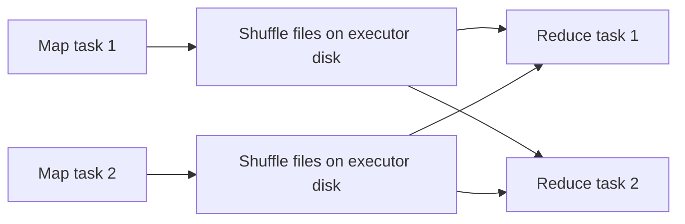

## Introduction

A shuffle is Spark redistributing data across the cluster so that rows with the same key end up in the same partition. It is the most expensive thing Spark does: it writes to disk, sends data over the network and splits the job into stages.

## Definition

A **shuffle** is the data exchange between two stages caused by a wide dependency. In physical plans it appears as an `Exchange` node (`hashpartitioning`, `rangepartitioning`, `RoundRobinPartitioning` or `SinglePartition`).

Triggers: `groupBy`/aggregations, `join` (non-broadcast, not co-partitioned), `distinct`, `dropDuplicates`, `orderBy`, `repartition`, window functions with `partitionBy`, set operations such as `intersect` and `except`.

## Why it matters

- Shuffle write and read time is often most of a job's runtime.
- Large shuffles spill to disk and can fail with fetch failures if executors are lost.
- Skew in the shuffle key creates stragglers.

## How it works

1. **Map side (shuffle write):** each task in the upstream stage computes a target partition for every row (for example `hash(key) mod N`), sorts or buffers rows by target, and writes them to local shuffle files plus an index. This is the sort-based shuffle, the only shuffle manager since Spark 2.0.
2. **Stage boundary:** the next stage starts only when the map stage finishes.
3. **Reduce side (shuffle read):** each downstream task fetches its partition's blocks from every map output over the network.
4. Shuffle files stay on disk, so a failed downstream task can refetch without rerunning the map stage. If an executor holding them is lost, Spark reruns the needed map tasks (an external shuffle service or decommissioning can keep the files available).

Key metrics in the Spark UI: Shuffle Write, Shuffle Read, Spill (Memory), Spill (Disk).

## Syntax and configuration

```python-syntax
from pyspark.sql import functions as F

q = orders.groupBy("customer_id").agg(F.sum("amount"))
q.explain()
# == Physical Plan ==
# AdaptiveSparkPlan
# +- HashAggregate(keys=[customer_id], functions=[sum(amount)])
#    +- Exchange hashpartitioning(customer_id, 200)
#       +- HashAggregate(keys=[customer_id], functions=[partial_sum(amount)])
#          +- FileScan parquet ...

spark.conf.set("spark.sql.shuffle.partitions", "800")
spark.conf.set("spark.sql.adaptive.enabled", "true")
spark.conf.set("spark.sql.adaptive.coalescePartitions.enabled", "true")
spark.conf.set("spark.sql.adaptive.advisoryPartitionSizeInBytes", "128m")
spark.conf.set("spark.shuffle.compress", "true")          # default true
```

## Examples

A shuffle simulated in pandas: map tasks bucket rows by hash of the key, then each reducer reads its bucket from every mapper.

```python
import pandas as pd

map_outputs = [
    pd.DataFrame({"key": ["a", "b", "c"], "v": [1, 2, 3]}),
    pd.DataFrame({"key": ["a", "c", "c"], "v": [4, 5, 6]}),
]
N = 2
reducers = {r: [] for r in range(N)}
for task in map_outputs:                                 # shuffle write
    task = task.assign(target=task["key"].map(lambda k: ord(k) % N))
    for r, block in task.groupby("target"):
        reducers[r].append(block)

for r, blocks in reducers.items():                       # shuffle read
    data = pd.concat(blocks)
    print(r, data.groupby("key")["v"].sum().to_dict())
```

## Architecture

Every reduce task reads a block from every map task's output.



## Practical example

A pipeline had a `distinct()`, then a join, then a `groupBy` on the same key: three shuffles. Rewriting it to aggregate first (which also deduplicates), then broadcast the small lookup table, removed two exchanges. Shuffle write fell from 900 GB to 120 GB.

## Exercises

1. Which physical node shows a shuffle?
<details><summary>Answer</summary>`Exchange` (and `BroadcastExchange` for a broadcast, which is not a shuffle of the large side).</details>

2. Why does a shuffle create a stage boundary?
<details><summary>Answer</summary>Reduce tasks need outputs from all map tasks, so the map stage must finish (or at least its outputs must exist) before they can read.</details>

3. A stage shows large "Spill (Disk)". What do you try?
<details><summary>Answer</summary>Increase the number of shuffle partitions so each task handles less data, give executors more memory, or reduce data before the shuffle by filtering and selecting fewer columns.</details>

## Common mistakes

- Unneeded `repartition` before a write that already shuffles.
- Shuffling wide rows: select only needed columns before the exchange.
- Too few shuffle partitions for big data, causing spills and out-of-memory.
- Ignoring skew: one huge reduce partition.

## Performance and best practices

- Filter and project before shuffles.
- Prefer broadcast joins for small tables.
- Aggregate before joining when possible.
- Size shuffle partitions to roughly 100–200 MB; let AQE coalesce.
- Reuse partitioning: consecutive operations on the same key can share one exchange.

## Interview questions

### What is a shuffle?

Redistributing data across partitions by key between two stages. Map tasks write partitioned shuffle files to local disk; reduce tasks fetch their parts over the network.

### Why is shuffling expensive?

It involves serialisation, disk writes, network transfer and a stage barrier, and it is sensitive to skew.

### Which operations cause a shuffle?

`groupBy`, non-broadcast `join`, `distinct`, `orderBy`, `repartition`, window functions with `partitionBy`, and set operations like `intersect`.

### How does AQE help with shuffles?

After the map stage, it uses real statistics to coalesce small partitions, split skewed partitions in joins and switch to broadcast joins.

## Quick revision

- Shuffle = `Exchange` = stage boundary.
- Map side writes local files; reduce side fetches over network.
- Default 200 shuffle partitions; tune or use AQE.
- Reduce data before shuffling.
- Broadcast joins avoid shuffling the large side.
- Watch Shuffle Read/Write and Spill in the UI.
