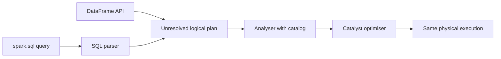

## Introduction

If you know SQL, you already know most of Spark. Spark SQL lets you register a DataFrame as a view and query it with SQL. The SQL and the DataFrame API compile to the same plan, so pick whichever reads better.

## Definition

**Spark SQL** is Spark's module for structured data. It includes:
- a SQL parser (ANSI-like dialect, close to Hive SQL);
- the **catalog** of databases, tables, views and functions (in-memory or a Hive metastore / Unity Catalog);
- the Catalyst optimiser and Tungsten engine shared with DataFrames.

`spark.sql("...")` returns a DataFrame.

## Why it matters

- Analysts and engineers can share logic.
- Window functions, CTEs and joins work much like PostgreSQL.
- Managed tables (`saveAsTable`) make outputs queryable by other tools.

## How it works

- `df.createOrReplaceTempView("orders")` registers a session-scoped view; `createOrReplaceGlobalTempView` makes it visible to other sessions in the same application as `global_temp.orders`.
- SQL text is parsed into the same logical plan the DataFrame API would build.
- Differences from PostgreSQL: Spark 3.5 has `spark.sql.ansi.enabled=false` by default, so invalid casts return NULL instead of raising errors; string comparison is case-sensitive; there is no `ILIKE` before 3.3 (it exists in 3.5); `QUALIFY` is not supported in 3.5.

## Syntax and configuration

```python-syntax
orders.createOrReplaceTempView("orders")
customers.createOrReplaceTempView("customers")

top = spark.sql("""
    WITH revenue AS (
        SELECT customer_id, SUM(amount) AS total
        FROM orders
        WHERE status = 'shipped'
        GROUP BY customer_id
    )
    SELECT c.name, r.total,
           RANK() OVER (ORDER BY r.total DESC) AS rnk
    FROM revenue r
    JOIN customers c ON c.customer_id = r.customer_id
""")
top.filter("rnk <= 10").show()

spark.sql("CREATE DATABASE IF NOT EXISTS analytics")
top.write.mode("overwrite").saveAsTable("analytics.top_customers")
spark.catalog.listTables("analytics")
```

The equivalent DataFrame API:

```python-syntax
from pyspark.sql import functions as F, Window

revenue = (orders.filter(F.col("status") == "shipped")
                 .groupBy("customer_id").agg(F.sum("amount").alias("total")))
top = (revenue.join(customers, "customer_id")
              .withColumn("rnk", F.rank().over(Window.orderBy(F.desc("total")))))
```

## Examples

The same SQL shape runs on Northwind in PostgreSQL, which is a good way to test the logic before porting it:

```sql
WITH revenue AS (
  SELECT o.customer_id, SUM(od.unit_price * od.quantity) AS total
  FROM orders o
  JOIN order_details od ON od.order_id = o.order_id
  GROUP BY o.customer_id
)
SELECT c.company_name, ROUND(r.total::numeric, 2) AS total,
       RANK() OVER (ORDER BY r.total DESC) AS rnk
FROM revenue r
JOIN customers c ON c.customer_id = r.customer_id
ORDER BY rnk
LIMIT 5;
```

## Architecture



## Practical example

A team kept business rules in SQL files for review by analysts. The Spark job reads raw Parquet, registers temp views, runs each SQL file with `spark.sql(open(path).read())`, and writes results with `saveAsTable`. Tests run the same SQL on small DataFrames built with `createDataFrame`.

## Exercises

1. Is `spark.sql("SELECT ...")` slower than the equivalent DataFrame code?
<details><summary>Answer</summary>No. Both produce the same logical plan and go through Catalyst.</details>

2. How long does a temp view live?
<details><summary>Answer</summary>Until the SparkSession ends or the view is dropped. Global temp views live until the application ends.</details>

3. In Spark 3.5 with default settings, what does `CAST('abc' AS INT)` return?
<details><summary>Answer</summary>NULL, because ANSI mode is off by default. With `spark.sql.ansi.enabled=true` it raises an error.</details>

## Common mistakes

- Assuming PostgreSQL behaviour for casts, NULL ordering or case sensitivity.
- Building SQL with string formatting from user input (injection risk); use parameters (`spark.sql(query, args={...})` in 3.4+) or the DataFrame API.
- Expecting temp views to persist across sessions.
- Forgetting that `saveAsTable` with `overwrite` replaces the whole table.

## Performance and best practices

- Use `EXPLAIN FORMATTED <query>` in SQL.
- Use broadcast hints in SQL: `SELECT /*+ BROADCAST(c) */ ...`.
- Store tables as Parquet or Delta with statistics.
- Turn on ANSI mode for stricter, PostgreSQL-like errors in new projects.

## Interview questions

### How do SQL queries and DataFrame code relate in Spark?

Both compile to the same logical plan and are optimised by Catalyst, so performance is the same.

### What is the difference between a temp view and a table?

A temp view is a named plan that exists only in the session. A table is stored in the catalog with data at a location and survives the session.

### What is the metastore?

The catalog service (often Hive metastore, Glue or Unity Catalog) storing table names, schemas, locations and partitions.

### Name a Spark SQL difference from PostgreSQL.

Non-ANSI mode returns NULL for invalid casts; PostgreSQL raises an error. Spark also lacks some PostgreSQL features and has its own functions such as `explode`.

## Quick revision

- `createOrReplaceTempView` then `spark.sql`.
- SQL and DataFrame API share Catalyst: same speed.
- `saveAsTable` writes a catalog table.
- Spark 3.5 default: ANSI off, invalid casts give NULL.
- Hints: `/*+ BROADCAST(t) */`, `/*+ REPARTITION(n) */`.
