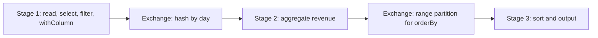

## Introduction

Transformations describe how to turn one DataFrame into another. They do not run anything by themselves. The key skill is knowing which transformations are cheap (narrow) and which move data across the cluster (wide).

## Definition

A **transformation** returns a new DataFrame or RDD from an existing one and is evaluated lazily.
- **Narrow:** each output partition depends on one input partition. Examples: `select`, `filter`/`where`, `withColumn`, `drop`, `map`, `flatMap`, `union`, `coalesce` (decreasing partitions), `sample`.
- **Wide:** an output partition depends on many input partitions, so data is shuffled. Examples: `groupBy().agg()`, `distinct`, `dropDuplicates`, `orderBy`/`sort`, `join` (unless broadcast or already co-partitioned), `repartition`, window functions with `partitionBy`.

## Why it matters

- Each wide transformation adds a shuffle and a stage boundary.
- Consecutive narrow transformations are **pipelined**: one task applies them all to a partition in one pass.
- Reducing wide transformations is the main way to speed up jobs.

## How it works

1. Each transformation adds a node to the logical plan.
2. At an action, Catalyst optimises the whole plan (for example, merges filters and pushes them to the source).
3. The physical plan inserts `Exchange` operators where wide transformations need data redistributed.
4. Stages are cut at each `Exchange`.

A broadcast join is wide in logic but avoids shuffling the large side: the small table is copied to every executor.

## Syntax and configuration

```python-syntax
from pyspark.sql import functions as F

clean = (
    raw.select("user_id", "event", "ts", "amount")      # narrow
       .filter(F.col("event") == "purchase")            # narrow
       .withColumn("day", F.to_date("ts"))              # narrow
)

daily = clean.groupBy("day").agg(F.sum("amount").alias("revenue"))   # wide
unique_users = clean.select("user_id").distinct()                     # wide
ranked = daily.orderBy(F.desc("revenue"))                             # wide (range shuffle)

ranked.explain()   # look for "Exchange" nodes
```

## Examples

The same chain in pandas, to see the result of each step:

```python
import pandas as pd

raw = pd.DataFrame({
    "user_id": [1, 2, 1, 3, 2],
    "event": ["purchase", "view", "purchase", "purchase", "purchase"],
    "ts": pd.to_datetime(["2024-01-01 10:00", "2024-01-01 11:00", "2024-01-02 09:00",
                          "2024-01-02 12:00", "2024-01-02 13:00"]),
    "amount": [20.0, 0.0, 35.0, 10.0, 15.0],
})
clean = raw[raw["event"] == "purchase"].assign(day=lambda d: d["ts"].dt.date)
daily = clean.groupby("day", as_index=False)["amount"].sum().rename(columns={"amount": "revenue"})
print(daily.sort_values("revenue", ascending=False).to_string(index=False))
print("unique users:", clean["user_id"].nunique())
```

## Architecture

Narrow steps are pipelined in one stage; each wide step adds an exchange.



## Practical example

A job did `orderBy` after every step "to make debugging easier", adding three full sorts. Removing all but the final sort, and filtering before the join instead of after, cut stages from 9 to 5 and runtime by more than half.

## Exercises

1. Classify: `withColumn`, `dropDuplicates`, `union`, `repartition(50)`, `coalesce(10)`.
<details><summary>Answer</summary>Narrow: `withColumn`, `union`, `coalesce(10)`. Wide: `dropDuplicates`, `repartition(50)`.</details>

2. How many stages does `read → filter → groupBy → agg → write` need?
<details><summary>Answer</summary>Two: one before the shuffle (read, filter, partial aggregate) and one after (final aggregate, write).</details>

3. Is a join always a shuffle?
<details><summary>Answer</summary>No. A broadcast hash join ships the small table to executors and does not shuffle the large side. Joins on already co-partitioned or bucketed data can also skip the exchange.</details>

## Common mistakes

- Unnecessary `orderBy`, `distinct` or `repartition` calls.
- Filtering after a join instead of before.
- Assuming `coalesce` shuffles (it does not, unless `shuffle=True` on RDDs).
- Using `withColumn` in a loop over many columns.

## Performance and best practices

- Filter and project as early as possible.
- Combine aggregations into one `agg` call.
- Use `explain()` and count `Exchange` nodes.
- Prefer `coalesce` to reduce partitions when no rebalancing is needed.

## Interview questions

### What is the difference between narrow and wide transformations?

Narrow transformations compute each output partition from a single input partition, so no data moves. Wide transformations need data from many partitions, so Spark shuffles and starts a new stage.

### Give examples of each.

Narrow: `select`, `filter`, `withColumn`, `union`, `coalesce`. Wide: `groupBy`, `join`, `distinct`, `orderBy`, `repartition`.

### What is pipelining?

Running consecutive narrow transformations together in one task over each partition, without materialising intermediate results.

### Why are transformations lazy?

So Spark can see the whole plan and optimise it before running anything: combine steps, push filters down and prune columns.

## Quick revision

- Transformations are lazy and return new DataFrames.
- Narrow: no shuffle, pipelined. Wide: shuffle, new stage.
- `Exchange` in `explain()` = shuffle.
- `coalesce` narrow; `repartition` wide.
- Filter early, sort once, at the end.
