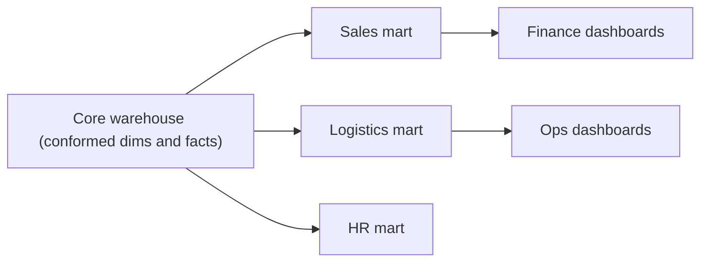

## Introduction

The finance team wants revenue; the logistics team wants shipping times. Each gets a mart built for its questions, on top of the same warehouse.

## Definition

A **data mart** is a subject-oriented subset of the warehouse for one department or use case. It usually contains one or more star schemas plus pre-aggregated summary tables.

- **Dependent mart:** built from the central warehouse (recommended).
- **Independent mart:** built directly from sources (fast, but creates silos).
- **Hybrid:** mixes both.

## Why it matters

Marts give users small, fast, understandable models and let you apply security and ownership per team.

## How it works

Marts reuse conformed dimensions from the warehouse, so "customer" means the same thing in sales and logistics. Heavy aggregates are materialised and refreshed after each load.

## Syntax and configuration

```sql-syntax
CREATE SCHEMA mart_sales;
CREATE MATERIALIZED VIEW mart_sales.monthly_revenue AS
SELECT ... FROM core.fact_sales ... GROUP BY ...;
REFRESH MATERIALIZED VIEW CONCURRENTLY mart_sales.monthly_revenue;  -- needs a unique index
GRANT SELECT ON ALL TABLES IN SCHEMA mart_sales TO sales_analysts;
```

## Examples

A monthly revenue summary for a sales mart:

```sql
CREATE TEMP TABLE mart_monthly_revenue AS
SELECT date_trunc('month', o.order_date)::date AS month,
       c.country,
       COUNT(DISTINCT o.order_id) AS orders,
       ROUND(SUM(od.unit_price * od.quantity * (1 - od.discount))::numeric, 2) AS revenue
FROM orders o
JOIN customers c      ON c.customer_id = o.customer_id
JOIN order_details od ON od.order_id = o.order_id
GROUP BY 1, 2;

SELECT month, SUM(revenue) AS revenue
FROM mart_monthly_revenue
GROUP BY month
ORDER BY revenue DESC
LIMIT 3;
```

## Architecture



Each mart is fed from the same core, so shared dimensions stay consistent.

## Practical example

A logistics mart table: shipping performance per shipper and year.

```sql
CREATE TEMP TABLE mart_shipping AS
SELECT EXTRACT(YEAR FROM o.order_date)::int AS year,
       s.company_name AS shipper,
       COUNT(*) AS orders,
       COUNT(*) FILTER (WHERE o.shipped_date > o.required_date) AS late,
       SUM(o.freight) AS freight
FROM orders o
JOIN shippers s ON s.shipper_id = o.ship_via
GROUP BY 1, 2;

SELECT * FROM mart_shipping ORDER BY year, shipper LIMIT 6;
```

## Exercises

1. Dependent or independent mart: which avoids conflicting numbers?
   <details><summary>Answer</summary>Dependent, because all marts share the warehouse's conformed dimensions and cleaned facts.</details>
2. Why materialise mart aggregates?
   <details><summary>Answer</summary>Dashboards hit them repeatedly; computing once per load is cheaper than scanning the fact on every view.</details>

## Common mistakes

- Independent marts with their own definitions of revenue or customer.
- Forgetting to refresh materialized views after a load.
- Copying the whole warehouse into every mart.

## Performance and best practices

- Use `REFRESH MATERIALIZED VIEW CONCURRENTLY` (PostgreSQL) to avoid blocking readers; it needs a unique index.
- Keep aggregates at a grain dashboards actually use.
- Grant access per mart schema.

## Interview questions

### What is a data mart?

A subject-specific subset of the warehouse, such as sales or HR, optimised for one group of users.

### Data mart vs data warehouse?

The warehouse integrates all subjects with conformed dimensions; a mart serves one subject and is usually derived from it.

### How do you keep marts consistent?

Build them from the same core and conformed dimensions, and define metrics once (for example in dbt or a semantic layer).

## Quick revision

- Mart = subject-focused slice of the warehouse.
- Dependent marts come from the core; prefer them.
- Materialise heavy aggregates; refresh after loads.
- Conformed dimensions keep marts consistent.
