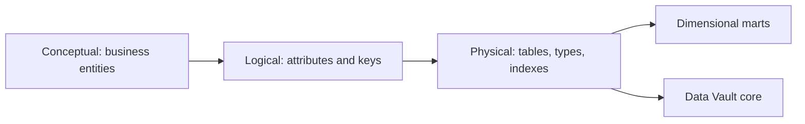

## Introduction

Before writing a single `CREATE TABLE`, you decide what the business cares about and how it fits together. That decision is the data model.

## Definition

**Data modelling** is designing the structure of data at three levels:
- **Conceptual:** entities and relationships in business terms (customer places order).
- **Logical:** attributes, keys and cardinalities, independent of database.
- **Physical:** tables, types, indexes and partitions for a specific database.

Warehouse modelling styles:
- **Dimensional (Kimball):** facts and dimensions in star schemas.
- **3NF (Inmon):** normalised enterprise model.
- **Data Vault:** hubs (business keys), links (relationships) and satellites (attributes with history).
- **One Big Table:** a single wide denormalised table per use case.

## Why it matters

The model decides how easy queries are, how history is kept, and how painful changes become. Interviewers often give a business case and ask you to model it.

## How it works

Dimensional design steps:
1. Choose the business process (sales, shipments, inventory).
2. Declare the grain.
3. Identify dimensions.
4. Identify measures.

A **bus matrix** lists processes as rows and dimensions as columns; ticks show which conformed dimensions each fact uses.

| Process | Date | Customer | Product | Employee | Shipper |
|---|---|---|---|---|---|
| Sales | x | x | x | x | |
| Shipments | x | x | | | x |
| Inventory | x | | x | | |

## Syntax and configuration

A Data Vault sketch:

```sql-syntax
CREATE TABLE hub_customer (customer_hk char(32) PRIMARY KEY, customer_id text, load_ts timestamptz, source text);
CREATE TABLE sat_customer (customer_hk char(32), load_ts timestamptz, city text, country text, hash_diff char(32),
                           PRIMARY KEY (customer_hk, load_ts));
CREATE TABLE link_order_customer (link_hk char(32) PRIMARY KEY, order_hk char(32), customer_hk char(32), load_ts timestamptz);
```

## Examples

Physical model choice: an order-grain shipments fact using the shipper dimension from the bus matrix.

```sql
CREATE TEMP TABLE fact_shipments AS
SELECT o.order_id,
       to_char(o.shipped_date, 'YYYYMMDD')::int AS ship_date_key,
       o.customer_id,
       o.ship_via AS shipper_key,
       o.freight,
       o.shipped_date - o.order_date AS days_to_ship
FROM orders o
WHERE o.shipped_date IS NOT NULL;

SELECT s.company_name, COUNT(*) AS shipments, ROUND(AVG(f.days_to_ship), 1) AS avg_days
FROM fact_shipments f
JOIN shippers s ON s.shipper_id = f.shipper_key
GROUP BY s.company_name
ORDER BY shipments DESC;
```

## Architecture



The same conceptual model can be implemented as Data Vault in the core and dimensional marts on top.

## Practical example

A tiny Data Vault hub and satellite from Northwind customers, using `md5` hash keys:

```sql
CREATE TEMP TABLE hub_customer AS
SELECT md5(customer_id) AS customer_hk, customer_id, now() AS load_ts, 'northwind' AS source
FROM customers;

CREATE TEMP TABLE sat_customer AS
SELECT md5(customer_id) AS customer_hk, now() AS load_ts, city, country,
       md5(concat_ws('|', city, country)) AS hash_diff
FROM customers;

SELECT h.customer_id, s.city, s.country, s.hash_diff
FROM hub_customer h
JOIN sat_customer s ON s.customer_hk = h.customer_hk
ORDER BY h.customer_id
LIMIT 3;
```

## Exercises

1. Model a "product returns" process: give the grain, dimensions and measures.
   <details><summary>Answer</summary>Grain: one row per returned order line. Dimensions: date, customer, product, reason. Measures: quantity returned, refund amount.</details>
2. What does a bus matrix show?
   <details><summary>Answer</summary>Which conformed dimensions each business process (fact) uses, so marts can be built consistently.</details>
3. When would you choose Data Vault?
   <details><summary>Answer</summary>Many changing sources and strong auditability needs. It is flexible to load but needs marts on top for querying.</details>

## Common mistakes

- Modelling the source system's tables instead of the business process.
- Skipping the grain decision.
- Different definitions of the same dimension in different marts (no conformance).
- Using Data Vault directly for BI queries.

## Performance and best practices

- Start from questions the business asks, then the grain.
- Conform dimensions early; it is hard to fix later.
- Denormalise for reads in marts; normalise or vault for integration in the core.

## Interview questions

### What are conceptual, logical and physical models?

Conceptual shows business entities and relationships. Logical adds attributes, keys and cardinality. Physical maps them to tables, data types, indexes and partitions in a specific database.

### Dimensional modelling vs 3NF for a warehouse?

Dimensional is optimised for querying and understanding; 3NF for integration and avoiding redundancy. Many warehouses use 3NF or Data Vault in the core and dimensional marts for users.

### What is Data Vault?

A modelling method with hubs (business keys), links (relationships) and satellites (descriptive history). It is insert-only and auditable.

## Quick revision

- Conceptual, logical, physical.
- Kimball dimensional, Inmon 3NF, Data Vault, One Big Table.
- Process, grain, dimensions, measures.
- Bus matrix shows conformed dimensions.
- Vault for integration, stars for consumption.
