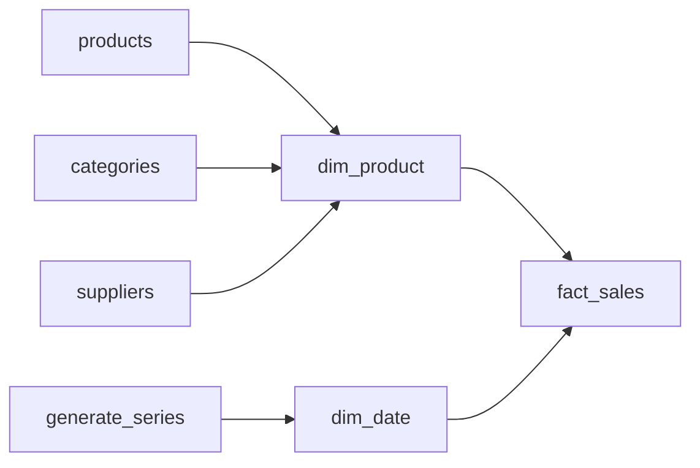

## Introduction

"Revenue by country by category by quarter": the numbers come from the fact table, and every "by" comes from a dimension.

## Definition

A **dimension table** holds descriptive attributes used to filter, group and label facts. It has one row per member (one customer, one product, one day), a **surrogate key** referenced by facts, the source **natural key**, and many text attributes.

Special kinds:
- **Date dimension:** one row per calendar day, generated, not extracted.
- **Conformed dimension:** shared by several facts and marts with the same keys and meaning.
- **Junk dimension:** groups low-cardinality flags.
- **Role-playing dimension:** one dimension used in several roles (order date, ship date).

## Why it matters

Good dimensions make queries simple: analysts group by readable columns without extra joins. Conformed dimensions let you compare facts across business processes.

## How it works

Dimensions are wide (many columns) and short (few rows) compared with facts. They are denormalised: a product row carries its category name and supplier country directly. Each dimension usually has an "Unknown" row so facts never need NULL keys.

## Syntax and configuration

```sql-syntax
CREATE TABLE dim_product (
  product_key   int GENERATED ALWAYS AS IDENTITY PRIMARY KEY,
  product_id    int NOT NULL,           -- natural key
  product_name  text NOT NULL,
  category_name text,
  supplier_name text,
  supplier_country text,
  discontinued  boolean
);
```

## Examples

A denormalised product dimension:

```sql
CREATE TEMP TABLE dim_product (
  product_key      int GENERATED ALWAYS AS IDENTITY PRIMARY KEY,
  product_id       int NOT NULL UNIQUE,
  product_name     text,
  category_name    text,
  supplier_country text
);

INSERT INTO dim_product (product_id, product_name, category_name, supplier_country)
SELECT p.product_id, p.product_name, c.category_name, s.country
FROM products p
LEFT JOIN categories c ON c.category_id = p.category_id
LEFT JOIN suppliers s  ON s.supplier_id = p.supplier_id
ORDER BY p.product_id;

SELECT * FROM dim_product ORDER BY product_key LIMIT 5;
```

A date dimension from `generate_series`:

```sql
CREATE TEMP TABLE dim_date AS
SELECT to_char(d, 'YYYYMMDD')::int        AS date_key,
       d::date                             AS full_date,
       EXTRACT(YEAR FROM d)::int           AS year,
       EXTRACT(QUARTER FROM d)::int        AS quarter,
       EXTRACT(MONTH FROM d)::int          AS month,
       to_char(d, 'FMMonth')               AS month_name,
       EXTRACT(ISODOW FROM d) IN (6, 7)    AS is_weekend
FROM generate_series(DATE '1996-01-01', DATE '1998-12-31', INTERVAL '1 day') AS g(d);

SELECT year, COUNT(*) AS days, SUM(is_weekend::int) AS weekend_days
FROM dim_date
GROUP BY year
ORDER BY year;
```

## Architecture



Several normalised source tables collapse into one dimension; the date dimension is generated.

## Practical example

Add an "Unknown" member and use it for the order with a NULL `employee_id`:

```sql
CREATE TEMP TABLE dim_employee AS
SELECT employee_id AS employee_key, first_name || ' ' || last_name AS employee_name, title
FROM employees
UNION ALL
SELECT -1, 'Unknown', 'Unknown';

SELECT d.employee_name, COUNT(*) AS orders
FROM orders o
JOIN dim_employee d ON d.employee_key = COALESCE(o.employee_id, -1)
GROUP BY d.employee_name
ORDER BY orders DESC
LIMIT 5;
```

The inner join keeps every order because no key is NULL.

## Exercises

1. Why generate the date dimension instead of extracting dates from orders?
   <details><summary>Answer</summary>Days with no orders must still exist (for zero-filled reports), and calendar attributes like quarter or weekend are computed once.</details>
2. Order date and ship date both point at `dim_date`. What is this called?
   <details><summary>Answer</summary>A role-playing dimension. Join it twice with different aliases or views.</details>
3. Why keep the natural key in the dimension?
   <details><summary>Answer</summary>To look up surrogate keys while loading facts and to trace rows back to the source.</details>

## Common mistakes

- Normalising dimensions into many small tables without a reason (see snowflake schema).
- No "Unknown" row, so facts get NULL keys and inner joins drop them.
- Using codes without labels: analysts need readable text.
- Rebuilding dimensions with new surrogate keys on every load, which breaks fact links.

## Performance and best practices

- Dimensions are small; index the natural key for lookups during fact loads.
- Use `int` date keys like `19970115` for readability and easy partitioning.
- Keep attribute names business-friendly.

## Interview questions

### What is a conformed dimension?

A dimension with the same keys, attributes and meaning used by several fact tables, so results across marts can be compared and combined.

### What is a role-playing dimension?

One physical dimension used in several roles, e.g. `dim_date` as order date, required date and ship date.

### What is a junk dimension?

A dimension that combines several low-cardinality flags (is_gift, payment_type) into one table, so the fact holds one key instead of many flags.

## Quick revision

- Dimensions: descriptive attributes, one row per member.
- Surrogate key for facts, natural key for lineage.
- Generate the date dimension with `generate_series`.
- Add an "Unknown" member instead of NULL keys.
- Conformed dimensions are shared across marts.
- Role-playing: one dimension, many roles.
