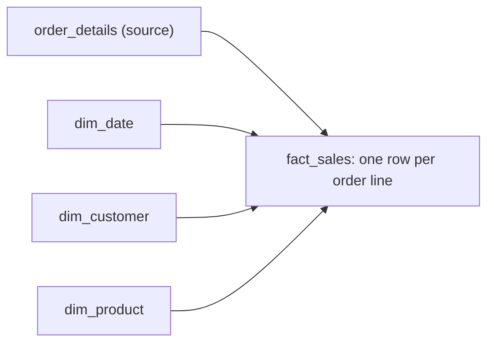

## Introduction

Every report question has numbers in it: revenue, quantity, freight, days to ship. Those numbers live in fact tables. Dimensions describe them; facts measure them.

## Definition

A **fact table** holds one row per business event (or per period) at a declared **grain**. It contains:
- **foreign keys** to dimensions (date, customer, product), and
- **measures**: numeric values you aggregate.

Measures are **additive** (sum across all dimensions, e.g. revenue), **semi-additive** (sum across some, e.g. stock balance across products but not across days) or **non-additive** (ratios, unit price).

## Why it matters

The grain decides what questions the table can answer. Getting it wrong causes double counting, which is the most common warehouse bug and a frequent interview topic.

## How it works

Three fact table types:

| Type | Grain | Northwind example |
|---|---|---|
| Transaction | one row per event | one row per order line |
| Periodic snapshot | one row per entity per period | stock per product per month |
| Accumulating snapshot | one row per process instance, updated at milestones | one row per order: ordered, shipped, days to ship |

A **factless fact** records events with no measure, such as "customer visited".

## Syntax and configuration

```sql-syntax
CREATE TABLE fact_sales (
  date_key     int     NOT NULL REFERENCES dim_date(date_key),
  customer_key int     NOT NULL REFERENCES dim_customer(customer_key),
  product_key  int     NOT NULL REFERENCES dim_product(product_key),
  order_id     int     NOT NULL,          -- degenerate dimension
  quantity     int     NOT NULL,
  revenue      numeric(12,2) NOT NULL,
  PRIMARY KEY (order_id, product_key)     -- enforces the grain
);
```

## Examples

A transaction fact at order-line grain:

```sql
CREATE TEMP TABLE fact_sales AS
SELECT to_char(o.order_date, 'YYYYMMDD')::int AS date_key,
       o.customer_id,
       od.product_id,
       o.order_id,                                   -- degenerate dimension
       od.quantity,
       (od.unit_price * od.quantity * (1 - od.discount))::numeric(12,2) AS revenue
FROM orders o
JOIN order_details od ON od.order_id = o.order_id;

SELECT COUNT(*) AS fact_rows, SUM(quantity) AS units, SUM(revenue) AS revenue
FROM fact_sales;
```

An accumulating snapshot at order grain:

```sql
CREATE TEMP TABLE fact_order_fulfilment AS
SELECT order_id,
       order_date,
       shipped_date,
       shipped_date - order_date AS days_to_ship,
       (shipped_date IS NOT NULL) AS is_shipped
FROM orders;

SELECT is_shipped, COUNT(*) AS orders, ROUND(AVG(days_to_ship), 1) AS avg_days
FROM fact_order_fulfilment
GROUP BY is_shipped;
```

## Architecture



The fact sits in the middle; each dimension contributes one foreign key.

## Practical example

Freight is stored per order, but `fact_sales` is per order line. Summing freight at line grain double counts it. Compare:

```sql
WITH lines AS (
  SELECT o.order_id, o.freight, od.product_id
  FROM orders o
  JOIN order_details od ON od.order_id = o.order_id
)
SELECT (SELECT SUM(freight) FROM orders) AS correct_freight,
       SUM(freight)                      AS double_counted
FROM lines;
```

Fix it by keeping freight in an order-grain fact, or by allocating it across lines (for example by revenue share).

## Exercises

1. What is the grain of `order_details`?
   <details><summary>Answer</summary>One row per order per product (order line). Its key is (order_id, product_id).</details>
2. Is `units_in_stock` additive?
   <details><summary>Answer</summary>Semi-additive: you can sum it across products on one day, but not across days. Use the latest or average value over time.</details>
3. Where does `order_id` go in a sales fact?
   <details><summary>Answer</summary>In the fact as a degenerate dimension: a key with no dimension table of its own.</details>

## Common mistakes

- Not declaring the grain before choosing columns.
- Mixing grains: order-level freight on line-level rows.
- Storing averages or ratios instead of their additive parts (sum and count).
- NULL foreign keys instead of pointing to an "Unknown" dimension row.

## Performance and best practices

- Keep facts narrow: integer keys plus numeric measures.
- Partition large facts by date and index the foreign keys you filter on.
- Load facts append-only where possible; accumulating snapshots need updates.

## Interview questions

### What is the grain of a fact table?

The exact meaning of one row, e.g. "one row per order line". Declare it first; every column must be true at that grain.

### Additive vs semi-additive vs non-additive?

Additive sums across all dimensions (revenue). Semi-additive sums across some but not time (balances). Non-additive never sums (ratios, prices); store the components instead.

### What is a factless fact table?

A fact with only foreign keys, recording that an event happened (attendance, promotion coverage). You count its rows.

### What is a degenerate dimension?

A dimension key stored in the fact with no dimension table, such as an order or invoice number.

## Quick revision

- Facts = foreign keys + numeric measures.
- Declare the grain first.
- Transaction, periodic snapshot, accumulating snapshot.
- Additive, semi-additive, non-additive measures.
- Mixed grain causes double counting.
- Order numbers are degenerate dimensions.
