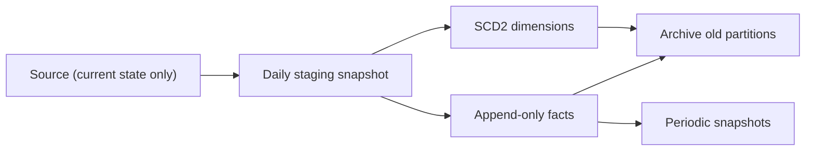

## Introduction

"What did we know, and when?" Source systems usually keep only the current state. The warehouse is where history lives, so it must be captured deliberately.

## Definition

**Historical data management** covers how a warehouse records change over time and how users query it:
- **Dimension history:** SCD Type 2 rows with validity ranges.
- **Fact history:** append-only transaction facts and periodic snapshots.
- **Audit metadata:** load timestamps and batch ids.
- **Retention:** how long each layer keeps data, and how it is archived.

## Why it matters

Without history you cannot reproduce last quarter's report, analyse trends, or audit a number. Regulations may also require keeping, or deleting, data for set periods.

## How it works

- **Point-in-time join:** join a fact to the dimension version valid on the event date.
- **As-of query:** filter dimension versions to those valid on a chosen date.
- **Snapshots:** store state per period (daily stock, monthly balances) because it cannot be rebuilt later.
- **Bi-temporal:** track both business validity and when the warehouse learned of it (`loaded_at`).

## Syntax and configuration

```sql-syntax
-- point-in-time join
JOIN dim_customer d
  ON d.customer_id = f.customer_id
 AND f.order_date >= d.valid_from
 AND f.order_date <  d.valid_to

-- as-of query
WHERE DATE :as_of >= valid_from AND DATE :as_of < valid_to
```

## Examples

A monthly periodic snapshot of order counts per customer, with change versus the previous month:

```sql
CREATE TEMP TABLE snap_customer_month AS
SELECT date_trunc('month', order_date)::date AS snapshot_month,
       customer_id,
       COUNT(*) AS orders
FROM orders
GROUP BY 1, 2;

SELECT customer_id, snapshot_month, orders,
       orders - LAG(orders) OVER (PARTITION BY customer_id ORDER BY snapshot_month) AS change
FROM snap_customer_month
ORDER BY customer_id, snapshot_month
LIMIT 5;
```

## Architecture



Each load captures state; dimensions keep versions, facts append, and old partitions move to cheaper storage.

## Practical example

Point-in-time reporting with an SCD Type 2 customer dimension. ALFKI moved to Munich on 1997-07-01; each order is attributed to the city valid on its date.

```sql
CREATE TEMP TABLE dim_customer (
  customer_key int GENERATED ALWAYS AS IDENTITY PRIMARY KEY,
  customer_id  text NOT NULL,
  city         text,
  valid_from   date NOT NULL,
  valid_to     date NOT NULL,
  is_current   boolean NOT NULL
);

INSERT INTO dim_customer (customer_id, city, valid_from, valid_to, is_current)
SELECT customer_id, city, DATE '1990-01-01',
       CASE WHEN customer_id = 'ALFKI' THEN DATE '1997-07-01' ELSE DATE '9999-12-31' END,
       customer_id <> 'ALFKI'
FROM customers
UNION ALL
SELECT 'ALFKI', 'Munich', DATE '1997-07-01', DATE '9999-12-31', true;

SELECT o.order_id, o.order_date, d.customer_key, d.city
FROM orders o
JOIN dim_customer d
  ON d.customer_id = o.customer_id
 AND o.order_date >= d.valid_from
 AND o.order_date <  d.valid_to
WHERE o.customer_id = 'ALFKI'
ORDER BY o.order_date;
```

An as-of query: which city did each customer have on 1997-01-01?

```sql
CREATE TEMP TABLE dim_customer AS
SELECT customer_id, city, DATE '1990-01-01' AS valid_from, DATE '9999-12-31' AS valid_to
FROM customers;

SELECT customer_id, city
FROM dim_customer
WHERE DATE '1997-01-01' >= valid_from AND DATE '1997-01-01' < valid_to
ORDER BY customer_id
LIMIT 3;
```

## Exercises

1. Why must inventory levels be snapshotted rather than recomputed later?
   <details><summary>Answer</summary>The source keeps only the current stock; past levels are overwritten. Unless you store a snapshot, the history is lost.</details>
2. What does a point-in-time join need on the dimension?
   <details><summary>Answer</summary>Non-overlapping validity ranges per natural key (`valid_from`, `valid_to`) covering every event date.</details>
3. How do you apply a 3-year retention rule to a large fact?
   <details><summary>Answer</summary>Partition by date and detach or drop partitions older than three years on a schedule.</details>

## Common mistakes

- Joining facts to the current dimension row only, which rewrites history.
- Overlapping validity ranges that duplicate fact rows.
- Updating facts in place instead of appending corrections.
- Keeping everything forever in hot storage.

## Performance and best practices

- Index `(natural_key, valid_from)` for point-in-time joins.
- Store surrogate keys on facts at load time so reports need no range join.
- Partition history by date; archive cold partitions.
- Record `loaded_at` and a batch id on every row.

## Interview questions

### How do you report last year's sales by the customer's region at that time?

Use an SCD Type 2 customer dimension and join facts to the version valid on the order date (or store that version's surrogate key on the fact at load time).

### What is a periodic snapshot?

A fact table that records the state of something at regular intervals, such as daily stock per product. It captures history the source does not keep.

### What is bi-temporal data?

Data with two timelines: when a fact was true in the business (valid time) and when the system recorded it (transaction time). It lets you reproduce what a report showed on a past date.

## Quick revision

- History must be captured on load; sources forget it.
- SCD2 for dimensions, append-only facts, snapshots for state.
- Point-in-time join on `valid_from <= date < valid_to`.
- Audit columns: `loaded_at`, batch id.
- Partition and archive for retention.
