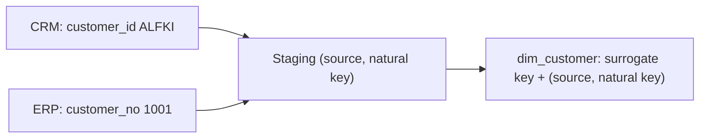

## Introduction

`ALFKI`, an email address, an ISBN, a tax number: these identify things in the real world or in a source system. They are natural keys.

## Definition

A **natural key** (business key) is an identifier that comes from the source or the business, not from the warehouse. It can be a single column (`customer_id`) or composite (`order_id, product_id`).

## Why it matters

The warehouse uses surrogate keys internally, but the natural key is how it recognises "the same customer" between loads. Without it you cannot detect changes, deduplicate, or trace a row back to the source.

## How it works

- Every dimension keeps the natural key next to the surrogate key.
- In a Type 2 dimension the natural key repeats once per version; it is unique only among current rows.
- With several sources, combine source system and key: `(source, customer_id)`.

## Syntax and configuration

```sql-syntax
-- unique among current rows only
CREATE UNIQUE INDEX ux_dim_customer_current
  ON dim_customer (customer_id) WHERE is_current;

-- multi-source natural key
UNIQUE (source_system, customer_id)
```

## Examples

Check that a natural key is really unique in the source:

```sql
SELECT COUNT(*) AS rows, COUNT(DISTINCT customer_id) AS distinct_keys
FROM customers;
```

A composite natural key: the grain of `order_details`.

```sql
SELECT order_id, product_id, COUNT(*) AS n
FROM order_details
GROUP BY order_id, product_id
ORDER BY n DESC
LIMIT 3;
```

## Architecture



Natural keys from each source are kept, qualified by source, and mapped to one surrogate key per version.

## Practical example

Deduplicate a staged feed on its natural key, keeping the latest record:

```sql
CREATE TEMP TABLE stg_customer AS
SELECT customer_id, city, now() - interval '1 day' AS extracted_at FROM customers
UNION ALL
SELECT 'ALFKI', 'Munich', now();

SELECT customer_id, city
FROM (
  SELECT s.*, ROW_NUMBER() OVER (PARTITION BY customer_id ORDER BY extracted_at DESC) AS rn
  FROM stg_customer s
) x
WHERE rn = 1 AND customer_id = 'ALFKI';
```

## Exercises

1. Is an email address a good natural key?
   <details><summary>Answer</summary>Risky: it can change and can be shared. Use it only if the business treats it as the identity, and handle changes.</details>
2. Why is `customer_id` not unique in an SCD Type 2 dimension?
   <details><summary>Answer</summary>Each version has its own row. It is unique only among current rows, enforced by a partial unique index.</details>

## Common mistakes

- Assuming source keys are unique without checking.
- Merging two sources on bare keys that collide.
- Case and whitespace differences (`alfki ` vs `ALFKI`); normalise before matching.

## Performance and best practices

- Index the natural key for lookups during fact loads.
- Standardise type and format in staging (trim, upper-case).
- Test uniqueness in the pipeline, not only in production.

## Interview questions

### What is a natural key?

An identifier with business meaning from a source system, such as a customer code or ISBN.

### Why keep the natural key if you have a surrogate key?

To match incoming rows to existing members, detect changes, and trace data back to the source.

### How do you integrate natural keys from two systems?

Qualify them with the source system, or build a mapping table to one master identity (master data management).

## Quick revision

- Natural key = business or source identifier.
- Keep it in every dimension.
- Unique among current rows in SCD2.
- Qualify with source when integrating systems.
- Validate and normalise in staging.
