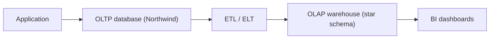

## Introduction

Northwind is an OLTP database: it records orders one at a time. A warehouse is an OLAP system: it answers questions over millions of those orders at once. The same data, modelled differently, serves both.

## Definition

- **OLTP (online transaction processing):** many short reads and writes that touch a few rows, such as inserting an order or updating stock. Schemas are normalised (3NF).
- **OLAP (online analytical processing):** fewer, long read queries that scan and aggregate many rows, such as revenue by country by month. Schemas are denormalised (star or snowflake).

## Why it matters

Running heavy reports on the OLTP database slows down the application and fights with its locks. Normalised schemas also need many joins for a single report. Data engineers copy OLTP data into an OLAP model so both workloads stay fast.

## How it works

| | OLTP | OLAP |
|---|---|---|
| Typical query | `INSERT`/`UPDATE` one order | `SUM` over all orders |
| Rows per query | 1–100 | thousands to billions |
| Schema | normalised, 3NF | star/snowflake, denormalised |
| History | current state | full history, snapshots |
| Users | application | analysts, BI tools |
| Storage | row store | often column store |
| Freshness | real time | batch or micro-batch |

## Syntax and configuration

An OLTP query and an OLAP query have different shapes:

```sql-syntax
-- OLTP: point lookup / write by primary key
SELECT * FROM orders WHERE order_id = :id;
UPDATE products SET units_in_stock = units_in_stock - :qty WHERE product_id = :pid;

-- OLAP: scan, join to dimensions, aggregate
SELECT d.year, c.country, SUM(f.revenue)
FROM fact_sales f
JOIN dim_date d     ON d.date_key = f.date_key
JOIN dim_customer c ON c.customer_key = f.customer_key
GROUP BY d.year, c.country;
```

## Examples

OLTP-style point lookup on Northwind:

```sql
SELECT order_id, customer_id, order_date, freight
FROM orders
WHERE order_id = (SELECT MIN(order_id) FROM orders);
```

OLAP-style aggregate over the whole history:

```sql
SELECT EXTRACT(YEAR FROM o.order_date)::int AS year,
       c.country,
       ROUND(SUM(od.unit_price * od.quantity * (1 - od.discount))::numeric, 2) AS revenue
FROM orders o
JOIN customers c      ON c.customer_id = o.customer_id
JOIN order_details od ON od.order_id = o.order_id
GROUP BY 1, 2
ORDER BY revenue DESC
LIMIT 5;
```

## Architecture



The application writes to OLTP. A pipeline copies and reshapes the data into the warehouse, which BI tools query.

## Practical example

Flatten the normalised order tables into one wide, analysis-ready table. This is the first step from OLTP to OLAP.

```sql
CREATE TEMP TABLE sales_flat AS
SELECT o.order_id, o.order_date, c.country, cat.category_name,
       od.quantity,
       (od.unit_price * od.quantity * (1 - od.discount))::numeric(12,2) AS revenue
FROM orders o
JOIN customers c      ON c.customer_id = o.customer_id
JOIN order_details od ON od.order_id = o.order_id
JOIN products p       ON p.product_id = od.product_id
JOIN categories cat   ON cat.category_id = p.category_id;

SELECT category_name, COUNT(*) AS lines, SUM(revenue) AS revenue
FROM sales_flat
GROUP BY category_name
ORDER BY revenue DESC
LIMIT 3;
```

## Exercises

1. Classify: "show a customer's last order" and "top 10 products by revenue per year". Which is OLTP and which is OLAP?
   <details><summary>Answer</summary>The first is OLTP (point lookup by key). The second is OLAP (scan and aggregate across history).</details>
2. Why are OLAP schemas denormalised?
   <details><summary>Answer</summary>Fewer joins and simpler queries for analysts. Redundancy is acceptable because the data is loaded in batches, not updated by users.</details>
3. Why not just run reports on the production database?
   <details><summary>Answer</summary>Long scans compete for CPU, I/O and locks with the application, and the normalised schema makes reports complex. It also keeps only current state, not history.</details>

## Common mistakes

- Treating a read replica as a warehouse: it has the same normalised schema and no history.
- Normalising the warehouse to 3NF "for cleanliness", which makes every report a 6-table join.
- Updating warehouse rows in place and losing history.

## Performance and best practices

- Keep OLTP indexes narrow and selective; OLAP benefits from partitioning, column stores and pre-aggregation.
- Load the warehouse in batches; avoid row-by-row inserts.
- Isolate analytical load from the application database.

## Interview questions

### What is the difference between OLTP and OLAP?

OLTP handles many small transactions on current data with a normalised schema. OLAP handles large analytical scans over historical data with a denormalised dimensional schema.

### Why are warehouses often column stores?

Analytical queries read a few columns over many rows. A column store reads only those columns and compresses them well.

### Can PostgreSQL be used for OLAP?

Yes, for small and medium warehouses. Use partitioning, BRIN indexes, materialized views and parallel query. Large scale usually moves to a columnar warehouse.

## Quick revision

- OLTP: many small writes, normalised, current state.
- OLAP: big scans and aggregates, denormalised, full history.
- ETL moves data from OLTP to OLAP.
- Star schemas are the usual OLAP model.
- Do not run heavy reports on the production OLTP database.
