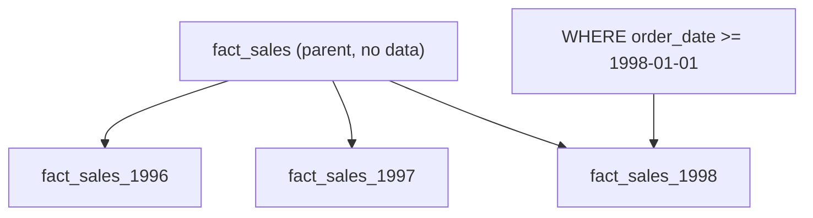

## Introduction

A fact table grows by millions of rows a month, but most queries ask about the last few months. Partitioning lets the database skip everything else.

## Definition

**Partitioning** splits one logical table into physical pieces (partitions) by a key. PostgreSQL supports declarative partitioning:
- **RANGE:** by value ranges, usually dates.
- **LIST:** by discrete values, such as country.
- **HASH:** by hash modulus, to spread rows evenly.

## Why it matters

- **Pruning:** queries filtered on the key read only matching partitions.
- **Maintenance:** drop or detach an old month instantly instead of a huge `DELETE`.
- **Loads:** load into a new partition and attach it.

## How it works

The parent table holds no data. Each partition has bounds; `FROM` is inclusive and `TO` is exclusive. Rows are routed on insert. A `DEFAULT` partition catches rows that fit no range. The planner removes partitions that cannot match the `WHERE` clause.

## Syntax and configuration

```sql-syntax
CREATE TABLE fact_sales (
  order_date date NOT NULL,
  order_id   int,
  revenue    numeric(12,2)
) PARTITION BY RANGE (order_date);

CREATE TABLE fact_sales_1997 PARTITION OF fact_sales
  FOR VALUES FROM ('1997-01-01') TO ('1998-01-01');

ALTER TABLE fact_sales DETACH PARTITION fact_sales_1996;   -- archive
```

## Examples

A yearly range-partitioned sales fact:

```sql
CREATE TEMP TABLE fact_sales (
  order_date date NOT NULL,
  order_id   int  NOT NULL,
  product_id int  NOT NULL,
  revenue    numeric(12,2)
) PARTITION BY RANGE (order_date);

CREATE TEMP TABLE fact_sales_1996 PARTITION OF fact_sales FOR VALUES FROM ('1996-01-01') TO ('1997-01-01');
CREATE TEMP TABLE fact_sales_1997 PARTITION OF fact_sales FOR VALUES FROM ('1997-01-01') TO ('1998-01-01');
CREATE TEMP TABLE fact_sales_1998 PARTITION OF fact_sales FOR VALUES FROM ('1998-01-01') TO ('1999-01-01');

INSERT INTO fact_sales
SELECT o.order_date, o.order_id, od.product_id,
       (od.unit_price * od.quantity * (1 - od.discount))::numeric(12,2)
FROM orders o JOIN order_details od ON od.order_id = o.order_id;

SELECT tableoid::regclass AS partition, COUNT(*) AS rows
FROM fact_sales
GROUP BY 1
ORDER BY 1;
```

## Architecture



Inserts are routed to the matching child; a date filter reads only the partitions that can match.

## Practical example

See pruning in the plan, and roll off the oldest year by detaching it:

```sql
CREATE TEMP TABLE fact_orders (order_date date NOT NULL, order_id int, freight numeric)
  PARTITION BY RANGE (order_date);
CREATE TEMP TABLE fact_orders_1996 PARTITION OF fact_orders FOR VALUES FROM ('1996-01-01') TO ('1997-01-01');
CREATE TEMP TABLE fact_orders_1997 PARTITION OF fact_orders FOR VALUES FROM ('1997-01-01') TO ('1998-01-01');
CREATE TEMP TABLE fact_orders_rest PARTITION OF fact_orders DEFAULT;

INSERT INTO fact_orders SELECT order_date, order_id, freight FROM orders;

EXPLAIN (COSTS OFF)
SELECT SUM(freight) FROM fact_orders WHERE order_date >= DATE '1997-01-01' AND order_date < DATE '1998-01-01';

ALTER TABLE fact_orders DETACH PARTITION fact_orders_1996;

SELECT MIN(order_date) AS oldest_remaining, COUNT(*) AS rows FROM fact_orders;
```

The plan scans only `fact_orders_1997`. After the detach, 1996 rows are gone from the parent but still exist in the standalone table.

## Exercises

1. Is the upper bound of `FOR VALUES FROM ('1997-01-01') TO ('1998-01-01')` included?
   <details><summary>Answer</summary>No. `TO` is exclusive, so `1998-01-01` goes to the next partition.</details>
2. A query filters on `customer_id` only. Does date partitioning help?
   <details><summary>Answer</summary>No. Without a filter on the partition key, every partition is scanned.</details>
3. Why keep a DEFAULT partition?
   <details><summary>Answer</summary>So rows outside the defined ranges do not fail the load. Monitor it and split it when it fills.</details>

## Common mistakes

- Too many tiny partitions (daily for small data), which slows planning.
- Wrapping the key in a function (`WHERE EXTRACT(YEAR FROM order_date) = 1997`), which can prevent pruning.
- Forgetting that primary keys and unique constraints must include the partition key.
- No partition for future dates, so inserts fail.

## Performance and best practices

- Partition by the column most queries filter on, usually date.
- Aim for partitions in the millions of rows, not thousands.
- Create future partitions ahead of time (cron or `pg_partman`).
- BRIN indexes suit large, date-ordered partitions.

## Interview questions

### What is partition pruning?

The planner (and executor, for parameters) skips partitions whose bounds cannot match the query's filter on the partition key.

### RANGE vs LIST vs HASH?

RANGE for continuous keys like dates; LIST for known categories like region; HASH for even spreading when there is no natural range.

### How do you delete old data from a partitioned fact?

`DETACH PARTITION` then archive or `DROP TABLE` the partition. It is instant and avoids a huge `DELETE` and vacuum.

### Partitioning vs indexing?

Indexes find rows inside a table; partitioning removes whole chunks from consideration and makes lifecycle operations cheap. Large facts often use both.

## Quick revision

- `PARTITION BY RANGE (order_date)` for facts.
- `FROM` inclusive, `TO` exclusive.
- Filter on the raw key to get pruning.
- Detach or drop partitions to archive.
- Keys must include the partition column.
- Do not over-partition.
