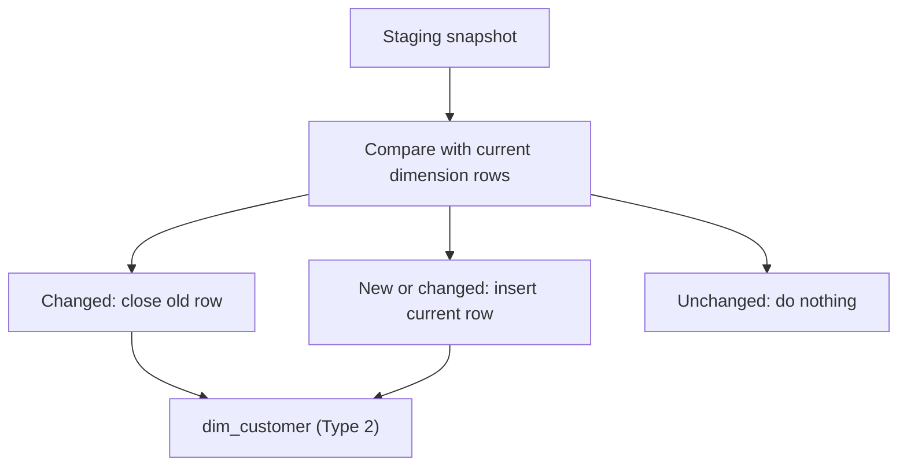

## Introduction

A customer moves from Berlin to Munich. Should last year's sales report Berlin or Munich? Slowly Changing Dimensions (SCDs) are the rules for answering that.

## Definition

An **SCD** is a dimension whose attributes change over time. The common types:

| Type | Behaviour | History |
|---|---|---|
| 0 | never change the attribute | original value only |
| 1 | overwrite | none |
| 2 | add a new row with a new surrogate key; close the old row | full |
| 3 | keep a `previous_value` column | one level |
| 4 / 6 | history table / hybrid of 1+2+3 | varies |

## Why it matters

Type 2 is the most asked SCD question in data engineering interviews, and getting it wrong silently rewrites history in every report.

## How it works

For Type 2, each dimension row has:
- a **surrogate key** (new per version),
- the **natural key** (same for all versions),
- `valid_from`, `valid_to` (open-ended: `9999-12-31`), and `is_current`.

On each load, for every changed natural key: close the current row (`valid_to = load date`, `is_current = false`), then insert a new current row. New keys get a first row. Facts store the surrogate key that was current when the event happened.

## Syntax and configuration

```sql-syntax
-- 1. close changed rows
UPDATE dim_customer d
SET valid_to = :load_date, is_current = false
FROM staging s
WHERE d.customer_id = s.customer_id AND d.is_current
  AND (d.city, d.country) IS DISTINCT FROM (s.city, s.country);

-- 2. insert new versions and new customers
INSERT INTO dim_customer (customer_id, city, country, valid_from, valid_to, is_current)
SELECT s.customer_id, s.city, s.country, :load_date, DATE '9999-12-31', true
FROM staging s
LEFT JOIN dim_customer d ON d.customer_id = s.customer_id AND d.is_current
WHERE d.customer_id IS NULL;
```

## Examples

Type 1 overwrite versus Type 3 previous-value column:

```sql
CREATE TEMP TABLE dim_customer_t3 AS
SELECT customer_id, city, NULL::text AS previous_city FROM customers;

UPDATE dim_customer_t3
SET previous_city = city, city = 'Munich'
WHERE customer_id = 'ALFKI';

SELECT customer_id, city, previous_city FROM dim_customer_t3 WHERE customer_id = 'ALFKI';
```

## Architecture



Each load compares the staged source with current rows and splits keys into three groups.

## Practical example

A full SCD Type 2 load. The initial load comes from Northwind; a second staged snapshot moves ALFKI and adds a new customer.

```sql
CREATE TEMP TABLE dim_customer (
  customer_key int GENERATED ALWAYS AS IDENTITY PRIMARY KEY,
  customer_id  text NOT NULL,
  city         text,
  country      text,
  valid_from   date NOT NULL,
  valid_to     date NOT NULL DEFAULT DATE '9999-12-31',
  is_current   boolean NOT NULL DEFAULT true
);

INSERT INTO dim_customer (customer_id, city, country, valid_from)
SELECT customer_id, city, country, DATE '1996-01-01' FROM customers ORDER BY customer_id;

CREATE TEMP TABLE stg_customer AS
SELECT customer_id,
       CASE WHEN customer_id = 'ALFKI' THEN 'Munich' ELSE city END AS city,
       country
FROM customers
UNION ALL
SELECT 'NEWCO', 'Oslo', 'Norway';

UPDATE dim_customer d
SET valid_to = DATE '1997-07-01', is_current = false
FROM stg_customer s
WHERE d.customer_id = s.customer_id
  AND d.is_current
  AND (d.city, d.country) IS DISTINCT FROM (s.city, s.country);

INSERT INTO dim_customer (customer_id, city, country, valid_from)
SELECT s.customer_id, s.city, s.country, DATE '1997-07-01'
FROM stg_customer s
LEFT JOIN dim_customer d ON d.customer_id = s.customer_id AND d.is_current
WHERE d.customer_id IS NULL;

SELECT customer_key, customer_id, city, valid_from, valid_to, is_current
FROM dim_customer
WHERE customer_id IN ('ALFKI', 'NEWCO')
ORDER BY customer_id, valid_from;
```

Facts then pick the version valid on the event date: `ON d.customer_id = o.customer_id AND o.order_date >= d.valid_from AND o.order_date < d.valid_to`.

## Exercises

1. Which SCD type for a customer's corrected spelling of their name?
   <details><summary>Answer</summary>Type 1: it is a correction, not a real change, so history is not needed.</details>
2. Why use `IS DISTINCT FROM` instead of `<>` when detecting changes?
   <details><summary>Answer</summary>`<>` returns NULL when either side is NULL, so changes to or from NULL would be missed.</details>
3. Why close rows before inserting new versions?
   <details><summary>Answer</summary>The insert finds keys without a current row. After closing, changed keys have none, so they get a new version in the same statement as new keys.</details>

## Common mistakes

- Using `valid_to IS NULL` in some queries and `9999-12-31` in others; pick one.
- Overlapping or gapped validity ranges. Use half-open ranges: `valid_from <= d < valid_to`.
- Joining facts to the dimension on the natural key only, which multiplies rows across versions.
- Running the load twice and creating duplicate versions; make it idempotent.

## Performance and best practices

- Index `(customer_id) WHERE is_current` for loads and `(customer_id, valid_from)` for point-in-time joins.
- Track only the columns that matter as Type 2; treat the rest as Type 1.
- Run the close and insert in one transaction.
- Compare a row hash (`md5(row(...)::text)`) when many columns are tracked.

## Interview questions

### Explain SCD Type 2.

Each change adds a new row with a new surrogate key and validity dates; the old row is closed. Facts reference the version that was current at event time, so history is preserved.

### Type 1 vs Type 2 vs Type 3?

Type 1 overwrites (no history). Type 2 adds rows (full history). Type 3 adds a column for the previous value (one level of history).

### How do you find the current version of every customer?

`WHERE is_current` or `WHERE valid_to = DATE '9999-12-31'`. Both rely on the load keeping exactly one current row per natural key.

### How would you implement SCD2 in one statement?

PostgreSQL 15+ `MERGE` cannot insert a second row for a matched key in the same pass, so the usual approach is the close-then-insert pair in one transaction, or a CTE with `UPDATE ... RETURNING` feeding an `INSERT`.

## Quick revision

- Type 0 fixed, 1 overwrite, 2 new row, 3 previous column.
- Type 2 columns: surrogate key, natural key, valid_from, valid_to, is_current.
- Close changed rows, then insert new versions.
- Detect changes with `IS DISTINCT FROM`.
- Half-open validity ranges avoid overlaps.
- Facts store the surrogate key current at event time.
