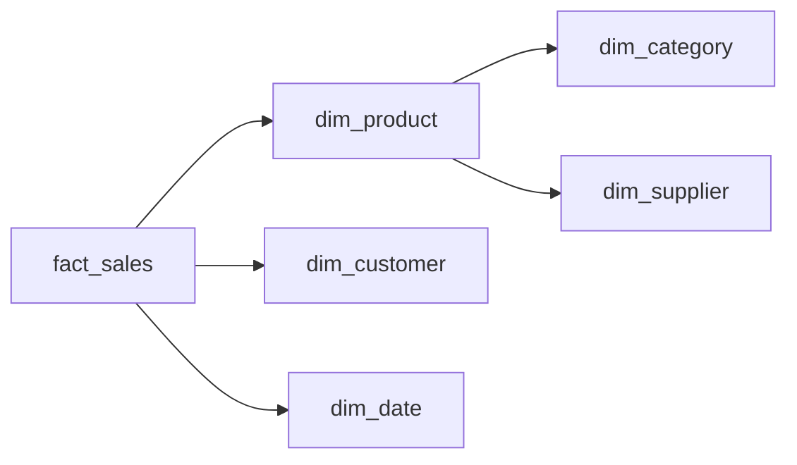

## Introduction

Northwind already looks a little like a snowflake: products point to categories and suppliers. A snowflake schema keeps that normalisation inside the dimensions instead of flattening it.

## Definition

A **snowflake schema** is a star schema whose dimensions are normalised into further tables. `dim_product` holds a `category_key` that points to `dim_category`, instead of copying the category name onto each product.

## Why it matters

You will be asked "star or snowflake?" in interviews. The honest answer: star by default; snowflake when a hierarchy is large, shared, or changes often.

## How it works

| | Star | Snowflake |
|---|---|---|
| Dimension shape | flat, denormalised | normalised into levels |
| Joins per query | fewer | more |
| Storage | some redundancy | less redundancy |
| Hierarchy updates | update many rows | update one row |
| BI friendliness | high | lower |

## Syntax and configuration

```sql-syntax
CREATE TABLE dim_category (
  category_key  int GENERATED ALWAYS AS IDENTITY PRIMARY KEY,
  category_name text
);
CREATE TABLE dim_product (
  product_key  int GENERATED ALWAYS AS IDENTITY PRIMARY KEY,
  product_name text,
  category_key int REFERENCES dim_category(category_key)
);
```

## Examples

Snowflaked product and category dimensions:

```sql
CREATE TEMP TABLE dim_category AS
SELECT category_id AS category_key, category_name FROM categories;

CREATE TEMP TABLE dim_product AS
SELECT product_id AS product_key, product_name, category_id AS category_key
FROM products;

SELECT c.category_name, SUM(od.quantity) AS units
FROM order_details od
JOIN dim_product p  ON p.product_key = od.product_id
JOIN dim_category c ON c.category_key = p.category_key
GROUP BY c.category_name
ORDER BY units DESC
LIMIT 5;
```

## Architecture



The product dimension branches into category and supplier tables, which makes the diagram look like a snowflake.

## Practical example

Flatten a snowflake into a star dimension with a view, so analysts get one join:

```sql
CREATE TEMP TABLE dim_category AS SELECT category_id AS category_key, category_name FROM categories;
CREATE TEMP TABLE dim_supplier AS SELECT supplier_id AS supplier_key, company_name, country FROM suppliers;
CREATE TEMP TABLE dim_product  AS SELECT product_id AS product_key, product_name,
                                         category_id AS category_key, supplier_id AS supplier_key
                                  FROM products;

CREATE TEMP VIEW dim_product_flat AS
SELECT p.product_key, p.product_name, c.category_name,
       s.company_name AS supplier_name, s.country AS supplier_country
FROM dim_product p
LEFT JOIN dim_category c ON c.category_key = p.category_key
LEFT JOIN dim_supplier s ON s.supplier_key = p.supplier_key;

SELECT * FROM dim_product_flat ORDER BY product_key LIMIT 5;
```

## Exercises

1. When does snowflaking make sense?
   <details><summary>Answer</summary>When a hierarchy level is large or shared by several dimensions, or changes often and must be updated in one place.</details>
2. How many joins does "units by category" need in each model?
   <details><summary>Answer</summary>Star: fact to dim_product (one). Snowflake: fact to dim_product to dim_category (two).</details>

## Common mistakes

- Snowflaking everything out of OLTP habit, which makes BI queries slow and hard.
- Forgetting `LEFT JOIN` when flattening, dropping products with no category.
- Saving storage that does not matter: dimensions are small compared with facts.

## Performance and best practices

- Prefer star; snowflake only where there is a clear reason.
- If you snowflake, expose flattened views to BI tools.
- Columnar warehouses compress repeated dimension text well, so redundancy is cheap.

## Interview questions

### What is a snowflake schema?

A star schema with normalised dimensions: hierarchy levels are split into their own tables linked by keys.

### Which is faster to query, star or snowflake?

Usually star, because it needs fewer joins. The difference is small for small dimensions, but star is simpler for users.

### What is a galaxy (fact constellation) schema?

Several fact tables sharing conformed dimensions, e.g. sales and shipments both using `dim_date` and `dim_product`.

## Quick revision

- Snowflake = normalised dimensions.
- More joins, less redundancy.
- Star is the default choice.
- Flatten snowflakes with views for BI.
- Galaxy: many facts, shared dimensions.
