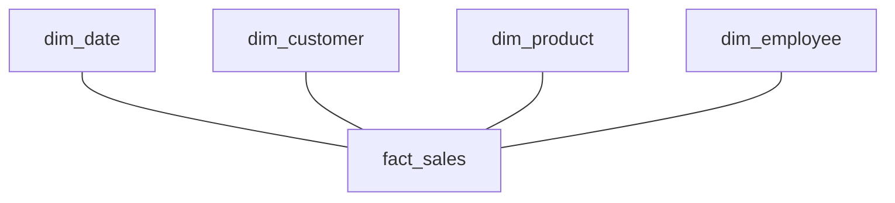

## Introduction

The star schema is the default shape of a warehouse. One fact table in the centre, one join to each dimension around it. Draw it and it looks like a star.

## Definition

A **star schema** has one fact table whose foreign keys each point to one denormalised dimension table. Dimensions do not join to each other. Every query is "fact joined to the dimensions it needs, then grouped".

## Why it matters

- Simple, predictable queries for analysts and BI tools.
- Few joins, each on an integer key.
- Planners in PostgreSQL and in cloud warehouses optimise this shape well ("star join").

## How it works

1. Pick a business process (sales).
2. Declare the grain (one row per order line).
3. Choose dimensions (date, customer, product, employee).
4. Choose measures (quantity, revenue, discount amount).

These four steps are Kimball's dimensional design process.

## Syntax and configuration

```sql-syntax
SELECT d.year, p.category_name, c.country, SUM(f.revenue) AS revenue
FROM fact_sales f
JOIN dim_date d     ON d.date_key     = f.date_key
JOIN dim_product p  ON p.product_key  = f.product_key
JOIN dim_customer c ON c.customer_key = f.customer_key
WHERE d.year = 1997
GROUP BY d.year, p.category_name, c.country;
```

## Examples

Build a complete small star and query it:

```sql
CREATE TEMP TABLE dim_customer (
  customer_key int GENERATED ALWAYS AS IDENTITY PRIMARY KEY,
  customer_id  text UNIQUE NOT NULL,
  company_name text, city text, country text
);
INSERT INTO dim_customer (customer_id, company_name, city, country)
SELECT customer_id, company_name, city, country FROM customers ORDER BY customer_id;

CREATE TEMP TABLE dim_product (
  product_key  int GENERATED ALWAYS AS IDENTITY PRIMARY KEY,
  product_id   int UNIQUE NOT NULL,
  product_name text, category_name text
);
INSERT INTO dim_product (product_id, product_name, category_name)
SELECT p.product_id, p.product_name, c.category_name
FROM products p LEFT JOIN categories c ON c.category_id = p.category_id
ORDER BY p.product_id;

CREATE TEMP TABLE dim_date AS
SELECT to_char(d, 'YYYYMMDD')::int AS date_key, d::date AS full_date,
       EXTRACT(YEAR FROM d)::int AS year, EXTRACT(QUARTER FROM d)::int AS quarter
FROM generate_series(DATE '1996-01-01', DATE '1998-12-31', INTERVAL '1 day') g(d);

CREATE TEMP TABLE fact_sales AS
SELECT to_char(o.order_date, 'YYYYMMDD')::int AS date_key,
       dc.customer_key, dp.product_key, o.order_id,
       od.quantity,
       (od.unit_price * od.quantity * (1 - od.discount))::numeric(12,2) AS revenue
FROM orders o
JOIN order_details od ON od.order_id = o.order_id
JOIN dim_customer dc  ON dc.customer_id = o.customer_id
JOIN dim_product dp   ON dp.product_id  = od.product_id;

SELECT d.year, p.category_name, SUM(f.revenue) AS revenue
FROM fact_sales f
JOIN dim_date d    ON d.date_key = f.date_key
JOIN dim_product p ON p.product_key = f.product_key
GROUP BY d.year, p.category_name
ORDER BY d.year, revenue DESC
LIMIT 6;
```

## Architecture



Every dimension connects only to the fact, never to another dimension.

## Practical example

Validate the star after loading: the fact total must match the source total, and no fact row may miss a dimension.

```sql
CREATE TEMP TABLE fact_sales AS
SELECT o.order_id, od.product_id, o.customer_id,
       (od.unit_price * od.quantity * (1 - od.discount))::numeric(12,2) AS revenue
FROM orders o JOIN order_details od ON od.order_id = o.order_id;

SELECT
  (SELECT ROUND(SUM(unit_price * quantity * (1 - discount))::numeric, 2) FROM order_details) AS source_total,
  (SELECT SUM(revenue) FROM fact_sales)                                                   AS fact_total,
  (SELECT COUNT(*) FROM fact_sales f
     LEFT JOIN customers c ON c.customer_id = f.customer_id
    WHERE c.customer_id IS NULL)                                                          AS orphan_rows;
```

The totals can differ by a few cents because each line is rounded to two decimals in the fact.

## Exercises

1. List Kimball's four design steps.
   <details><summary>Answer</summary>Choose the business process, declare the grain, identify the dimensions, identify the facts (measures).</details>
2. Why join the fact to `dim_customer` with an inner join while loading?
   <details><summary>Answer</summary>Only safe when every natural key exists in the dimension. Otherwise use a left join and map misses to the Unknown member, or rows are silently lost.</details>
3. Why do dimensions not join to each other in a star?
   <details><summary>Answer</summary>Each dimension is denormalised, so all attributes are one join from the fact. That keeps queries simple and fast.</details>

## Common mistakes

- Joining two facts directly, which multiplies rows. Aggregate each fact to a common grain first ("drill across").
- Dimension keys that change on every rebuild.
- Inner joins during load that drop rows with unknown members.

## Performance and best practices

- Index fact foreign keys or partition the fact by date.
- Filter on dimension attributes; the planner pushes them into the join.
- Pre-aggregate popular combinations into summary tables or materialized views.

## Interview questions

### What is a star schema?

A fact table surrounded by denormalised dimension tables, each joined by one key. It is the standard model for analytics.

### Star vs snowflake?

A snowflake normalises dimensions into sub-tables (product, then category). Star has fewer joins and is simpler; snowflake saves some storage and keeps hierarchies in one place.

### How do you combine two fact tables?

Aggregate each to the same grain on conformed dimensions, then join the aggregates (drill across). Never join raw facts to each other.

## Quick revision

- One fact, many denormalised dimensions.
- Process, grain, dimensions, measures.
- Dimensions join only to the fact.
- Validate totals against the source after load.
- Drill across facts via conformed dimensions.
