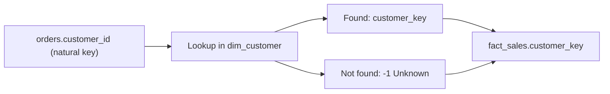

## Introduction

Northwind customers have keys like `ALFKI`. The warehouse could use them, but it usually adds its own integer key instead. That key is a surrogate key.

## Definition

A **surrogate key** is a system-generated identifier with no business meaning, usually a sequential integer. It is the primary key of a dimension and the foreign key stored in facts. The source's **natural key** stays as an ordinary column.

## Why it matters

- **History:** SCD Type 2 needs several rows per customer; only a new key per version makes that possible.
- **Integration:** two sources may both have customer `1001`; surrogate keys keep them apart.
- **Stability:** source keys can be reused or changed; warehouse keys do not.
- **Speed:** small integer joins are faster than long text joins.

## How it works

1. Load the dimension; the database assigns a key to each new row.
2. While loading facts, look up the surrogate key by natural key (and by date for SCD2).
3. Unmatched lookups map to a reserved key such as `-1` (Unknown).

## Syntax and configuration

In PostgreSQL, prefer identity columns over `SERIAL`:

```sql-syntax
CREATE TABLE dim_customer (
  customer_key int GENERATED ALWAYS AS IDENTITY PRIMARY KEY,
  customer_id  text NOT NULL,      -- natural key
  ...
);
-- reserve -1 for Unknown
INSERT INTO dim_customer (customer_key, customer_id) OVERRIDING SYSTEM VALUE VALUES (-1, 'UNKNOWN');
```

## Examples

Generated keys and an Unknown member:

```sql
CREATE TEMP TABLE dim_employee (
  employee_key  int GENERATED ALWAYS AS IDENTITY PRIMARY KEY,
  employee_id   int,
  employee_name text NOT NULL
);

INSERT INTO dim_employee (employee_key, employee_id, employee_name)
OVERRIDING SYSTEM VALUE VALUES (-1, NULL, 'Unknown');

INSERT INTO dim_employee (employee_id, employee_name)
SELECT employee_id, first_name || ' ' || last_name FROM employees ORDER BY employee_id;

SELECT * FROM dim_employee ORDER BY employee_key LIMIT 4;
```

## Architecture



The fact load swaps each natural key for a surrogate key.

## Practical example

Load a fact with a surrogate key lookup and an Unknown fallback:

```sql
CREATE TEMP TABLE dim_employee (
  employee_key int GENERATED ALWAYS AS IDENTITY PRIMARY KEY,
  employee_id  int UNIQUE
);
INSERT INTO dim_employee (employee_key, employee_id) OVERRIDING SYSTEM VALUE VALUES (-1, NULL);
INSERT INTO dim_employee (employee_id) SELECT employee_id FROM employees ORDER BY employee_id;

CREATE TEMP TABLE fact_orders AS
SELECT o.order_id,
       COALESCE(d.employee_key, -1) AS employee_key,
       o.freight
FROM orders o
LEFT JOIN dim_employee d ON d.employee_id = o.employee_id;

SELECT employee_key, COUNT(*) AS orders
FROM fact_orders
GROUP BY employee_key
ORDER BY employee_key
LIMIT 4;
```

The order with a NULL `employee_id` lands on key `-1`.

## Exercises

1. Why does SCD Type 2 require surrogate keys?
   <details><summary>Answer</summary>Each version is a separate row; the natural key repeats, so a new unique key per version is needed for facts to point at the right one.</details>
2. Why `GENERATED ALWAYS` rather than `BY DEFAULT`?
   <details><summary>Answer</summary>`ALWAYS` blocks accidental manual values; you must write `OVERRIDING SYSTEM VALUE` on purpose, e.g. for the -1 row.</details>
3. Should you use `row_number()` to create keys on each rebuild?
   <details><summary>Answer</summary>No. Keys would change when rows are added or reordered, breaking existing facts. Keys must be stable.</details>

## Common mistakes

- Regenerating keys on full rebuilds.
- Exposing surrogate keys to business users as if they meant something.
- Dropping the natural key from the dimension, losing lineage.
- Using UUIDs where integers would do, making facts wider.

## Performance and best practices

- `int` is enough for most dimensions; `bigint` for very large ones.
- Index the natural key (current rows) for fast lookups during loads.
- Hash keys (`md5` of natural key) are an option when loads run in parallel across systems, as in Data Vault.

## Interview questions

### What is a surrogate key?

A warehouse-generated, meaningless identifier (usually an integer) that is the primary key of a dimension and the foreign key in facts.

### Surrogate vs natural key: why not just use the natural key?

Natural keys can change, collide across sources, be long text, and cannot represent multiple versions for SCD2.

### How do you handle facts whose dimension member is missing?

Map them to a reserved Unknown key (-1), or create an "inferred member" row to be filled in later.

## Quick revision

- Meaningless, stable, integer, warehouse-owned.
- `GENERATED ALWAYS AS IDENTITY` in PostgreSQL.
- Keep the natural key in the dimension.
- Look up keys during fact loads; misses go to -1.
- Required for SCD Type 2.
