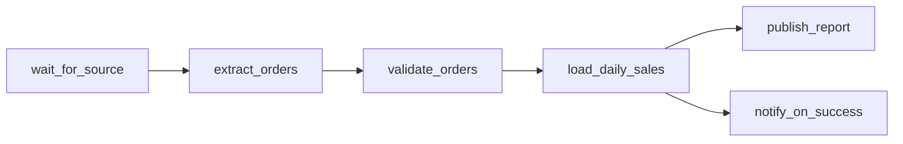

## Business problem

A nightly cron script builds daily sales per region. When it fails nobody notices, and re-running it doubles the numbers. The team is moving to Apache Airflow and wants a DAG that runs daily, retries transient failures, can backfill history and is safe to re-run for any date.

## Learning objectives

- Describe a DAG as tasks and upstream dependencies, and detect cycles
- Understand logical dates and data intervals for daily schedules
- Compute exponential retry delays the way Airflow does
- Write a partition load that is idempotent for one `ds`
- Backfill a date range in one statement

## Architecture

The DAG extracts, validates, loads one day's partition and then publishes. Each run owns exactly one `ds`.



## Technologies

- **Apache Airflow 2.x**: DAGs, operators, sensors, retries, `catchup`, backfill
- **Python** for graph logic and scheduling arithmetic
- **PostgreSQL** as the target warehouse

## Dataset

The SQL tasks use the **sales** dataset (623 orders, 2024-01-03 to 2025-12-31). The load target is `daily_sales(ds, region_id, orders, net_revenue)` with primary key `(ds, region_id)`.

## Tasks

The Python tasks model what Airflow does for you; the SQL tasks are the statements your `PostgresOperator` would run. Each task runs in its own rolled-back transaction, so create every table the check needs in this task.

```task
{
 "id": "dag-topology",
 "title": "Validate the DAG and order its tasks",
 "type": "python",
 "instructions": "A DAG is given as `{task: [upstream tasks]}`. Write `topo_order(dag)` that returns a list in which every task comes after all its upstream tasks; break ties alphabetically (Kahn's algorithm with a sorted ready list). Raise `ValueError` if the graph has a cycle or an upstream task is not defined.",
 "starter": "DAG = {\n    'wait_for_source': [],\n    'extract_orders': ['wait_for_source'],\n    'validate_orders': ['extract_orders'],\n    'load_daily_sales': ['validate_orders'],\n    'publish_report': ['load_daily_sales'],\n    'notify_on_success': ['load_daily_sales'],\n}\n\ndef topo_order(dag):\n    return list(dag)\n",
 "solution": "DAG = {\n    'wait_for_source': [],\n    'extract_orders': ['wait_for_source'],\n    'validate_orders': ['extract_orders'],\n    'load_daily_sales': ['validate_orders'],\n    'publish_report': ['load_daily_sales'],\n    'notify_on_success': ['load_daily_sales'],\n}\n\ndef topo_order(dag):\n    for t, ups in dag.items():\n        for u in ups:\n            if u not in dag:\n                raise ValueError(f'unknown upstream {u}')\n    indeg = {t: len(set(ups)) for t, ups in dag.items()}\n    children = {t: [] for t in dag}\n    for t, ups in dag.items():\n        for u in set(ups):\n            children[u].append(t)\n    ready = sorted(t for t, d in indeg.items() if d == 0)\n    order = []\n    while ready:\n        t = ready.pop(0)\n        order.append(t)\n        for c in children[t]:\n            indeg[c] -= 1\n            if indeg[c] == 0:\n                ready.append(c)\n        ready.sort()\n    if len(order) != len(dag):\n        raise ValueError('cycle detected')\n    return order\n",
 "tests": "assert topo_order(DAG) == ['wait_for_source', 'extract_orders', 'validate_orders', 'load_daily_sales', 'notify_on_success', 'publish_report']\nfor bad in ({'a': ['b'], 'b': ['a']}, {'a': ['missing']}):\n    try:\n        topo_order(bad)\n        assert False, bad\n    except ValueError:\n        pass\nassert topo_order({'b': [], 'a': [], 'c': ['a', 'b']}) == ['a', 'b', 'c']"
}
```

```task
{
 "id": "data-intervals",
 "title": "Compute daily data intervals for a backfill",
 "type": "python",
 "instructions": "For a `@daily` DAG, write `data_intervals(start, end)` returning a list of `(logical_date, interval_end)` tuples of `datetime.date`, one per day, for every run whose interval **ends on or before** `end`. The first logical date is `start`.\n\nAlso write `run_after(logical_date)` returning the date the scheduler actually starts that run (the end of its interval).",
 "starter": "from datetime import date, timedelta\n\ndef data_intervals(start, end):\n    return [(start, end)]\n\ndef run_after(logical_date):\n    return logical_date\n",
 "solution": "from datetime import date, timedelta\n\ndef data_intervals(start, end):\n    out, d = [], start\n    while d + timedelta(days=1) <= end:\n        out.append((d, d + timedelta(days=1)))\n        d += timedelta(days=1)\n    return out\n\ndef run_after(logical_date):\n    return logical_date + timedelta(days=1)\n",
 "tests": "iv = data_intervals(date(2025, 6, 1), date(2025, 6, 4))\nassert iv == [(date(2025, 6, 1), date(2025, 6, 2)), (date(2025, 6, 2), date(2025, 6, 3)), (date(2025, 6, 3), date(2025, 6, 4))]\nassert run_after(date(2025, 6, 1)) == date(2025, 6, 2)\nassert data_intervals(date(2025, 6, 1), date(2025, 6, 1)) == []\nassert len(data_intervals(date(2025, 1, 1), date(2026, 1, 1))) == 365"
}
```

```task
{
 "id": "retry-delays",
 "title": "Exponential retry delays",
 "type": "python",
 "instructions": "With `retries=r`, `retry_delay=d` seconds, `retry_exponential_backoff=True` and `max_retry_delay=m`, write `retry_delays(r, d, m)` returning the wait before each retry: `d * 2**(n-1)` for retry `n = 1..r`, capped at `m`. With `exponential=False` every delay is `d`.",
 "starter": "def retry_delays(retries, delay, max_delay, exponential=True):\n    return [delay] * retries\n",
 "solution": "def retry_delays(retries, delay, max_delay, exponential=True):\n    if not exponential:\n        return [delay] * retries\n    return [min(delay * 2 ** (n - 1), max_delay) for n in range(1, retries + 1)]\n",
 "tests": "assert retry_delays(5, 60, 600) == [60, 120, 240, 480, 600]\nassert retry_delays(3, 30, 1000, exponential=False) == [30, 30, 30]\nassert retry_delays(0, 60, 600) == []"
}
```

```task
{
 "id": "idempotent-partition",
 "title": "Idempotent load of one ds partition",
 "type": "sql",
 "instructions": "Create `daily_sales(ds DATE, region_id INTEGER, orders INTEGER, net_revenue NUMERIC(14,2), PRIMARY KEY (ds, region_id))`. Write the load for `ds = '2025-06-16'`: non-cancelled orders of that day, grouped by the customer's region, `net_revenue = SUM(ROUND(quantity * unit_price * (1 - discount), 2))`.\n\nAirflow may retry the task, so **run your load twice**. Delete the partition before inserting it.",
 "starter": "CREATE TABLE daily_sales (\n  ds DATE NOT NULL,\n  region_id INTEGER NOT NULL,\n  orders INTEGER NOT NULL,\n  net_revenue NUMERIC(14,2) NOT NULL,\n  PRIMARY KEY (ds, region_id)\n);\n-- TODO: make this safe to run twice (it currently fails on the primary key)\nINSERT INTO daily_sales (ds, region_id, orders, net_revenue)\nSELECT o.order_date, c.region_id, COUNT(DISTINCT o.order_id),\n       SUM(ROUND(oi.quantity * oi.unit_price * (1 - oi.discount), 2))\nFROM orders o\nJOIN customers c ON c.customer_id = o.customer_id\nJOIN order_items oi ON oi.order_id = o.order_id\nWHERE o.order_date = DATE '2025-06-16' AND o.status <> 'cancelled'\nGROUP BY o.order_date, c.region_id;\nINSERT INTO daily_sales (ds, region_id, orders, net_revenue)\nSELECT o.order_date, c.region_id, COUNT(DISTINCT o.order_id),\n       SUM(ROUND(oi.quantity * oi.unit_price * (1 - oi.discount), 2))\nFROM orders o\nJOIN customers c ON c.customer_id = o.customer_id\nJOIN order_items oi ON oi.order_id = o.order_id\nWHERE o.order_date = DATE '2025-06-16' AND o.status <> 'cancelled'\nGROUP BY o.order_date, c.region_id;",
 "solution": "CREATE TABLE daily_sales (\n  ds DATE NOT NULL,\n  region_id INTEGER NOT NULL,\n  orders INTEGER NOT NULL,\n  net_revenue NUMERIC(14,2) NOT NULL,\n  PRIMARY KEY (ds, region_id)\n);\n-- run 1\nDELETE FROM daily_sales WHERE ds = DATE '2025-06-16';\nINSERT INTO daily_sales (ds, region_id, orders, net_revenue)\nSELECT o.order_date, c.region_id, COUNT(DISTINCT o.order_id),\n       SUM(ROUND(oi.quantity * oi.unit_price * (1 - oi.discount), 2))\nFROM orders o\nJOIN customers c ON c.customer_id = o.customer_id\nJOIN order_items oi ON oi.order_id = o.order_id\nWHERE o.order_date = DATE '2025-06-16' AND o.status <> 'cancelled'\nGROUP BY o.order_date, c.region_id;\n-- retry\nDELETE FROM daily_sales WHERE ds = DATE '2025-06-16';\nINSERT INTO daily_sales (ds, region_id, orders, net_revenue)\nSELECT o.order_date, c.region_id, COUNT(DISTINCT o.order_id),\n       SUM(ROUND(oi.quantity * oi.unit_price * (1 - oi.discount), 2))\nFROM orders o\nJOIN customers c ON c.customer_id = o.customer_id\nJOIN order_items oi ON oi.order_id = o.order_id\nWHERE o.order_date = DATE '2025-06-16' AND o.status <> 'cancelled'\nGROUP BY o.order_date, c.region_id;",
 "check": "SELECT (COALESCE(((SELECT COUNT(*) FROM information_schema.columns WHERE table_schema = current_schema() AND table_name = 'daily_sales' AND column_name IN ('ds','region_id','orders','net_revenue')) = 4), FALSE) AND COALESCE(((SELECT COUNT(*) FROM daily_sales) = (SELECT COUNT(DISTINCT c.region_id) FROM orders o JOIN customers c USING (customer_id) WHERE o.order_date = '2025-06-16' AND o.status <> 'cancelled' AND EXISTS (SELECT 1 FROM order_items i WHERE i.order_id = o.order_id))), FALSE) AND COALESCE(((SELECT SUM(net_revenue) FROM daily_sales) = (SELECT SUM(ROUND(oi.quantity*oi.unit_price*(1-oi.discount),2)) FROM orders o JOIN order_items oi USING (order_id) WHERE o.status <> 'cancelled' AND o.order_date = '2025-06-16')), FALSE)) AS ok, CASE WHEN NOT COALESCE(((SELECT COUNT(*) FROM information_schema.columns WHERE table_schema = current_schema() AND table_name = 'daily_sales' AND column_name IN ('ds','region_id','orders','net_revenue')) = 4), FALSE) THEN 'daily_sales is missing a column' WHEN NOT COALESCE(((SELECT COUNT(*) FROM daily_sales) = (SELECT COUNT(DISTINCT c.region_id) FROM orders o JOIN customers c USING (customer_id) WHERE o.order_date = '2025-06-16' AND o.status <> 'cancelled' AND EXISTS (SELECT 1 FROM order_items i WHERE i.order_id = o.order_id))), FALSE) THEN 'one row per region with sales on 2025-06-16' WHEN NOT COALESCE(((SELECT SUM(net_revenue) FROM daily_sales) = (SELECT SUM(ROUND(oi.quantity*oi.unit_price*(1-oi.discount),2)) FROM orders o JOIN order_items oi USING (order_id) WHERE o.status <> 'cancelled' AND o.order_date = '2025-06-16')), FALSE) THEN 'net_revenue must match the source, once' ELSE 'The partition load is idempotent' END AS message"
}
```

```task
{
 "id": "backfill-month",
 "title": "Backfill June 2025",
 "type": "sql",
 "instructions": "Create `daily_sales` and backfill every day of June 2025 in one idempotent statement pair: delete `ds BETWEEN '2025-06-01' AND '2025-06-30'`, then insert all days at once. Days without sales simply have no rows.",
 "starter": "CREATE TABLE daily_sales (\n  ds DATE NOT NULL,\n  region_id INTEGER NOT NULL,\n  orders INTEGER NOT NULL,\n  net_revenue NUMERIC(14,2) NOT NULL,\n  PRIMARY KEY (ds, region_id)\n);\nDELETE FROM daily_sales WHERE ds = DATE '2025-06-01';\nINSERT INTO daily_sales (ds, region_id, orders, net_revenue)\nSELECT o.order_date, c.region_id, COUNT(DISTINCT o.order_id),\n       SUM(ROUND(oi.quantity * oi.unit_price * (1 - oi.discount), 2))\nFROM orders o\nJOIN customers c ON c.customer_id = o.customer_id\nJOIN order_items oi ON oi.order_id = o.order_id\nWHERE o.order_date = DATE '2025-06-01' AND o.status <> 'cancelled'\nGROUP BY o.order_date, c.region_id;\n-- TODO: the other 29 days",
 "solution": "CREATE TABLE daily_sales (\n  ds DATE NOT NULL,\n  region_id INTEGER NOT NULL,\n  orders INTEGER NOT NULL,\n  net_revenue NUMERIC(14,2) NOT NULL,\n  PRIMARY KEY (ds, region_id)\n);\nDELETE FROM daily_sales WHERE ds BETWEEN DATE '2025-06-01' AND DATE '2025-06-30';\nINSERT INTO daily_sales (ds, region_id, orders, net_revenue)\nSELECT o.order_date, c.region_id, COUNT(DISTINCT o.order_id),\n       SUM(ROUND(oi.quantity * oi.unit_price * (1 - oi.discount), 2))\nFROM orders o\nJOIN customers c ON c.customer_id = o.customer_id\nJOIN order_items oi ON oi.order_id = o.order_id\nWHERE o.order_date BETWEEN DATE '2025-06-01' AND DATE '2025-06-30' AND o.status <> 'cancelled'\nGROUP BY o.order_date, c.region_id;",
 "check": "SELECT (COALESCE(((SELECT COUNT(DISTINCT ds) FROM daily_sales) = (SELECT COUNT(DISTINCT order_date) FROM orders WHERE order_date BETWEEN '2025-06-01' AND '2025-06-30' AND status <> 'cancelled')), FALSE) AND COALESCE(((SELECT SUM(net_revenue) FROM daily_sales) = (SELECT SUM(ROUND(oi.quantity*oi.unit_price*(1-oi.discount),2)) FROM orders o JOIN order_items oi USING (order_id) WHERE o.status <> 'cancelled' AND o.order_date BETWEEN '2025-06-01' AND '2025-06-30')), FALSE) AND COALESCE((NOT EXISTS (SELECT 1 FROM daily_sales WHERE ds NOT BETWEEN '2025-06-01' AND '2025-06-30')), FALSE)) AS ok, CASE WHEN NOT COALESCE(((SELECT COUNT(DISTINCT ds) FROM daily_sales) = (SELECT COUNT(DISTINCT order_date) FROM orders WHERE order_date BETWEEN '2025-06-01' AND '2025-06-30' AND status <> 'cancelled')), FALSE) THEN 'every June day with sales needs rows' WHEN NOT COALESCE(((SELECT SUM(net_revenue) FROM daily_sales) = (SELECT SUM(ROUND(oi.quantity*oi.unit_price*(1-oi.discount),2)) FROM orders o JOIN order_items oi USING (order_id) WHERE o.status <> 'cancelled' AND o.order_date BETWEEN '2025-06-01' AND '2025-06-30')), FALSE) THEN 'June net_revenue does not match the source' WHEN NOT COALESCE((NOT EXISTS (SELECT 1 FROM daily_sales WHERE ds NOT BETWEEN '2025-06-01' AND '2025-06-30')), FALSE) THEN 'load only June 2025' ELSE 'June 2025 backfilled' END AS message"
}
```

```task
{
 "id": "run-airflow",
 "title": "Run the DAG in Airflow",
 "type": "checklist",
 "instructions": "Turn the pieces into a real DAG.",
 "items": [
  "Install Airflow 2.x with the official constraints file, or start it with the docker-compose quick start",
  "Create a Postgres connection `sales_dw` in the UI or with `airflow connections add`",
  "Write `dags/daily_sales.py` with `schedule='@daily'`, `catchup=False`, `retries=3`, `retry_exponential_backoff=True`",
  "Use a `SqlSensor` for `wait_for_source` and `SQLExecuteQueryOperator` with `{{ ds }}` for the load",
  "Run `airflow dags test daily_sales 2025-06-16` and check `daily_sales`",
  "Run `airflow dags backfill -s 2025-06-01 -e 2025-06-30 daily_sales` and compare totals with the SQL task",
  "Add an `on_failure_callback` that posts to Slack or email"
 ]
}
```

## Expected output

- `topo_order` returns a valid order for the 6-task DAG and raises on a cycle
- `data_intervals` for 2025-06-01 to 2025-06-04 returns 3 daily intervals
- `daily_sales` for 2025-06-16 matches the source revenue of 117523.93 even after two runs
- The June 2025 backfill totals 862622.87

## Common mistakes

- Using `datetime.now()` inside tasks instead of the run's logical date, so backfills load today's data.
- Appending in the load task; retries then duplicate rows.
- Putting heavy work at DAG top level, which runs on every scheduler parse.
- Passing large datasets through XCom instead of a table or object store.

## Interview discussion questions

### What is the logical date of a daily run?
The start of the data interval it processes. The run for 2025-06-01 starts after that interval ends, i.e. on 2025-06-02.

### How do you make an Airflow task idempotent?
Make its output a function of its `ds` only: delete-and-insert or overwrite the partition for that date inside one transaction, and never use the wall clock.

### catchup=True vs backfill?
`catchup` makes the scheduler create runs for every missed interval since `start_date`. `airflow dags backfill` runs a chosen range on demand, even for DAGs with catchup off.

## Summary

You modelled an Airflow DAG, its schedule and retry behaviour, and wrote the idempotent load and backfill SQL it runs.
